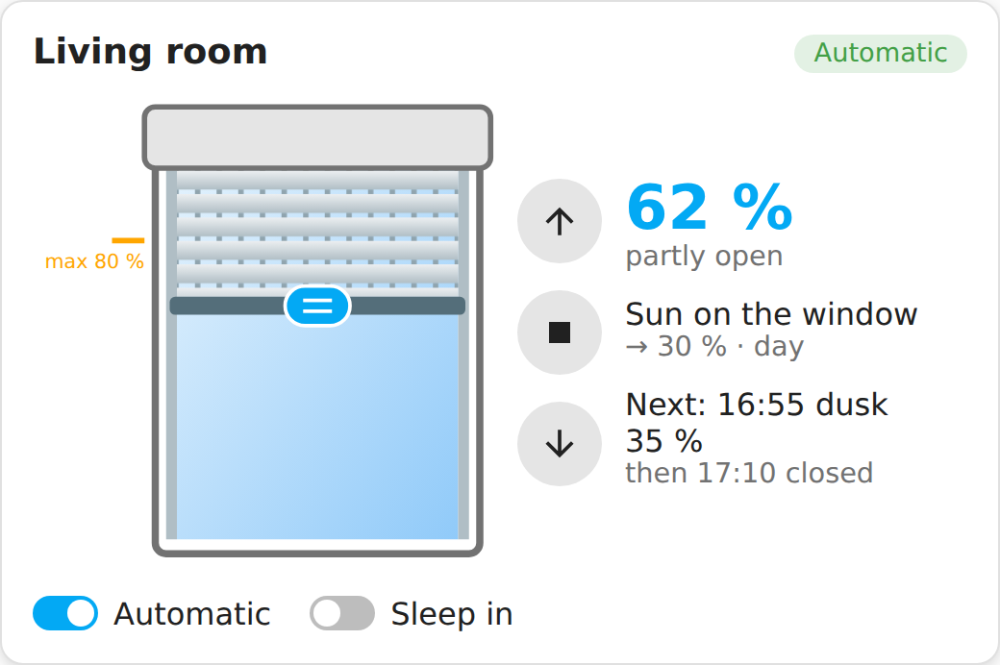
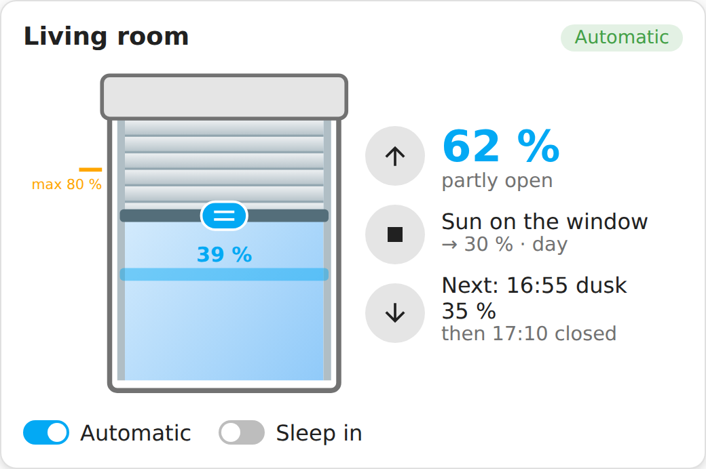
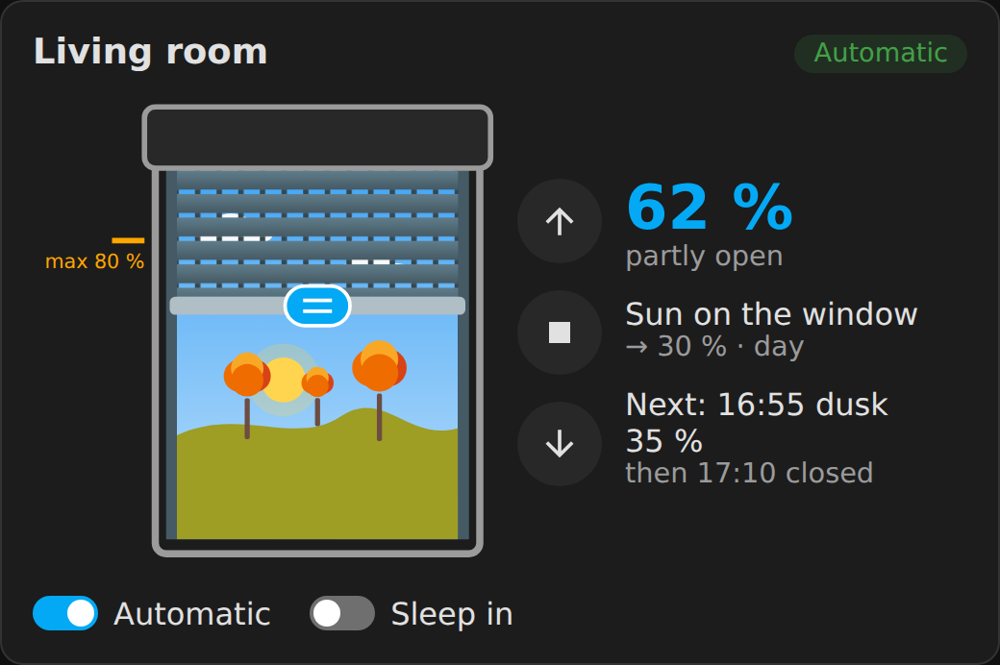
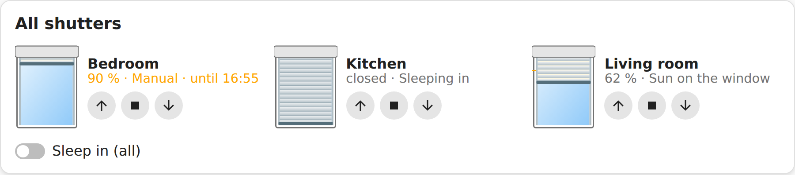

# Smart Shutter Control

A Home Assistant integration (HACS) that controls roller shutters: on a schedule per shutter, against the
heat when the sun really shines on a window, safely in a storm, and without fighting you when you move a
shutter by hand.

## Features

- **Base controller with one device per shutter:** shared settings (sun source: PV power or light sensors, wind, holidays,
  the base schedule) and per shutter its window direction, maximum position and any overrides.
- **Schedules:** slit, open, dusk and night per shutter, with weekend and holiday times (from a calendar,
  with holidays you can switch off), sunset-relative evenings and sleep-in.
- **Heat protection:** the sun's position against the window direction, with PV power or light sensors
  (lux) as a measure of clouds (learned clear-sky reference), and delays so passing clouds do not move the
  shutters.
- **Glare protection:** bright sun on the window lowers the shutter to its own position, whatever the
  temperature, also in winter.
- **Calibrated positions:** an assistant measures each shutter, or you edit the measured points in a table,
  so 50 % is half way down the window from either direction; fully open and closed use the module's own
  ends.
- **Manual operation is respected:** a manual move pauses automatic control until the next phase (or for a
  while); it resumes with a button, or when you move the shutter to where automatic control wants it.
- **Safety:** in a storm only fully open or fully closed; no moves during frost; optional temperature limits.
- **Winter mode:** closed all day in severe cold, and a closed shutter stays closed in the evening.
- **Lovelace card:** drag the grip to a position, up/stop/down, the reason and the next actions; or all
  shutters at a glance. English and Dutch.

| Dragging to a position | Dark theme |
|---|---|
|  |  |

All shutters of a base controller:

## Installation

*Settings → Marketplace → Add from link* → `abroeders/smart-shutter-control` (type *Integration*) → open it →
**Install** → restart (Home Assistant 2026.11 and later; before that: HACS → ⋮ → *Custom repositories*). Then
*Settings → Devices & services → Add integration → Smart Shutter Control*, and *Add shutter* for each
shutter. Details: [Installation](docs/installation.md).

## Documentation

Read it on the documentation site: **<https://abroeders.github.io/smart-shutter-control/>**, or in
[`docs/`](docs/).

| | |
|---|---|
| [Installation](docs/installation.md) | requirements, HACS, adding shutters |
| [Configuration](docs/configuration.md) | every setting with its default and effect |
| [Calibration](docs/calibration.md) | making 50 % mean half way |
| [Entities](docs/entities.md) | what each entity shows or does |
| [How it works](docs/how-it-works.md) | rules and priorities, sun, clouds, manual operation, storm, frost, winter |
| [The card](docs/card.md) | the Lovelace card |
| [FAQ and troubleshooting](docs/faq.md) | common questions and problems |
| [Architecture](docs/architecture.md) | code structure with UML, for developers |

## Development

- Logic in `custom_components/smart_shutter_control/core/` (no Home Assistant imports): `pytest`.
- Home Assistant tests: `pytest tests_ha -o pythonpath=. -o testpaths=tests_ha -o asyncio_mode=auto` with
  `pytest-homeassistant-custom-component`.
- Code style: `ruff check .` and `ruff format .`.
- Designs: [`docs/design/`](docs/design/), architecture and UML: [`docs/architecture.md`](docs/architecture.md).
- Icons: edit `brand/*.svg`, then `python scripts/render_icons.py`.
- Card: in `frontend/`, `npm ci`, `npm test`, `npm run build` (the bundle in
  `custom_components/smart_shutter_control/frontend/` is committed); screenshots with
  `python scripts/screenshot_card.py`.
- Releases: push a version tag (`YEAR.MONTH.N`) on `main`. The *Release* workflow publishes the GitHub
  release only when that commit passes the HACS and hassfest validation and the versions in `manifest.json`,
  `frontend/package.json` and the changelog match the tag. Run it by hand to validate without releasing.

## Support

Do your shutters run themselves now? A coffee keeps the project going. Thank you!

## License

[Apache-2.0](LICENSE)
