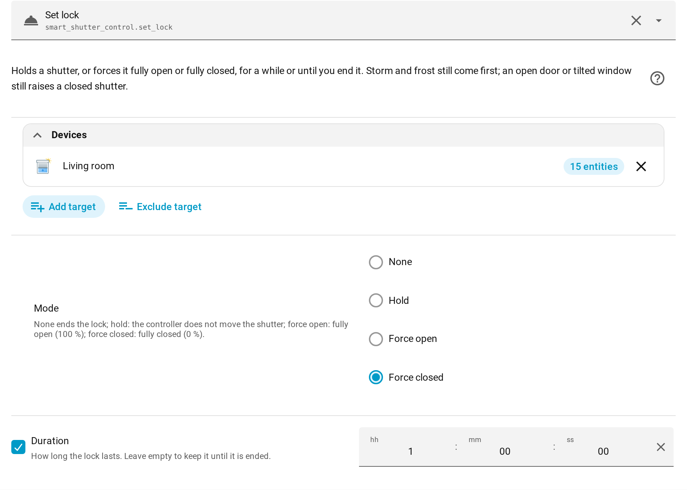

# Actions

## `smart_shutter_control.set_lock`

Locks one or more shutters: the controller holds them, or forces them fully open or fully closed, for a while
or until you end the lock. How a lock ranks among the rules, and how it ends, is in
[How it works](how-it-works.md#locks).



The select *Lock* on each shutter's device page (see [Entities](entities.md#each-shutter)) sets the same modes
without a duration.

| Field | Required | Meaning |
|---|---|---|
| target | yes | one or more shutter devices of the integration (the devices of the shutters, not the base controller) |
| `mode` | yes | `none` ends the lock; `hold`: the controller does not move the shutter; `force_open`: fully open (100 %, also above the *Maximum position*); `force_closed`: fully closed (0 %) |
| `duration` | no | how long the lock lasts. Without it the lock lasts until it is ended |

A new lock on a locked shutter replaces the old one. A device that is not a shutter of the integration gives
an error, and then no shutter is locked. The select *Lock* of each shutter shows the lock and sets one
without a duration (see [Entities](entities.md#each-shutter)).

The `duration` is a time such as `"02:00:00"` (two hours) or `"00:30:00"` (half an hour). Example: a `hold` of
`"01:00:00"` set at 13:00 keeps `cover.living_room` where it is until 14:00; then it moves to what the rules
want at that moment. Lock durations survive a restart.

### Hail warning: close for two hours

```yaml
automation:
  - alias: "Shutters closed on a hail warning"
    triggers:
      - trigger: state
        entity_id: binary_sensor.hail_warning
        to: "on"
    actions:
      - action: smart_shutter_control.set_lock
        target:
          device_id:
            - 0a1b2c3d4e5f60718293a4b5c6d7e8f9 # Living room shutter
            - 9f8e7d6c5b4a39281706f5e4d3c2b1a0 # Bedroom shutter
        data:
          mode: force_closed
          duration: "02:00:00"
```

### Washing windows: open until you are done

```yaml
script:
  windows_open:
    alias: "Shutters open for washing windows"
    sequence:
      - action: smart_shutter_control.set_lock
        target:
          device_id: 0a1b2c3d4e5f60718293a4b5c6d7e8f9 # Living room shutter
        data:
          mode: force_open

  windows_done:
    alias: "Washing windows done"
    sequence:
      - action: smart_shutter_control.set_lock
        target:
          device_id: 0a1b2c3d4e5f60718293a4b5c6d7e8f9
        data:
          mode: none
```

Use the target picker in the automation editor to choose the devices; it only offers shutters of this
integration. The device ids above are made up. The shutter of `cover.living_room` can also be locked with
`select.select_option` on its *Lock* entity, with `force_open` and, to end it, `none`.
