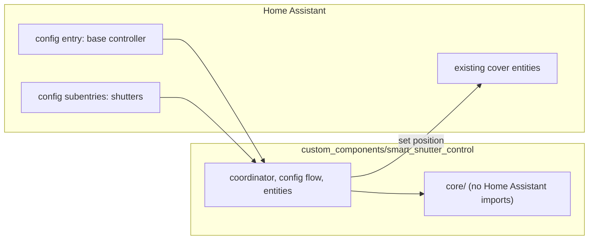
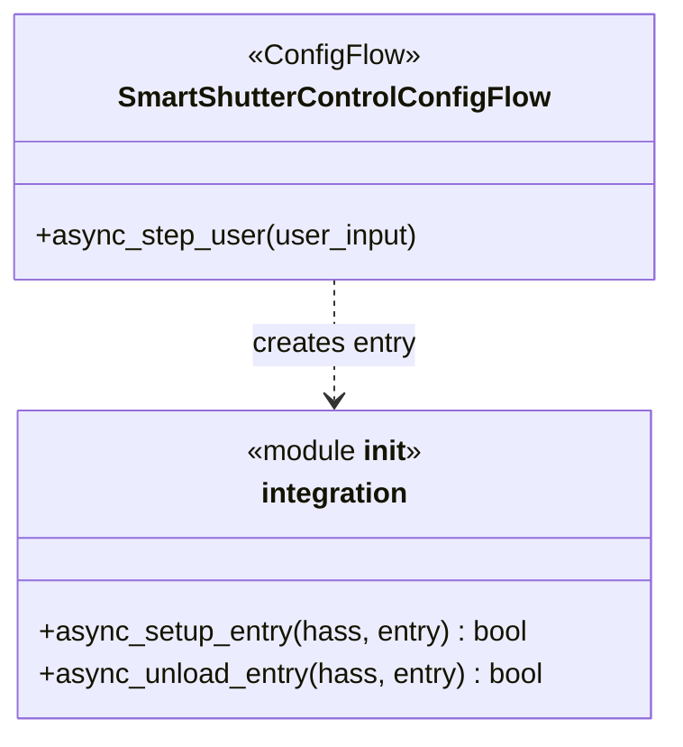

# Architecture

How the integration is built. Design documents per issue are in [`design/`](design/).

## 1. Overview

- `core/` holds the logic (sun geometry, rules, calibration) as plain Python, tested with pytest.
- The Home Assistant layer reads inputs, calls `core/` and moves the shutters.

## 2. Design principles

| Principle | How |
|---|---|
| Single responsibility | one module per concern; one class per rule |
| Dependency inversion | `core/` depends on its own protocols, not on Home Assistant |

## 3. Scaffold (#1)

