# Architecture

How the integration is built. Design documents per issue are in [`design/`](design/).

## 1. Overview

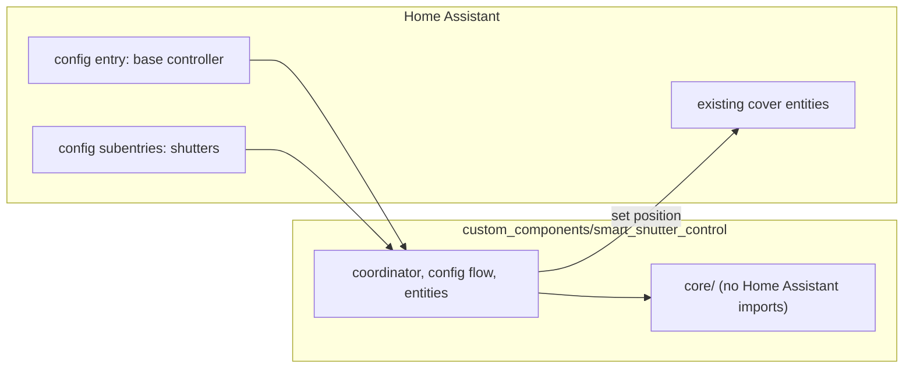

- `core/` holds the logic (sun geometry, rules, calibration) as plain Python, tested with pytest.
- The Home Assistant layer reads inputs, calls `core/` and moves the shutters.
- `frontend/` holds the Lovelace card (TypeScript, Lit), built into the integration (§10).

### 1.1 The rule chain today

| Priority | Rule | Module | Kind |
|---|---|---|---|
| 10 | `StormRule` | `core/weather.py` | final: 0 or 100 |
| 11 | `FrostRule` | `core/weather.py` | final: no move |
| 15 | `TemperatureLimitRule` | `core/weather.py` | final: closed |
| 20 | `ManualPauseRule` | `core/manual.py` | final: no move |
| 30 | `SleepInRule` | `core/daily.py` | target |
| 40 | `HeatProtectionRule` | `core/heat.py` | cap |
| 41 | `GlareProtectionRule` | `core/glare.py` | cap |
| 50 | `WinterRule` | `core/winter.py` | target or cap |
| 60 | `ScheduleRule` | `core/daily.py` | target |

The chain is built in `ShutterController.__init__`; `PositionLimiter` applies the maximum position after it.

## 2. Design principles

| Principle | How |
|---|---|
| Single responsibility | one module per concern; one class per rule |
| Dependency inversion | `core/` depends on its own protocols, not on Home Assistant |
| **Chain of responsibility** | `RuleChain` asks every `Rule` by priority: the first target wins, caps may lower it, a final target (safety) is not lowered (#2, #3) |
| **State** | `ProtectionState` phases open → pending → shading → leaving, shared by heat and glare protection (#3, #95); `DaySchedule` phases night → slit → day → dusk (#4); `ManualDetector` idle → commanded → manual (#5) |
| **Template / inheritance of settings** | `merged(base, overrides)`: every shutter takes the base schedule unless it overrides a setting (#4) |
| **Strategy** | `Calibration` (`IdentityCalibration`, `RollerCalibration`) and `Curve` (`QuadraticCurve`, `MonotoneCurve`) |
| **Decorator (floor)** | `raise_to` puts the window and door contacts' floor over the chain's decision without the rules knowing about it (#49) |
| **Factory method** | `fit_curve` picks the roller model or the monotone fallback; `RollerCalibration.from_data`; `build_rules` builds a shutter's rule chain (#96); `ShutterSettings.from_data` |
| **Adapter** | `CoverAdapter` is the only code that moves a physical cover; the ends (100, 0) go by `open_cover`/`close_cover` when the cover supports them, so the module runs to its limit switch |
| **Observer** | the entities listen to `BaseCoordinator` |
| **Descriptor** | `StoredSetting`: one class attribute per entity setting of a shutter, read from and written to `RuntimeStore` with the subentry's value as default (#96) |
| **Repository** | `RuntimeStore` keeps the runtime state per shutter (automatic on/off, maximum position, sleep-in, manual pause, last target) and globals (winter mode, 24-hour outdoor temperatures, the learned clear-sky references for PV and lux). Settings are saved within 5 s, learned data within 5 minutes; a later, longer delay never postpones an earlier save, and unloading writes at once |

## 3. Scaffold (#1)

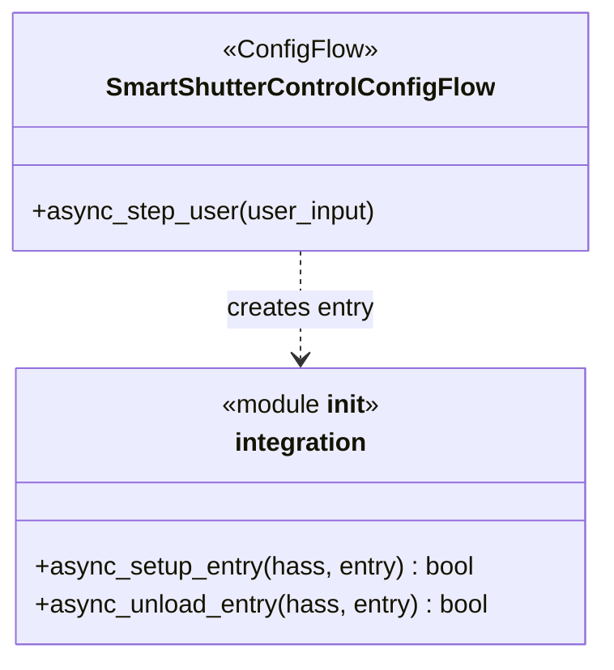

## 4. Base controller and shutters (#2)

Design: [`design/2026-11-19-base-controller-and-shutters.md`](design/2026-11-19-base-controller-and-shutters.md).

### 4.1 Configuration and devices

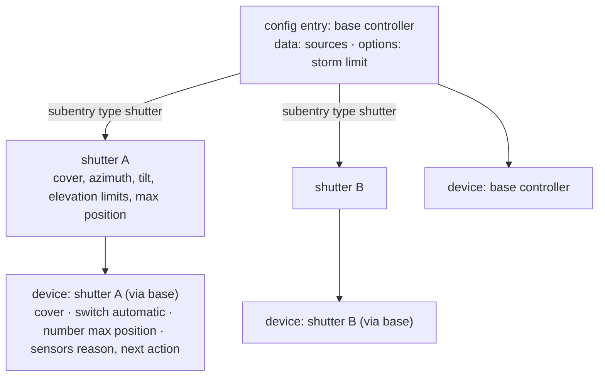

### 4.2 Classes

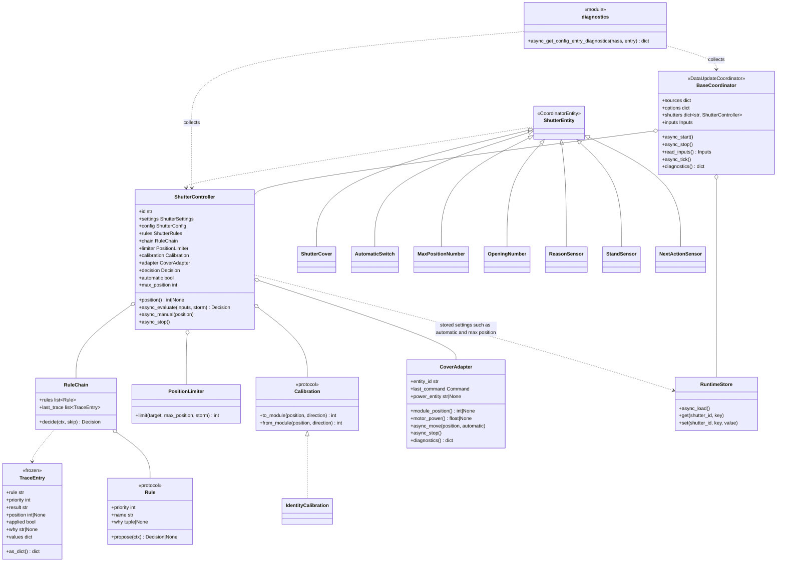

`core/` (no Home Assistant): `ShutterConfig`, `Inputs`, `ShutterContext`, `Decision`, `Reason`, `Direction`,
`RuleChain`, `Rule`, `PositionLimiter`, `Calibration`, `IdentityCalibration`.

### 4.3 A tick

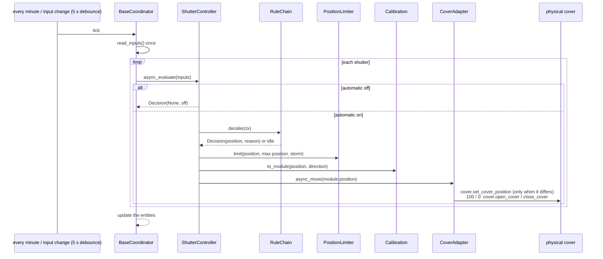

### 4.4 Manual operation through the shutter entity

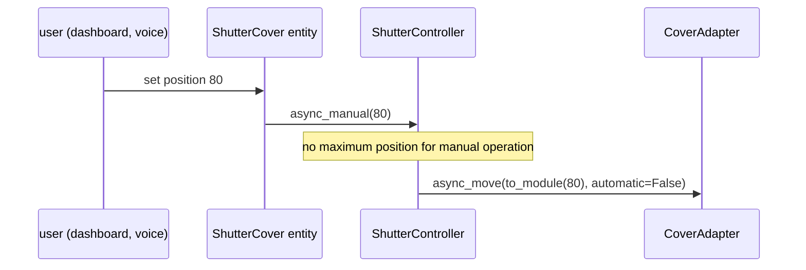

## 5. Calibrated positions (#10)

Design: [`design/2026-11-20-calibration.md`](design/2026-11-20-calibration.md).

### 5.1 Classes

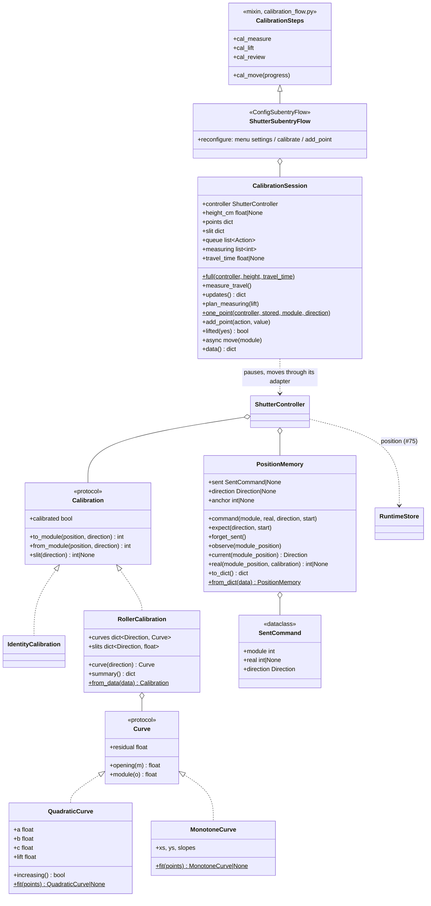

### 5.2 Moving to a real position

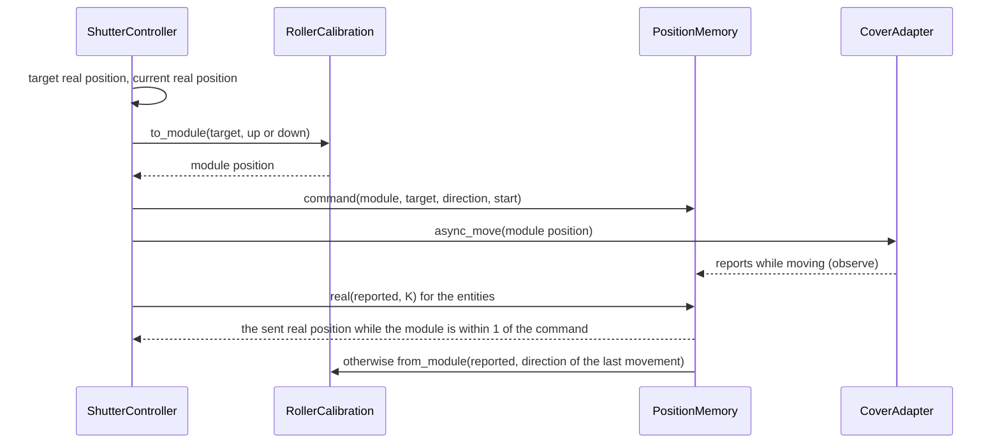

The memory is stored per shutter (key `position`), so the sent position and the direction survive a reload
or restart. A report on the way to the command keeps it; a report moving away, or a manual move, clears it.
The direction only changes after a movement of at least 3 module points (#75). While the shutter follows a
command, the anchor moves along, so a later manual move is measured from
where the command ended (#85).

### 5.3 The assistant

```mermaid
stateDiagram-v2
    [*] --> Menu
    Menu --> Settings
    Menu --> Height: calibrate
    Menu --> OnePoint: add a point
    Height --> Move: queue goto 0, lift; after the lift point: 4 points up, goto 100, 4 points down
    OnePoint --> Move: queue goto 0 or 100, measure
    Move --> Measure: measure action
    Move --> Lift: lift action
    Move --> Move: goto action
    Measure --> Move: next action
    Lift --> Move: not lifted (2 % higher)
    Lift --> Review: lifted
    Measure --> Review: queue empty
    Review --> [*]: save in the subentry, reload
    Settings --> [*]
```

During the assistant the controller is paused (`Reason.CALIBRATING`); ending the flow in any way resumes it.

### 5.4 Moving during the assistant


## 6. Sun on the window (#3)

Design: [`design/2026-11-20-sun-on-the-window.md`](design/2026-11-20-sun-on-the-window.md).

### 6.1 Classes

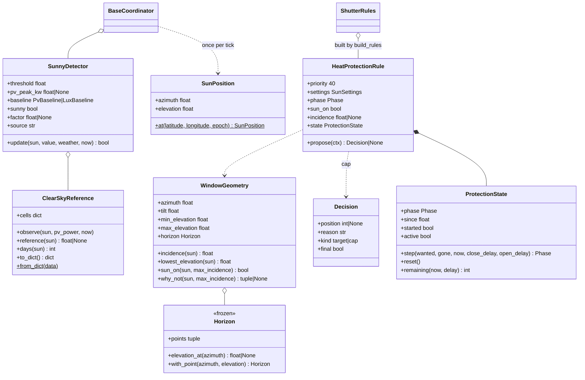

### 6.2 A tick with the sun

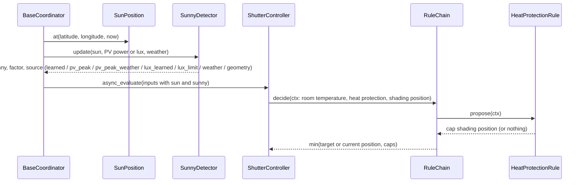

### 6.3 Heat protection phases

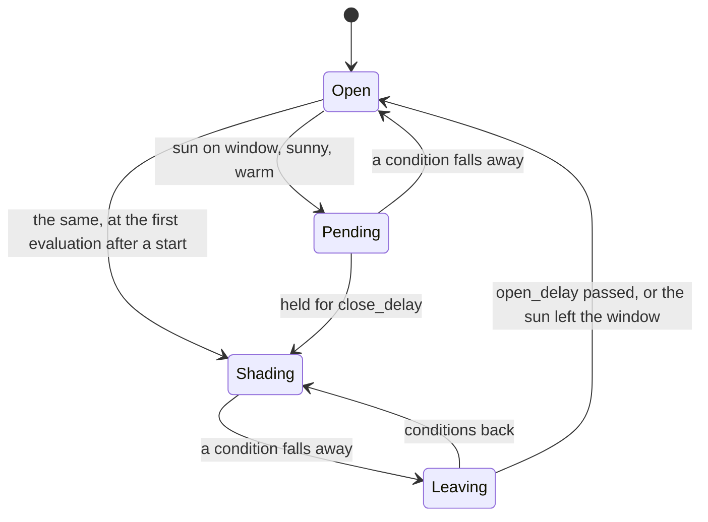

The phases are kept by `ProtectionState` (`core/protection.py`, #95): the rule decides whether shading is
*wanted* and whether the sun is *gone* (which skips the open delay); `step` applies the delays. Glare
protection uses the same class (section 13).

The learned clear-sky reference is kept with the runtime state (`RuntimeStore.globals`, saved every few
minutes).

## 7. Profiles and manual operation (#4, #5)

Designs: [`design/2026-11-20-profiles.md`](design/2026-11-20-profiles.md),
[`design/2026-11-20-manual-operation.md`](design/2026-11-20-manual-operation.md).

### 7.1 Classes

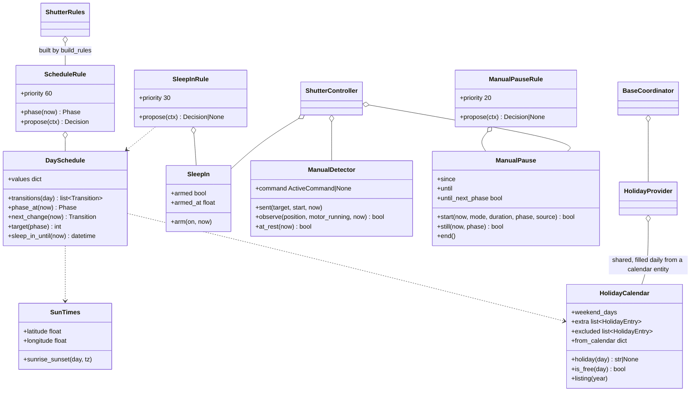

The rule chain per shutter, by priority: `ManualPauseRule` (20, final while paused) → `SleepInRule` (30) →
`HeatProtectionRule` (40, cap) → `ScheduleRule` (60). A slit decision carries a module position
(`Decision.module`); caps do not lower it.

### 7.2 Evaluation with the last sent target

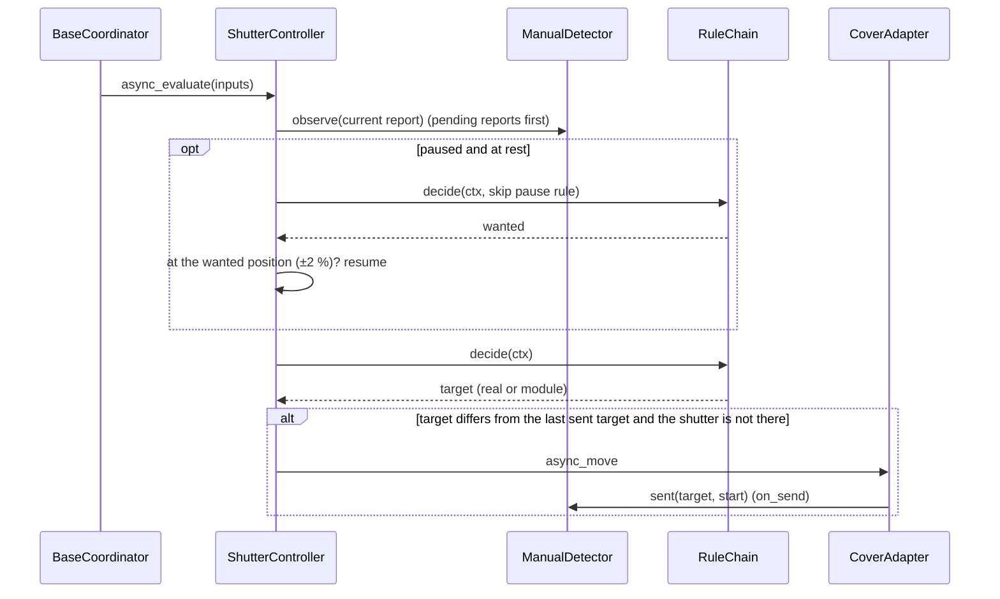

The controller moves only when the target changes (a phase change, a setting, the end of a pause or of
sleep-in, heat protection starting or ending). A shutter moved by hand is recognised by `ManualDetector`:
any change that is not on the way of an own command, or the motor running without one.

### 7.3 Manual operation

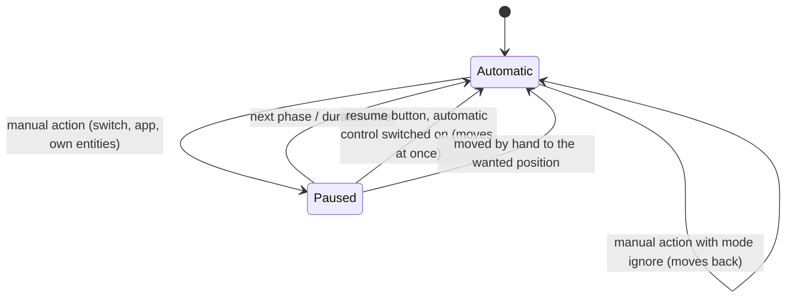

## 8. Weather and safety (#6)

Design: [`design/2026-11-20-weather-and-safety.md`](design/2026-11-20-weather-and-safety.md).

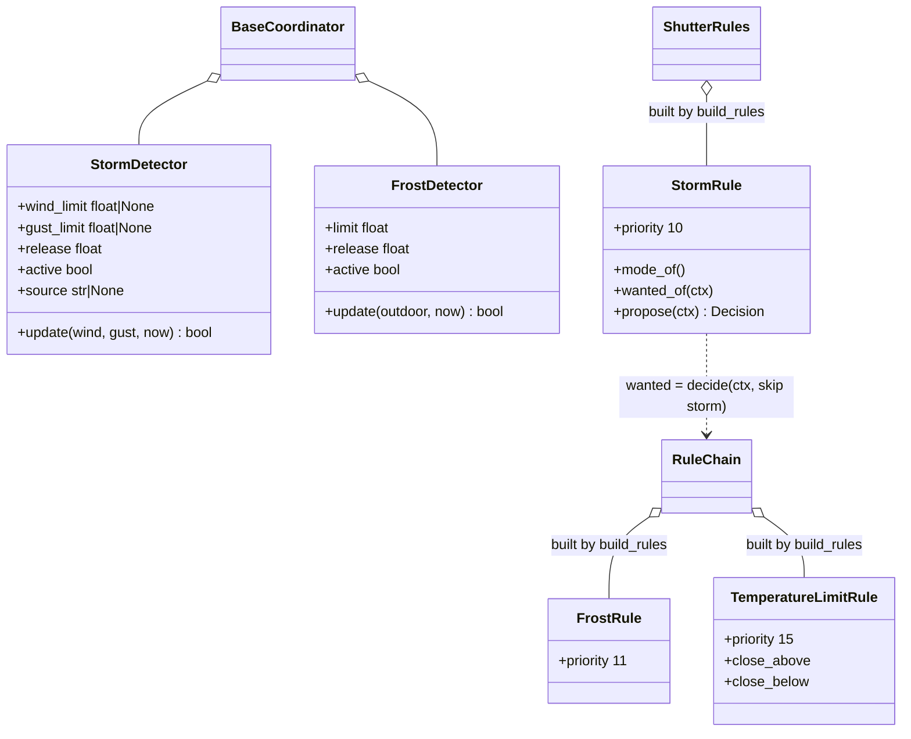

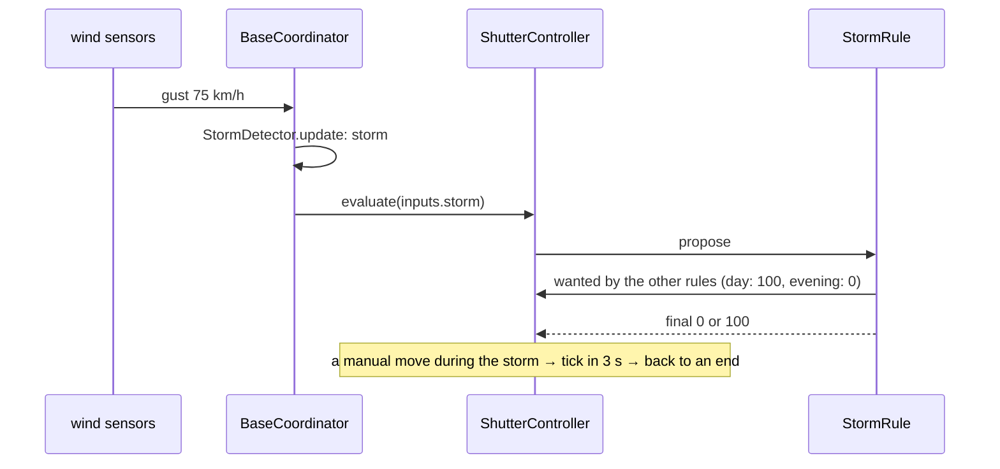

## 9. Winter mode (#7)

Design: [`design/2026-11-20-winter.md`](design/2026-11-20-winter.md).

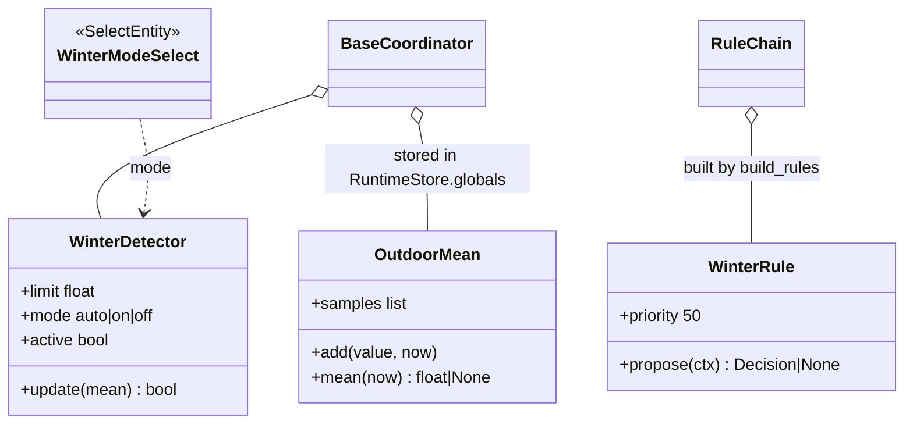

`WinterRule` gives a target *closed* on a very cold day (below the manual pause, so a manual action
overrides it) and, in the dusk phase, a cap at the current position so the dusk position never raises a
closed shutter.

## 10. Lovelace card (#9)

Design: [`design/2026-11-20-card.md`](design/2026-11-20-card.md). TypeScript and Lit in `frontend/`, built
into `custom_components/smart_shutter_control/frontend/smart-shutter-card.js`, served by the integration.

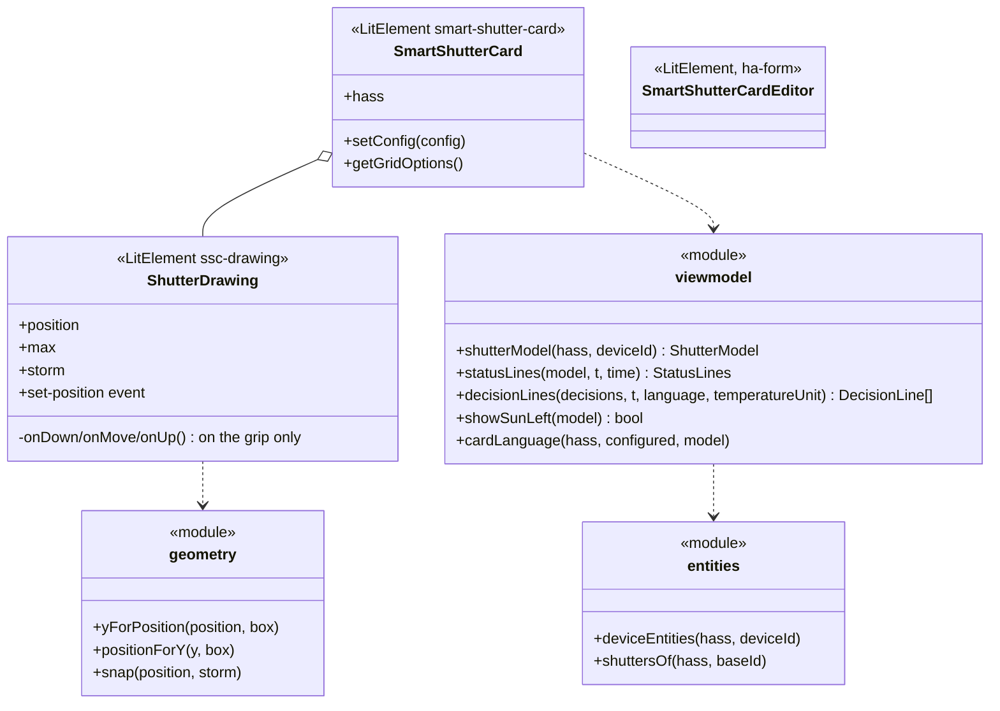

The card finds entities by translation key on the device, so renamed entities keep working. The language is
the card option, else the `language` attribute of the shutter's *Reason* sensor (the integration's setting),
else the user's profile language.

## 11. Light sensors as the sun source (#26)

Design: [`design/2026-11-20-light-sensor.md`](design/2026-11-20-light-sensor.md).

```mermaid
classDiagram
    class SunnyDetector {
        +reference ClearSkyReference
        +threshold float
        +baseline PvBaseline|LuxBaseline
        +update(sun, value, weather, now) bool
        +factor float|None
        +source str
        +value float|None
    }
    class PvBaseline {
        <<strategy>>
        +pv_peak_kw
        +young_reference(sun, threshold)
        +hysteresis(threshold, young)
        +low_sun(sun, weather) bool|None
    }
    class LuxBaseline {
        <<strategy>>
        +limit_lux
        +young_reference(sun, threshold)
        +hysteresis(threshold, young)
        +low_sun(sun, weather) bool|None
    }
    SunnyDetector o-- ClearSkyReference
    SunnyDetector o-- PvBaseline
    SunnyDetector o-- LuxBaseline
    BaseCoordinator o-- SunnyDetector : sun source (PV or light)
    ShutterController o-- SunnyDetector : facade light sensor
```

`BaseCoordinator.sun_value()` gives the PV sum or the highest lux, by the sun source. The learned references
are stored under `clear_sky` (PV) and `clear_sky_lux` (light), a facade sensor's with its shutter. A shutter
with a facade sensor replaces `sunny` and `sun_factor` in its copy of the inputs before the rules run.

While the PV reference is young, `PvBaseline` never lets the rough curve drop below its value at 10°
elevation, and below 10° `low_sun()` lets the weather condition decide (`source` `pv_peak_weather`);
`LuxBaseline.low_sun()` has no opinion. Design: [`design/2026-11-25-low-sun-factor.md`](design/2026-11-25-low-sun-factor.md) (#107).

## 12. The view through the window (#30, #34)

Designs: [`design/2026-11-20-window-view.md`](design/2026-11-20-window-view.md),
[`design/2026-11-21-window-view-sky.md`](design/2026-11-21-window-view-sky.md).

```mermaid
flowchart LR
  A["attributes: sun azimuth/elevation, weather, cloud_coverage, state (Sun factor), wind/gust (Storm), window direction and facade sun_factor (Sun on the window)"] --> I["viewmodel.outsideInputs"]
  T["time, location (hass.config)"] --> I
  I --> S["scene.sceneFor → Scene (pure)"]
  M["moon.moonPhase / moonPosition (pure)"] --> S
  U["sun.sunPosition (pure)"] --> S
  S --> V["view.renderView: SVG layers under the slats"]
```

```mermaid
classDiagram
    class scene {
        <<module, pure>>
        +sceneFor(inputs) Scene
        +cloudCover(weather, cloudCoverage, sunFactor) number
        +veil(sunFactor, cover) Veil
        +sunPath(date, lat, lon, windowAzimuth) Place[][]
        +sideLight(sunAzimuth, sunElevation, windowAzimuth, cover) SideLight
        +landscape(windowAzimuth) Landscape
        +placeInWindow(azimuth, elevation, windowAzimuth) Place
    }
    class Scene {
        +sun Place
        +glow number
        +veil Veil
        +path Place[][]
        +cover number
        +cloudCount number
        +overcast bool
        +sideLight SideLight
        +landscape Landscape
    }
    class sun {
        <<module, pure>>
        +sunPosition(date, lat, lon)
    }
    class moon {
        <<module, pure>>
        +moonPhase(date)
        +moonPosition(date, lat, lon)
    }
    scene ..> sun
    scene ..> moon
    scene --> Scene : builds
```

`scene.ts` decides what is visible (light, sun and moon place, the sun's path, cloud cover and the cloud in
front of the sun, the landscape and side light of this window direction, weather, season, sway); `view.ts`
only draws it, in the glass area of `ssc-drawing`, under the curtain. The cloud cover mixes the weather
entity (cloud coverage or condition) with the measured sun factor (the facade sensor's when the shutter has
one), the latter weighing three times as much by day. The closed slat pattern is opaque; the open
pattern's slots are transparent, so the view shows through them.

## 13. Glare protection (#36)

Design: [`design/2026-11-21-glare-protection.md`](design/2026-11-21-glare-protection.md).

```mermaid
classDiagram
    class GlareProtectionRule {
        <<cap>>
        +priority 41
        +settings SunSettings
        +day_phase(now) Phase
        +state ProtectionState
        +phase Phase
        +propose(ctx) Decision|None
    }
    class ProtectionState {
        +step(wanted, gone, now, close_delay, open_delay) Phase
    }
    class HeatProtectionRule {
        <<cap>>
        +priority 40
        +settings SunSettings
    }
    class WindowGeometry {
        +sun_on(sun, max_incidence) bool
    }
    class ShutterContext {
        +glare_protection bool
        +glare_position int
        +glare_from float
    }
    class ScheduleRule {
        +phase(now) Phase
    }
    GlareProtectionRule ..> WindowGeometry
    HeatProtectionRule ..> WindowGeometry
    GlareProtectionRule ..> ShutterContext
    GlareProtectionRule ..> ScheduleRule : day phase
    GlareProtectionRule *-- ProtectionState
    HeatProtectionRule *-- ProtectionState
    ShutterRules o-- GlareProtectionRule : built by build_rules
```

```mermaid
stateDiagram-v2
    [*] --> Open
    Open --> Pending: day phase, sun on window, sun factor ≥ glare_from
    Open --> Shading: the same, at the first evaluation after a start
    Pending --> Open: a condition falls away
    Pending --> Shading: held for close_delay
    Shading --> Leaving: sun factor < glare_from − 15 points (or not sunny)
    Leaving --> Shading: bright again
    Leaving --> Open: open_delay passed, the sun left the window, or the day phase ended
```

`GlareProtectionRule` shares the state machine of heat protection (`ProtectionState`, #95) and its `SunSettings` (largest
angle of incidence, delays), but not the temperature. The sun factor is `Inputs.sun_factor`: the base
controller's, or the facade sensor's when the shutter has one. Its phase is the attribute `glare_phase` of
*Sun on the window*. The switch *Glare protection* and the numbers *Glare position* and *Glare from* are kept
in the `RuntimeStore`, with the subentry's values as defaults.

## 14. Calibration table (#40)

Design: [`design/2026-11-21-calibration-table.md`](design/2026-11-21-calibration-table.md).

```mermaid
classDiagram
    class ShutterSubentryFlow {
        +async_step_calibrate() menu
        +async_step_cal_assistant()
        +async_step_cal_table()
        +async_step_cal_table_review()
    }
    class calibration_table {
        <<module, pure>>
        +rows_from(data) list
        +slits_from(data) dict
        +check(rows) list~str~
        +data_from(rows, slits, height_cm) dict
    }
    class RollerCalibration {
        +from_data(data)$
        +summary() dict
    }
    ShutterSubentryFlow ..> calibration_table
    ShutterSubentryFlow ..> RollerCalibration : review
```

```mermaid
sequenceDiagram
    participant U as User
    participant F as ShutterSubentryFlow
    participant T as calibration_table
    participant R as RollerCalibration
    U->>F: Calibrate → Edit table
    F->>T: rows_from(stored calibration)
    F-->>U: object selector with the rows, slits
    U->>F: edited rows
    F->>T: check(rows)
    alt errors
        F-->>U: the form again, with the error
    else fine
        F->>T: data_from(rows, slits, height)
        F->>R: from_data(data).summary()
        F-->>U: result (module position for 50 %, fit)
        U->>F: submit
        F->>F: async_update_and_abort(calibration)
    end
```

The stored format is unchanged (`points` per direction as fractions, `slit`, `window_height_cm`); the table
only converts it to whole percentages and back. The column labels of the object selector come from
`TABLE_LABELS` (en, nl), as its fields have no translation keys.


## 15. The decision of every rule (#56)

`RuleChain.decide` builds a `TraceEntry` per rule while it decides, and keeps the list of the last full
decision (not of a decision with a skipped rule) as `last_trace`. A rule that proposes nothing sets
`why = (code, values)` during `propose`; the chain clears it before asking. `WindowGeometry.why_not` gives
the codes for a sun that is not on the window. The *Reason* sensor shows the trace as the attribute
`decision` (not recorded); the card turns it into localized lines under **Why?**.

```mermaid
sequenceDiagram
    participant SC as ShutterController
    participant RC as RuleChain
    participant R as Rule
    participant S as ReasonSensor
    SC->>RC: decide(ctx)
    loop by priority
        RC->>R: why = None, propose(ctx)
        R-->>RC: Decision or None (+ why)
        RC->>RC: append TraceEntry
    end
    RC->>RC: mark the applied entry, last_trace
    RC-->>SC: Decision
    S->>SC: trace()
    SC-->>S: [entry.as_dict()] (empty while automatic control is off)
```

## 16. Horizon per window (#54)

`Horizon` (`core/horizon.py`, pure) holds `(azimuth, elevation)` points of a window; `WindowGeometry` uses
the higher of the horizon in the sun's direction and the lowest elevation. The points live in the shutter's
subentry (`horizon`). The button *Sun has left the window* stores a point without a reload: the coordinator
applies it to the running controller and marks the subentry update as quiet, so the update listener skips
the reload once. The table step *Horizon* saves like the other settings (with a reload).

```mermaid
sequenceDiagram
    participant U as User
    participant B as SunLeftButton
    participant C as BaseCoordinator
    participant SC as ShutterController
    participant HA as ConfigEntries
    U->>B: press
    B->>C: async_record_horizon(controller)
    C->>SC: horizon_with(sun) → set_horizon
    C->>HA: async_update_subentry (quiet)
    HA-->>C: update listener: quiet_update() → no reload
    C->>C: async_tick: the sun is off the window
```

## 17. Shading position from the sun (#55)

`core/shading.py` (pure): `depth_position(room, sun, window_azimuth)` computes the highest real position that
keeps direct sun within the depth, in steps of 10 %; `DepthShading` (one per heat and glare rule) returns it,
never below the fixed position, held for 15 minutes, and falls back to the fixed position without a
`RoomGeometry` or on a sloped window. `ShutterConfig.room` comes from the subentry (`window_sill`,
`window_height` or the calibration's `window_height_cm`, `sun_depth`).

```mermaid
classDiagram
    class RoomGeometry {
        <<frozen>>
        +sill_cm float
        +window_cm float
        +depth_m float
    }
    class DepthShading {
        +position int|None
        +at float
        +reset()
        +__call__(now, room, sun, azimuth, tilt, fixed) int
    }
    class HeatProtectionRule {
        +shade DepthShading
    }
    class GlareProtectionRule {
        +shade DepthShading
    }
    HeatProtectionRule o-- DepthShading
    GlareProtectionRule o-- DepthShading
    DepthShading ..> RoomGeometry
    ShutterConfig o-- RoomGeometry
```

## 18. Pausing the whole integration (#53)

`BaseCoordinator.automatic_all` (a global in `RuntimeStore`, saved within seconds) is passed to every
`ShutterController.async_evaluate` as `paused`; while it is set, the controller returns
`Decision(None, PAUSED)` before asking any rule (so the storm rule does not act either) and the trace is
empty. Switching it on clears every controller's last target, so the next tick moves each shutter to its
wanted position.

```mermaid
sequenceDiagram
    participant U as User
    participant S as AutomaticAllSwitch
    participant C as BaseCoordinator
    participant SC as ShutterController
    U->>S: turn off
    S->>C: set_automatic_all(False), async_tick
    C->>SC: async_evaluate(inputs, paused=True)
    SC-->>C: Decision(None, paused)
    U->>S: turn on
    S->>C: set_automatic_all(True): last_target = None for all, async_tick
    C->>SC: async_evaluate(inputs, paused=False)
    SC->>SC: move to the wanted position
```

## 19. Checking that a move arrives (#48)

`ArrivalCheck` (`core/arrival.py`, pure) per shutter: every command the adapter sends (except during the
calibration assistant) starts a check; a manual move by someone else, the calibration and pausing everything
cancel it. `ShutterController.async_check_arrival` runs on every tick and when the cover or its power sensor
reports; when due it refreshes the module's position, judges it (±2 %) and retries once or reports the
shutter stuck: the binary sensor *Stuck* and a repair issue `stuck_<shutter>` (`issue_registry`), deleted at
the next arrival.

```mermaid
stateDiagram-v2
    [*] --> Idle
    Idle --> Waiting: sent(target)
    Waiting --> Idle: arrived
    Waiting --> Retrying: not arrived, send again
    Retrying --> Idle: arrived (issue deleted)
    Retrying --> Stuck: not arrived (issue created)
    Stuck --> Waiting: sent(target)
    Waiting --> Idle: manual move / calibration / paused
    Retrying --> Idle: manual move / calibration / paused
```

```mermaid
classDiagram
    class ArrivalCheck {
        +state State
        +target int|None
        +deadline float
        +sent(target, now)
        +cancel()
        +due(motor_running, now) bool
        +judge(position) Verdict
    }
    class ShutterController {
        +arrival ArrivalCheck
        +stuck bool
        +async_check_arrival()
    }
    class StuckSensor {
        <<BinarySensorEntity, problem>>
    }
    ShutterController o-- ArrivalCheck
    StuckSensor ..> ShutterController
```

## 20. Window and door contacts (#49)

`OpeningGuard` (`core/contacts.py`, pure) per shutter holds the state of the optional *opened* and *tilted*
contacts (an unavailable contact keeps its last state) and gives a `Floor`: the lockout position while
opened, the ventilation position (a real position or the slit) while tilted, each held for 1 minute after
the contact closes. `ShutterController.async_evaluate` reads the contacts first (a door that has just opened
ends a manual pause), then applies the floor with `raise_to` to the position after the rule chain and the
limiter, or to the current position when no rule wants anything. Frost and a manual pause (a final decision
without a position) leave the shutter alone. The lockout floor is safety: above the maximum position, and
fully open in a storm; ventilation gives way to both. The floor adds a line *contacts* to the decision
trace. `BaseCoordinator` evaluates at once when a contact changes and once more when a hold ends.

```mermaid
classDiagram
    class OpeningGuard {
        +lockout int
        +ventilation int|None
        +opened Contact
        +tilted Contact
        +update(opened, tilted, now) bool
        +floor(now, slit_module, max_position) Floor|None
        +release_at() float|None
    }
    class Contact {
        +on bool
        +off_since float|None
        +update(on, now) bool
        +holds(now) bool
    }
    class Floor {
        +reason lockout|ventilation
        +target Target
        +safety bool
    }
    class ShutterController {
        +guard OpeningGuard
        +contacts
        +floor_entry dict|None
        +async_evaluate()
    }
    OpeningGuard *-- Contact
    OpeningGuard ..> Floor
    ShutterController o-- OpeningGuard
```

```mermaid
sequenceDiagram
    participant D as Door contact
    participant C as BaseCoordinator
    participant SC as ShutterController
    participant G as OpeningGuard
    D->>C: on
    C->>SC: async_evaluate(inputs)
    SC->>G: update(opened, tilted, now)
    G-->>SC: just opened: resume (end a manual pause)
    SC->>SC: rule chain, limiter
    SC->>G: floor(now)
    SC->>SC: raise_to(target, current, floor, storm): lockout
    D->>C: off
    C->>C: async_call_later(release_at)
    C->>SC: async_evaluate: the rules' position
```

## 21. Heat protection from the weather forecast (#50)

`ForecastProvider.async_refresh` (#98) calls `weather.get_forecasts` (`type: daily`) at start, once Home
Assistant has started, when the weather entity appears or becomes available (#67), and every 30 minutes; `today_max` (`core/forecast.py`, pure) takes the `temperature` of the entry whose local date is
today, and `ForecastMaximum` keeps it for that day only (a failed call keeps today's value, never
yesterday's). `Inputs.forecast_max` carries it to every shutter. `HeatProtectionRule._warm` is true on a hot
day, when `forecast_max ≥ SunSettings.hot_day` (the base option, or the shutter's override; `None` is off),
so the outdoor and room limits do not apply; sun on the window, sunny and the delays still do. The base
entities *Forecast maximum* (sensor) and *Hot day* (binary sensor) show the value and the base limit.

```mermaid
classDiagram
    class ForecastMaximum {
        <<core/forecast.py>>
        +day date|None
        +value float|None
        +update(value, today)
        +today(today) float|None
    }
    class ForecastProvider {
        +maximum ForecastMaximum
        +value float|None
        +async_refresh()
        +track(on_update) list
    }
    class BaseCoordinator {
        +forecast ForecastProvider
        +forecast_max float|None
        +hot_day bool
    }
    class Inputs {
        +forecast_max float|None
    }
    class SunSettings {
        +hot_day float|None
    }
    class HeatProtectionRule {
        -_hot_day(ctx) bool
        -_warm(ctx) bool
    }
    class ForecastSensor {
        <<SensorEntity, temperature>>
    }
    class HotDaySensor {
        <<BinarySensorEntity>>
    }
    BaseCoordinator o-- ForecastProvider
    ForecastProvider o-- ForecastMaximum
    BaseCoordinator ..> Inputs
    HeatProtectionRule ..> Inputs
    HeatProtectionRule o-- SunSettings
    ForecastSensor ..> BaseCoordinator
    HotDaySensor ..> BaseCoordinator
```

```mermaid
sequenceDiagram
    participant C as BaseCoordinator
    participant F as ForecastProvider
    participant W as weather.get_forecasts
    participant SC as ShutterController
    participant H as HeatProtectionRule
    F->>W: type daily (start, started, entity appears, every 30 min)
    W-->>F: forecast list
    F->>F: today_max → ForecastMaximum
    C->>F: value (each tick)
    C->>SC: async_evaluate(Inputs(forecast_max))
    SC->>H: propose(ctx)
    H->>H: hot day? then warm without the outdoor and room limits
```

## 22. Temperatures and wind speeds in any unit (#64)

`units.py` (Home Assistant side) converts every value it reads with Home Assistant's `TemperatureConverter`
and `SpeedConverter`: the outdoor and room temperature (the sensor's `unit_of_measurement`) and the daily
forecast (the weather entity's `temperature_unit`) to °C, wind and gust to km/h; a value without a unit or
with an unknown one counts as °C or km/h. `core/` keeps working in °C and km/h. The 30-day wind maxima on the
storm page are converted the same way.

```mermaid
classDiagram
    class units {
        <<module units.py>>
        +temperature(state) float|None
        +speed(state) float|None
        +to_celsius(value, unit) float
        +to_kmh(value, unit) float
    }
    BaseCoordinator ..> units : outdoor, wind, gust, forecast
    ShutterController ..> units : room temperature
    SmartShutterControlOptionsFlow ..> units : 30-day wind maxima
```

## 23. Settings in the user's units (#65, #71)

The settings stay stored in °C, km/h, cm and m. `DisplayUnit` (in `units.py`) shows them in the user's unit
system: `temperature_unit(hass)` follows `hass.config.units.temperature_unit`, `speed_unit(hass)` gives mph with
US customary units and km/h otherwise, `length_unit(hass, stored_unit, step)` gives inches for cm and feet for m
with US customary units. The flows mark the fields in `TEMPERATURE_FIELDS`, `SPEED_FIELDS` and `LENGTH_FIELDS`
(window sill and height in whole inches, sun depth in steps of 0.5 ft); `_shown_form` replaces their number
selectors (range rounded outwards to the shown `step`) and converts the stored values, `_stored_input` converts
the input back, rounded to `digits` decimals. A value the user left unchanged keeps its stored value exactly, so
saving a form never shifts a setting by rounding. The calibration assistant asks the window height in inches and
each measured opening in steps of a quarter inch, and converts them to cm with `to_stored`. The card converts the temperatures of the
decision trace (which stays in °C) to `hass.config.unit_system.temperature`.

```mermaid
classDiagram
    class DisplayUnit {
        <<dataclass, units.py>>
        +converter
        +stored_unit str
        +unit str
        +step float
        +digits int
        +converts bool
        +selector_config(low, high, step) dict
        +shown(stored) float|None
        +stored(shown, previous) float|None
        +to_stored(shown) float
    }
    class units {
        <<module units.py>>
        +temperature_unit(hass) DisplayUnit
        +speed_unit(hass) DisplayUnit
        +length_unit(hass, stored_unit, step) DisplayUnit
    }
    units ..> DisplayUnit : creates
    SmartShutterControlOptionsFlow ..> DisplayUnit : sun, storm, winter, schedule
    ShutterSubentryFlow ..> DisplayUnit : settings, schedule, calibration assistant
```

```mermaid
sequenceDiagram
    participant U as User
    participant F as Flow step
    participant D as DisplayUnit
    F->>D: shown(stored °C / km/h / cm / m)
    F->>U: form in °F / mph / in / ft
    U->>F: input
    F->>D: stored(input, previous)
    D-->>F: previous if unchanged, else converted (digits)
    F->>F: save in °C / km/h / cm / m
```


## 24. Documentation site (#78)

The pages in `docs/` are also published as a site on GitHub Pages, built with MkDocs and the Material theme.
`mkdocs.yml` holds the navigation, the theme and the Markdown extensions (Mermaid through
`pymdownx.superfences`). The designs in `docs/design/` stay out of the site; the hook `docs/hooks.py` turns
links to them into links to GitHub, so the pages stay plain Markdown that reads the same on GitHub. The *Docs*
workflow builds and deploys the site on every push to `main`; the *docs* job in *Tests* builds it with
`--strict` on every push and PR, so a broken link fails early. Design:
[`design/2026-11-22-docs-site.md`](design/2026-11-22-docs-site.md).

The hook also adds `brand/icon.svg` to the site as its logo and favicon, and turns GitHub's theme fragments
(`#gh-light-mode-only`, `#gh-dark-mode-only`) into Material's (`#only-light`, `#only-dark`), so an image for
one theme follows GitHub's theme on GitHub and the site's switch on the site (#81).

### Screenshots (#81)

`scripts/screenshot_card.py` draws the card alone with example states. `scripts/demo_screenshots.py` takes the
screenshots of Home Assistant itself: it starts a made-up demo (`scripts/demo/configuration.yaml`: template
covers and sensors) in a temporary directory, chooses the longitude so it is about 13:00 solar time, onboards
and sets up the integration through the REST API, saves a dashboard through the websocket API and takes each
screenshot with Playwright. Design: [`design/2026-11-22-ha-screenshots.md`](design/2026-11-22-ha-screenshots.md).

```mermaid
sequenceDiagram
    participant S as demo_screenshots.py
    participant H as Demo Home Assistant
    participant B as Chromium (Playwright)
    S->>S: copy scripts/demo, set longitude for 13:00 solar time
    S->>H: start hass -c dir
    S->>H: onboarding, token (REST)
    S->>H: config flows: base controller, shutters (REST)
    S->>H: lovelace/dashboards/create, lovelace/config/save (websocket)
    loop each screenshot
        B->>H: open page, dialog, steps
        B-->>S: PNG to docs/images/
    end
    S->>H: stop, remove dir
```

```mermaid
flowchart LR
    docs["docs/*.md, docs/images"] --> mk["mkdocs build --strict"]
    cfg[mkdocs.yml] --> mk
    hook["docs/hooks.py: design links to GitHub"] --> mk
    mk --> art[Pages artifact] --> site["abroeders.github.io/smart-shutter-control"]
    main[push to main] --> wf[docs.yml] --> mk
    pr[push / PR] --> tests["tests.yml: docs job"] --> mk
```

## 25. Flow modules (#97)

The flows are split by responsibility; the step ids, forms and translations did not change.

| Module | Contents |
|---|---|
| `config_flow.py` | `SmartShutterControlConfigFlow`: the base controller (sources, PV or light sensors), reconfigure |
| `options_flow.py` | `SmartShutterControlOptionsFlow`: language, winter, schedule, holidays, sun, storm; the holiday calendar and its listing as functions |
| `subentry_flow.py` | `ShutterSubentryFlow`: add and change a shutter, schedule overrides, horizon, contacts |
| `calibration_flow.py` | `CalibrationSteps`: the calibration assistant and the calibration table, mixed into `ShutterSubentryFlow` |
| `flow_common.py` | Form helpers shared by the flows: selectors, defaults, values in the user's units, schedule fields |
| `recorder_stats.py` | The 30-day maxima from long-term statistics (wind, light sensors) |

```mermaid
classDiagram
    class SmartShutterControlConfigFlow {
        <<ConfigFlow>>
    }
    class SmartShutterControlOptionsFlow {
        <<OptionsFlow>>
    }
    class ShutterSubentryFlow {
        <<ConfigSubentryFlow>>
    }
    class CalibrationSteps {
        <<mixin>>
    }
    class flow_common {
        <<module>>
    }
    class recorder_stats {
        <<module>>
        +_max_30_days(hass, entity_id, wind) str
        +lux_maxima(hass, sensors) tuple
    }
    SmartShutterControlConfigFlow ..> SmartShutterControlOptionsFlow : async_get_options_flow
    SmartShutterControlConfigFlow ..> ShutterSubentryFlow : subentry type shutter
    CalibrationSteps <|-- ShutterSubentryFlow
    SmartShutterControlConfigFlow ..> flow_common
    SmartShutterControlOptionsFlow ..> flow_common
    ShutterSubentryFlow ..> flow_common
    CalibrationSteps ..> flow_common
    SmartShutterControlConfigFlow ..> recorder_stats : light sensor maxima
    SmartShutterControlOptionsFlow ..> recorder_stats : wind maxima
```

## 26. Base controller providers (#98)

`BaseCoordinator` reads the inputs, runs the tick and wires the parts; the weather forecast and the holiday
calendar are providers in `providers.py`, each with its own listeners. `async_start` creates the shutter
controllers, refreshes both providers once and collects every listener's unsubscribe function, which
`async_stop` calls. A provider calls `on_update` (the coordinator's `async_update_listeners`) when its entity
appears late, so the base entities show the new value at once.

```mermaid
classDiagram
    class BaseCoordinator {
        <<DataUpdateCoordinator>>
        +forecast ForecastProvider
        +holidays HolidayProvider
        +calendar HolidayCalendar
        +async_start()
        +async_stop()
        -_create_shutters()
        -_track_entities() list
    }
    class ForecastProvider {
        +entity_id str|None
        +maximum ForecastMaximum
        +value float|None
        +day date|None
        +async_refresh()
        +track(on_update) list
    }
    class HolidayProvider {
        +entity_id str|None
        +calendar HolidayCalendar
        +async_refresh()
        +track(on_update) list
    }
    class read_calendar {
        <<function>>
        +read_calendar(hass, entity_id) dict|None
    }
    BaseCoordinator o-- ForecastProvider
    BaseCoordinator o-- HolidayProvider
    ForecastProvider o-- ForecastMaximum
    HolidayProvider o-- HolidayCalendar
    HolidayProvider ..> read_calendar
    SmartShutterControlOptionsFlow ..> read_calendar : holiday listing
```

```mermaid
sequenceDiagram
    participant C as BaseCoordinator
    participant H as HolidayProvider
    participant F as ForecastProvider
    C->>C: _create_shutters()
    C->>H: async_refresh()
    C->>F: async_refresh()
    C->>C: _track_entities(): tick, covers, inputs, contacts
    C->>H: track(async_update_listeners): every night, calendar appears
    C->>F: track(async_update_listeners): every 30 min, weather appears
    Note over C: async_stop calls every unsubscribe function
```

## 27. Shutter controller parts (#96)

`ShutterController` decides, limits and moves; three parts it used to do itself are separate:

- `ShutterSettings` (`shutter_settings.py`) reads the subentry once into typed values: the `ShutterConfig`,
  the defaults of the entity settings, contacts, motor power sensor, travel time, calibration, schedule
  overrides and the shutter's heat limits (`sun(base)`). The controller reads no raw subentry data; it keeps
  a copy only to write a recorded horizon point back and for the diagnostics.
- `build_rules` (`core/rule_factory.py`, pure) builds the rule chain from the day schedule, the schedule
  settings, the sun settings, sleep-in, the manual pause and the temperature limits, and returns
  `ShutterRules`: the chain and the rules the controller and its entities talk to.
- `StoredSetting` (`storage.py`) is a descriptor: `automatic`, `max_position`, `heat_protection`,
  `shading_position`, `glare_protection`, `glare_position` and `glare_from` are class attributes that read
  the runtime store with the subentry's value as default; the entities assign to them.

```mermaid
classDiagram
    class ShutterController {
        +settings ShutterSettings
        +rules ShutterRules
        +chain RuleChain
        +automatic StoredSetting~bool~
        +max_position StoredSetting~int~
        +heat_protection StoredSetting~bool~
        +shading_position StoredSetting~int~
        +glare_protection StoredSetting~bool~
        +glare_position StoredSetting~int~
        +glare_from StoredSetting~int~
        +set_automatic(on)
    }
    class ShutterSettings {
        <<frozen>>
        +config ShutterConfig
        +max_position int
        +heat_protection bool
        +shading_position int
        +glare_protection bool
        +glare_position int
        +glare_from int
        +lockout_position int
        +ventilation_position int|None
        +opened_contact str|None
        +tilted_contact str|None
        +facade_light str|None
        +motor_power str|None
        +travel_time float|None
        +calibration dict|None
        +schedule_overrides dict
        +sun_overrides dict
        +from_data(data)$ ShutterSettings
        +sun(base) SunSettings
        +calibration_points dict
    }
    class ShutterRules {
        <<frozen>>
        +chain RuleChain
        +schedule ScheduleRule
        +pause ManualPauseRule
        +heat HeatProtectionRule
        +glare GlareProtectionRule
        +storm StormRule
    }
    class build_rules {
        <<function core/rule_factory.py>>
        +build_rules(schedule, values, sun, sleep_in, pause, slit_module, wanted_without_storm, close_above, close_below) ShutterRules
    }
    class StoredSetting~T~ {
        <<descriptor>>
        +key str
        +kind bool|int
        +default(owner) T
        +__get__(owner) T
        +__set__(owner, value)
    }
    ShutterController *-- ShutterSettings
    ShutterController o-- ShutterRules
    build_rules ..> ShutterRules : creates
    ShutterController ..> build_rules
    ShutterController ..> StoredSetting : class attributes
    StoredSetting ..> RuntimeStore
    ShutterRules o-- RuleChain
```
