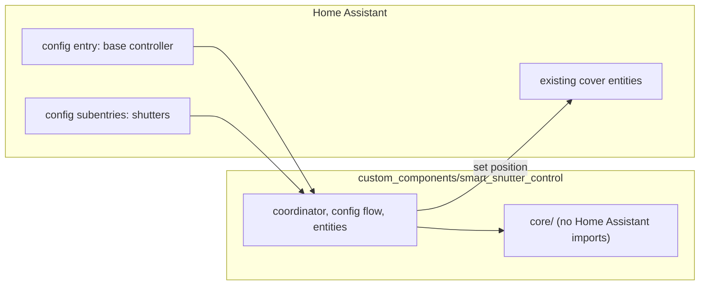
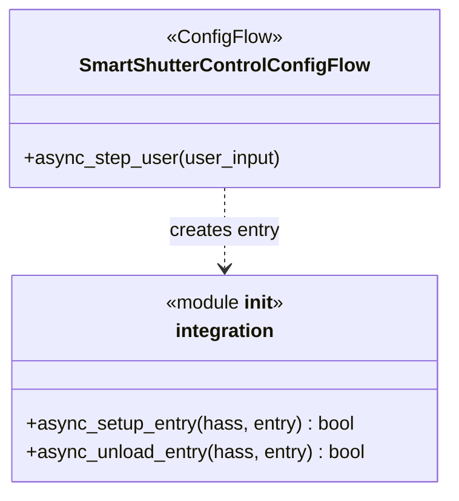
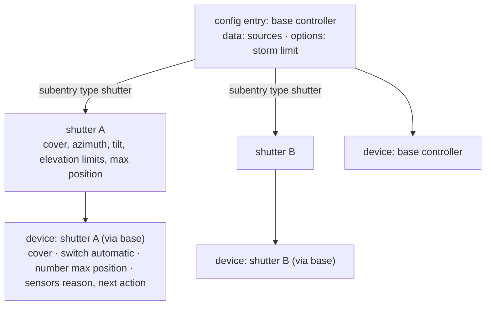
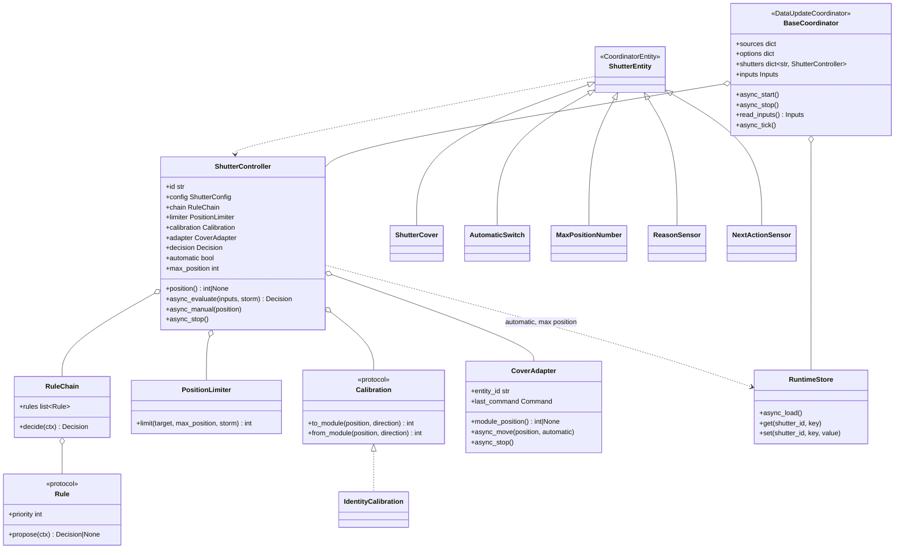
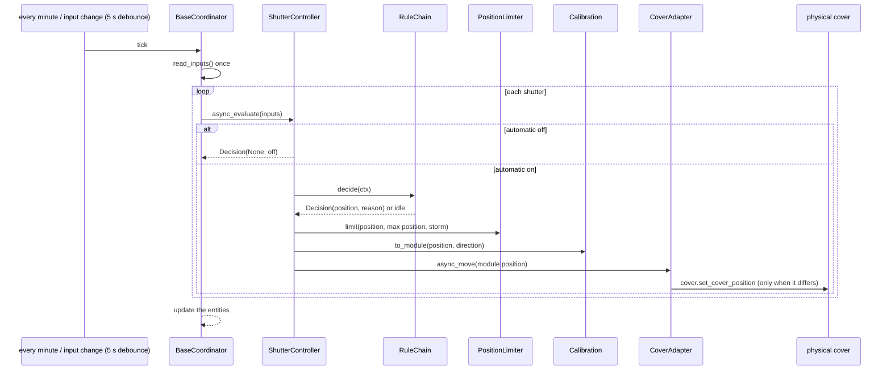
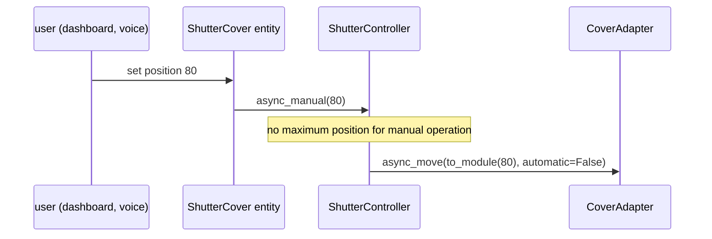
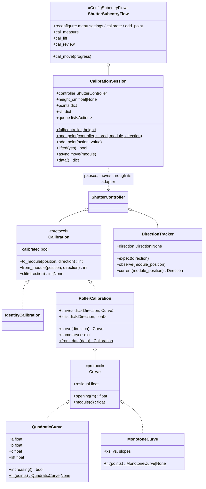
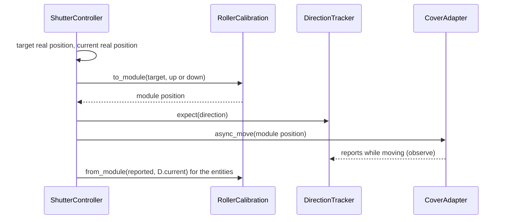
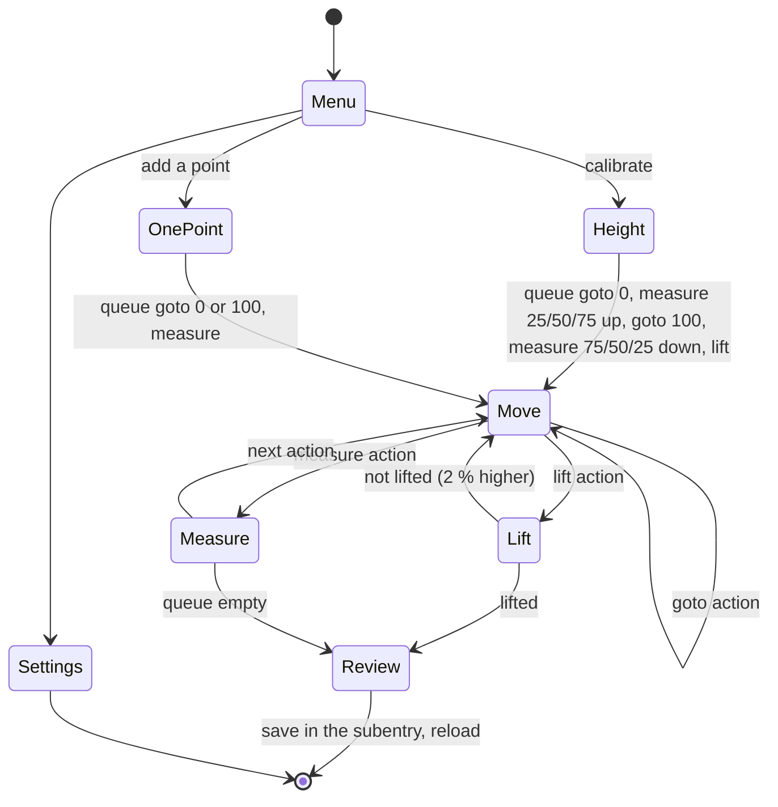

# Architecture

How the integration is built. Design documents per issue are in [`design/`](design/).

## 1. Overview

- `core/` holds the logic (sun geometry, rules, calibration) as plain Python, tested with pytest.
- The Home Assistant layer reads inputs, calls `core/` and moves the shutters.

## 2. Design principles

| Principle | How |
|---|---|
| Single responsibility | one module per concern; one class per rule |
| Dependency inversion | `core/` depends on its own protocols, not on Home Assistant |
| **Chain of responsibility** | `RuleChain` asks the `Rule`s by priority; the first decision wins (#2) |
| **Strategy** | `Calibration` (`IdentityCalibration`, `RollerCalibration`) and `Curve` (`QuadraticCurve`, `MonotoneCurve`) |
| **Factory method** | `fit_curve` picks the roller model or the monotone fallback; `RollerCalibration.from_data` |
| **Adapter** | `CoverAdapter` is the only code that moves a physical cover |
| **Observer** | the entities listen to `BaseCoordinator` |
| **Repository** | `RuntimeStore` keeps automatic on/off and the maximum position per shutter |

## 3. Scaffold (#1)

## 4. Base controller and shutters (#2)

Design: [`design/2026-11-19-base-controller-and-shutters.md`](design/2026-11-19-base-controller-and-shutters.md).

### 4.1 Configuration and devices

### 4.2 Classes

`core/` (no Home Assistant): `ShutterConfig`, `Inputs`, `ShutterContext`, `Decision`, `Reason`, `Direction`,
`RuleChain`, `Rule`, `PositionLimiter`, `Calibration`, `IdentityCalibration`.

### 4.3 A tick

### 4.4 Manual operation through the shutter entity

## 5. Calibrated positions (#10)

Design: [`design/2026-11-20-calibration.md`](design/2026-11-20-calibration.md).

### 5.1 Classes

### 5.2 Moving to a real position

### 5.3 The assistant

During the assistant the controller is paused (`Reason.CALIBRATING`); ending the flow in any way resumes it.
