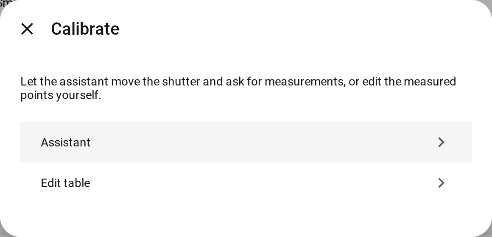
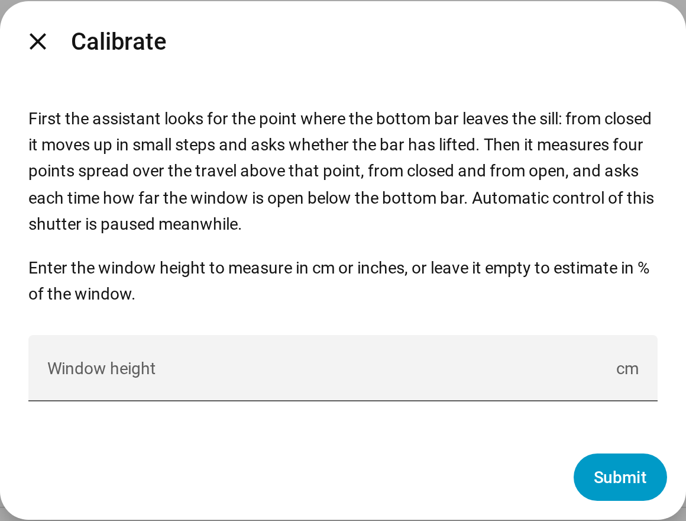
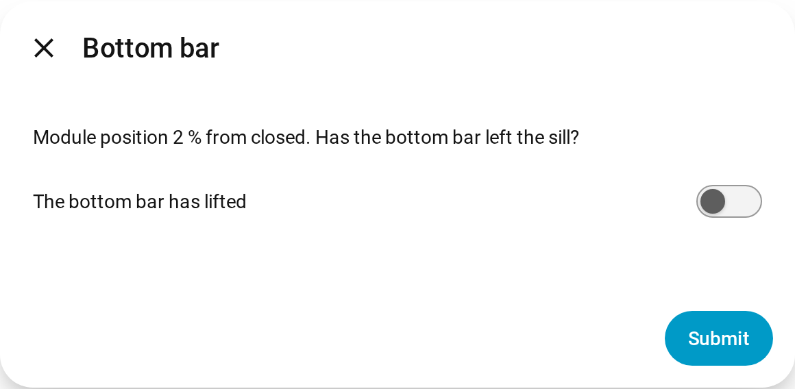
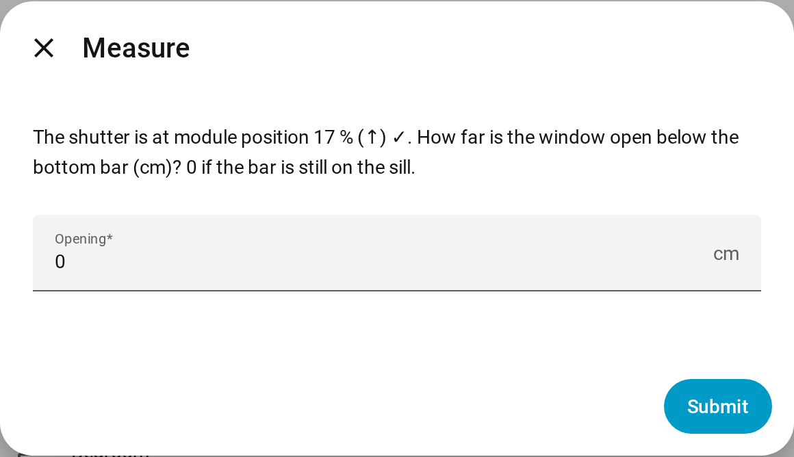
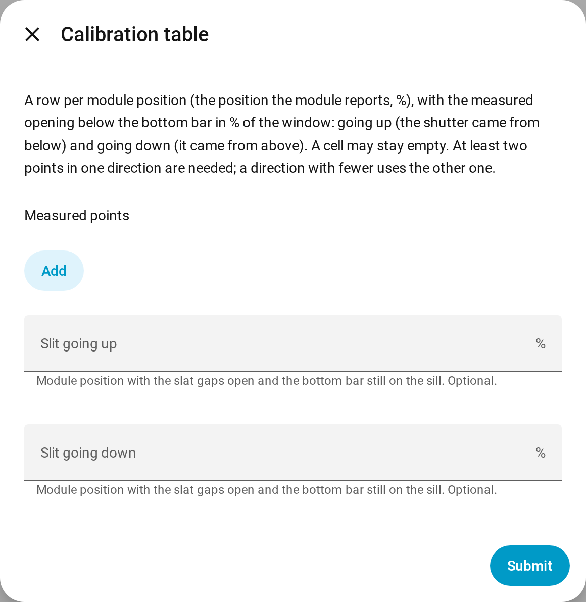

# Calibration

## Why

Most shutter modules only know the travel time between the ends. At "50 %" they have run half that time,
but the shutter is then **lower** than half way, for three reasons:

1. **The roller grows.** Each turn winds more slat length as the roll gets thicker, so the shutter moves
   slowly at first and faster later.
2. **Slat gaps.** From closed, the first part of the travel only pulls the slats apart (light through the
   gaps) before the bottom bar lifts from the sill.
3. **Direction.** If the motor is slower going up than going down, the same module position is a different
   height in each direction.

After calibration the integration's cover and card show the **real** position (the height of the opening
below the bottom bar, as a share of the window), and a target of 50 % ends half way, from either direction.
Fully open and fully closed always use the module's own ends (its limit switches): the integration sends
the module's open or close (the arrows), not position 100 or 0, so the module runs until it stops at its
limit even when its own travel-time estimate has drifted.

## Two ways

*Reconfigure → Calibrate* on the shutter offers:

- **Assistant:** moves the shutter and asks for measurements (below).
- **Edit table:** edit the measured points yourself (see [Edit the table](#edit-the-table)).

## The assistant

*Reconfigure → Calibrate → Assistant* on the shutter. Have a tape measure ready. Automatic control of that shutter pauses
while the assistant runs. It does not run during a storm.

1. **Window height** in cm, or in inches with US customary units (or leave it empty and give openings in % of
   the window). The openings are then measured in the same unit, in inches to a quarter inch.
2. The shutter **closes**.
3. **Lift point:** the shutter moves up in steps of 2 % and asks *Has the bottom bar left the sill?* until you
   say yes. The step before is the **slit**: all gaps open, bar still on the sill.

    

4. **Four points going up**, spread over the travel above the lift point. At each point: measure the opening
   below the bottom bar.

    

5. The shutter **opens fully**, then the same points **going down**.
6. **Result:** the module position for 50 % in each direction, and how well the model fits. A difference of
   more than about 5 % between the directions means the motor is faster one way.

With a **motor power sensor** the assistant sees when the motor stops; without one it first measures the
**travel time** (open fully, then close fully) and waits the expected time for each move. While it waits it
also asks the module for its position every 5 seconds, so a module that does not report by itself is still
seen to arrive, and the assistant goes on as soon as the position is there.

### Worked example

The window of `cover.living_room` is 150 cm high. The assistant closes the shutter and lifts it in steps of 2 %.
At 34 % the bottom bar has left the sill, so the lift point is 34 % and the **slit** is the step before: 32 %.
The four points going up are spread over the travel above the lift point (66 %), at 15, 40, 65 and 90 % of
it: module positions 44, 60, 77 and 93. At each one you measure the opening below the bar, for example 18 cm
at 44 %, which you enter as 18 (cm), about 12 % of the window. Going down the same positions are measured
again. The result might read: *50 % is reached at module position 66 going up and 71 going down*. A target of
50 % then sends 66 when the shutter comes from below and 71 when it comes from above.

**Reading the result.** A difference of about 2 % or less between the directions: equally fast. More than 5 %:
the motor is slower in one direction, and the model takes care of it; check the fit shown per direction.
The fit is good when it stays within 3 % of the window.

**Add a calibration point** moves the shutter from closed (↑) or from open (↓) to a module position you
choose, and asks for the opening. Use it to improve a curve without measuring everything again.

## Edit the table

*Reconfigure → Calibrate → Edit table* shows the stored points as a list of rows, ready to change, extend
or remove. Use it to correct one value, to type in measurements taken earlier, or to give an identical
window the same calibration.

| Module position (%) | Going up: opening (%) | Going down: opening (%) |
|---|---|---|
| 34 | 9 | 1 |
| 53 | 30 | 22 |
| 73 | 60 | 53 |
| 92 | 90 | 86 |

- **Module position:** the position the module reports (it follows the travel time).
- **Going up / going down:** the opening below the bottom bar in % of the window, measured when the shutter
  came from below (up) or from above (down). A cell may stay empty.
- **Slit going up / going down:** the module position with the slat gaps open and the bottom bar still on
  the sill (optional).

Values are checked on *Submit*:

| Message | Meaning |
|---|---|
| module position out of range / twice | a module position must be 1 to 99 and appear once |
| opening out of range | an opening must be 0 to 100 (%) |
| too few points | at least one direction needs two points |
| opening falls | in one direction the opening may not decrease as the module position rises |

At least one direction needs two points; a direction with fewer uses the other one. Per direction the
opening may not fall while the module position rises. After *Submit* you see the result (the module position
for 50 % and the fit per direction); *Submit* again saves it.

## The model

Per direction the real opening `o` follows from the module position `m` as a clipped quadratic,
`o = a·m + b·m² − c`, fitted to your points (the roller grows linearly with each turn; `c` is the gap zone).
When that does not fit within 3 % of the window, a smooth monotone curve through the points is used instead.
The sensor *Calibration* shows the model and the fit per direction.

To send a real position the integration inverts the curve of the direction the shutter will move in, and
picks the nearest whole module position. It remembers that command: while the module stays at it (within 1),
the shutter shows the real position that was sent, also after a restart. When the shutter is moved elsewhere,
the real position follows the curve of that movement's direction; a movement of less than 3 module points
does not change the direction.
