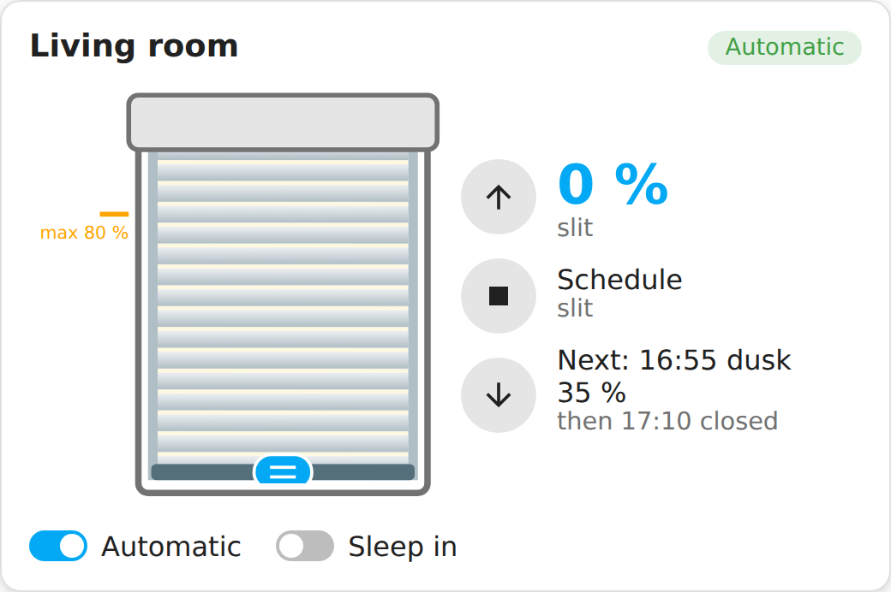
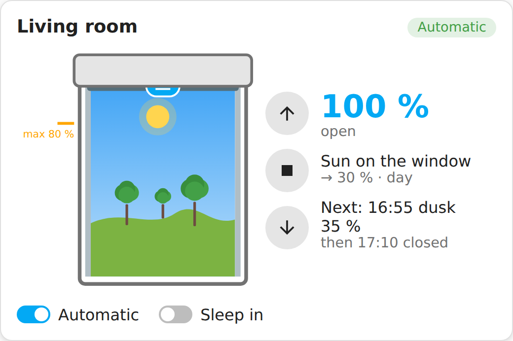
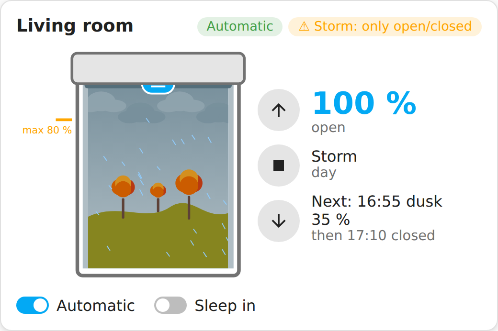
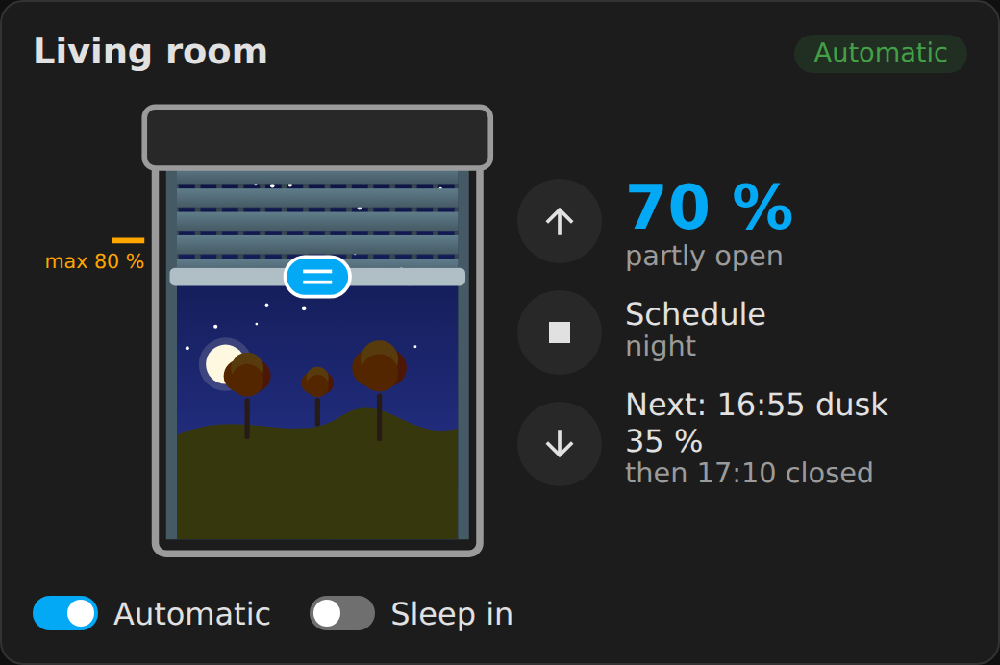
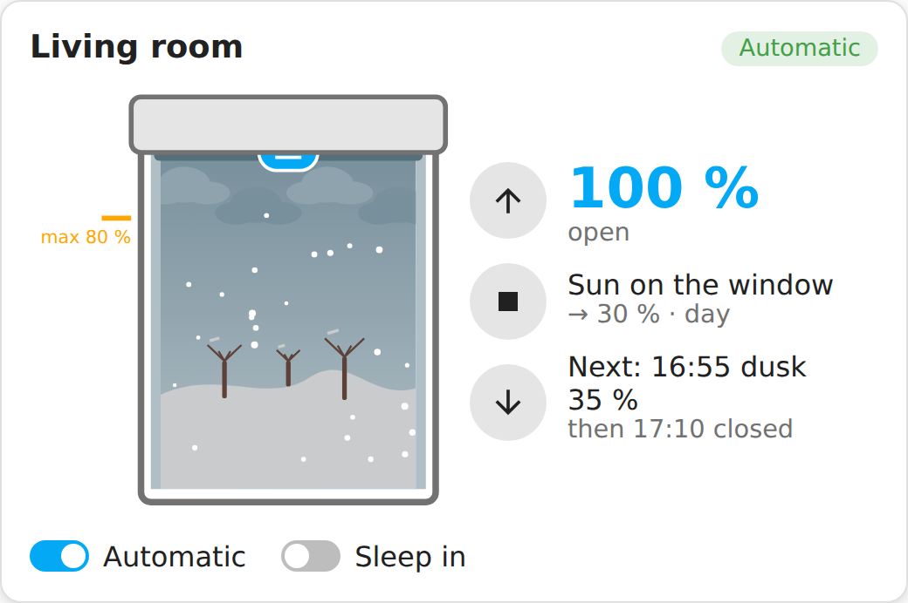
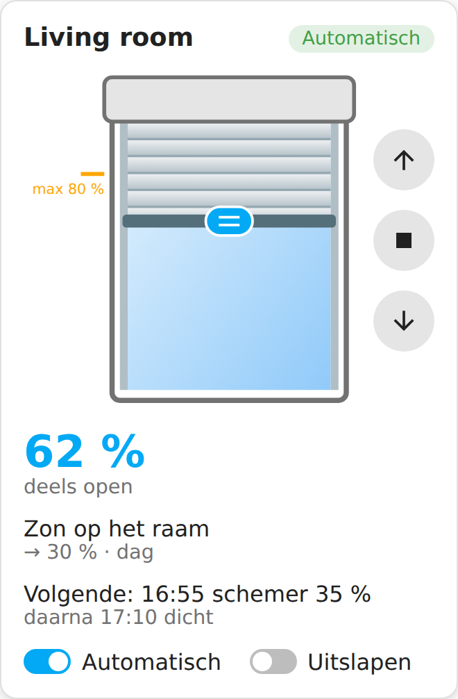
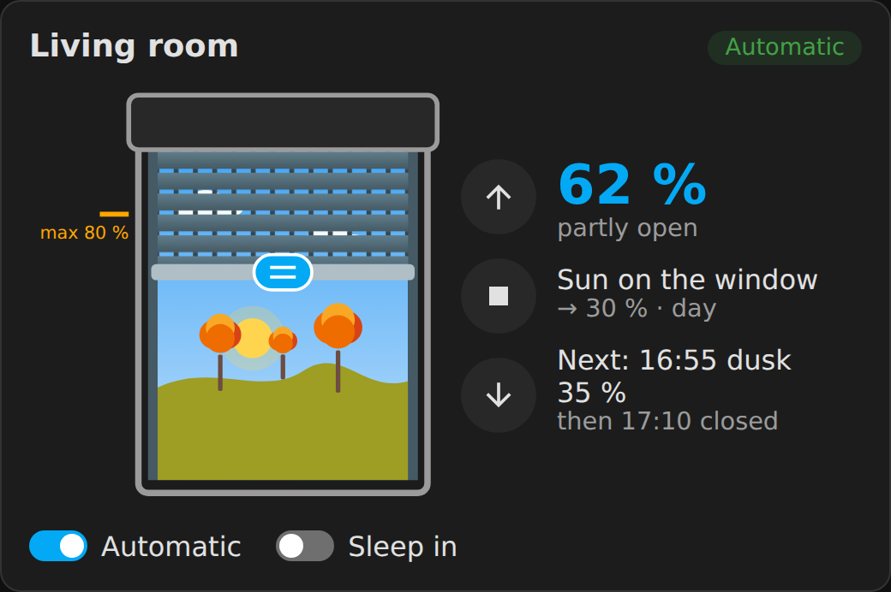

# Lovelace card

The integration ships a card and adds it to every dashboard: no resource to add. Pick **Smart Shutter** in
the card picker, or add it in YAML.


## One shutter

```yaml
type: custom:smart-shutter-card
device_id: <the shutter's device>
```

- **Drawing:** the shutter at its real (calibrated) position. Drag the blue grip on the bottom bar up or
  down: a shadow bar shows the target, releasing moves the shutter there. Only the grip moves the shutter,
  so scrolling over the drawing on a phone does nothing. This counts as a manual action, so automatic control pauses
  (see *Manual operation*). During a storm the target snaps to fully open or fully closed.
- **Keyboard:** focus the drawing; ↑/↓ 5 %, Page Up/Down 25 %, Home open, End closed, Enter to move,
  Escape to cancel.
- **Slats:** light shows between the slats whenever the shutter is not fully closed, also in the slit
  position (bar on the sill, gaps open); only fully closed are they pressed together.

  
- **The view through the window:** a cartoon landscape behind the shutter with the real light (night with
  stars, twilight, day), the weather (clouds, rain, snow, fog, lightning), the sun and the moon (with its
  phase) at their place as seen through this window, the leaves of the season, and trees that sway with the
  wind (harder in a storm). Fully closed you see nothing; otherwise the view shows through the slots and below
  the bottom bar. With reduced motion everything stands still.
  - **Per window:** every window direction has its own landscape, the sky is lighter and warmer on the side
    of the sun, and a dotted arc shows today's path of the sun from east to west, as far as this window sees
    it (a north window sees none in winter).
  - **Clouds that match the light:** the amount of clouds follows the cloud cover. By day the measured light
    (PV power or light sensors, or the window's own facade light sensor) counts three times as much as the
    weather entity, which reports for a wide area. A sun in view that is not bright has a grey cloud in front
    of it; when the sun breaks through for a while, the cloud slides aside.

  | Summer day | Autumn storm | Full moon | Snow |
  |---|---|---|---|
  |  |  |  |  |
- **Maximum position:** an orange mark on the left of the window when it is below 100 %.
- **Buttons:** open, stop, close.
- **Status:** position, why the shutter is where it is (sun, schedule, sleep-in, manual until …, storm,
  frost, winter, door open, window tilted), and the next two actions of the schedule. **Why?** unfolds what
  every rule said, with the one that decided in bold: *Glare protection: at most 40 % (sun factor 100 % ≥
  55 %)*, *Heat protection: not warm (9.5 °C < 22 °C)*
  (temperatures in your unit system, e.g. *49.1 °F < 71.6 °F*), *Window and door contacts: at least 100 % (open)*.
- **Switches:** *Automatic* and *Sleep in*; *Resume* during a manual pause; *Sun has left the window* while
  the sun lowered the shutter, by heat or glare protection (records a point of the window's horizon).

Below 360 px wide the status moves under the drawing.

 

## All shutters

Choose the **base controller** as the device: a tile per shutter with a small drawing, its position and
reason, and open/stop/close. Tapping a tile opens the shutter's dialog. *Sleep in (all)* and the storm and
frost warnings are at the top.


## Language

| Option | Meaning |
|---|---|
| card `language: en` or `nl` | this card in that language |
| none | the integration's *Configure → Language*; with *System language*, your profile language |

The integration's language setting also names its entities. Settings screens and state values in Home
Assistant's own cards always follow your profile language.

## Dark theme


