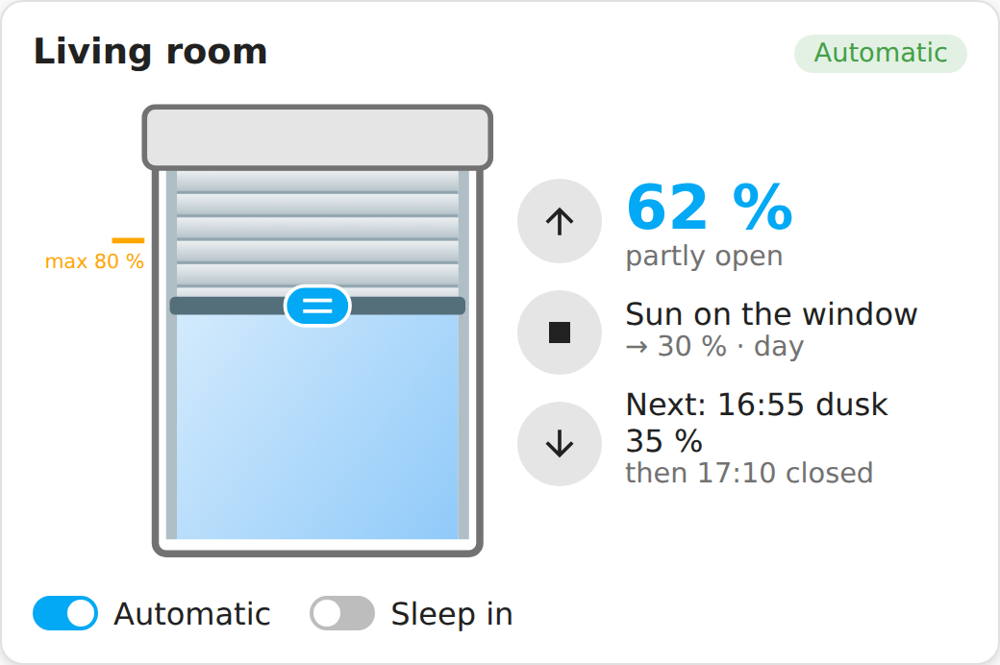
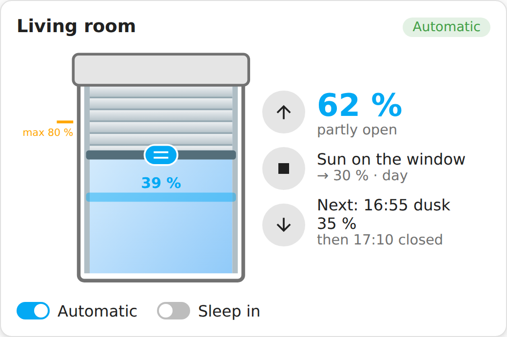
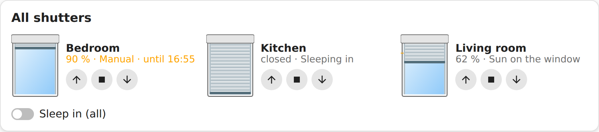

# Lovelace card

The integration ships a card and adds it to every dashboard: no resource to add. Pick **Smart Shutter** in
the card picker, or add it in YAML.



## One shutter

```yaml
type: custom:smart-shutter-card
device_id: <the shutter's device>
```

- **Drawing:** the shutter at its real (calibrated) position. Drag it up or down: a shadow bar shows the
  target, releasing moves the shutter there. This counts as a manual action, so automatic control pauses
  (see *Manual operation*). During a storm the target snaps to fully open or fully closed.
- **Keyboard:** focus the drawing; ↑/↓ 5 %, Page Up/Down 25 %, Home open, End closed, Enter to move,
  Escape to cancel.
- **Maximum position:** an orange mark on the left of the window when it is below 100 %.
- **Buttons:** open, stop, close.
- **Status:** position, why the shutter is where it is (sun, schedule, sleep-in, manual until …, storm,
  frost, winter), and the next two actions of the schedule.
- **Switches:** *Automatic* and *Sleep in*; *Resume* during a manual pause.

Below 360 px wide the status moves under the drawing.

 

## All shutters

Choose the **base controller** as the device: a tile per shutter with a small drawing, its position and
reason, and open/stop/close. Tapping a tile opens the shutter's dialog. *Sleep in (all)* and the storm and
frost warnings are at the top.



## Language

| Option | Meaning |
|---|---|
| card `language: en` or `nl` | this card in that language |
| none | the integration's *Configure → Language*; with *System language*, your profile language |

The integration's language setting also names its entities. Settings screens and state values in Home
Assistant's own cards always follow your profile language.

## Dark theme


