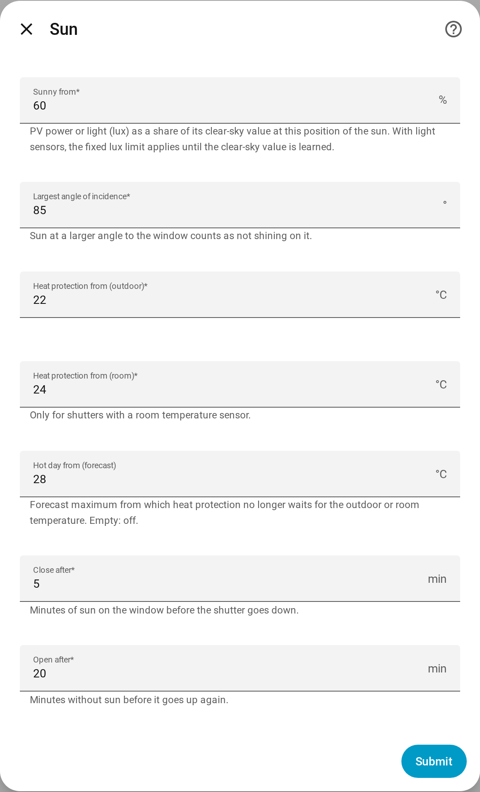
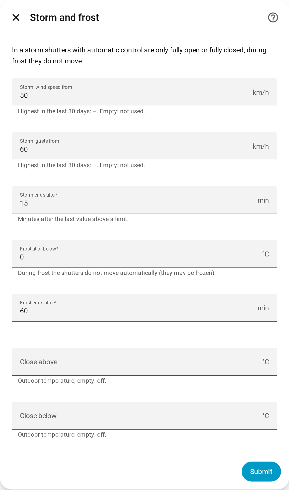
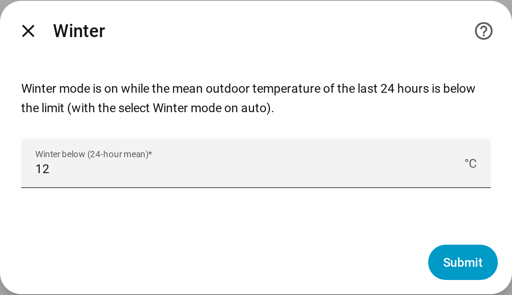
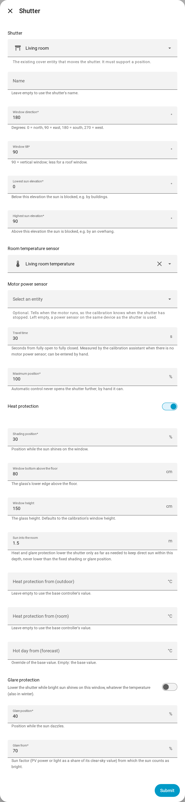

# Configuration

The **base controller** holds the settings for all shutters. Each **shutter** has its own settings and can
override any setting of the base schedule.

| Where | How to open it |
|---|---|
| Sources | *Smart Shutter Control → ⋮ → Reconfigure* |
| Base settings | *Smart Shutter Control → Configure* (menu) |
| A shutter | the shutter's line on the integration page → *Reconfigure* (menu) |

## Sources

| Setting | Default | Effect |
|---|---|---|
| Outdoor temperature | required | frost, heat protection, temperature limits, winter mode |
| Weather | – | fallback for "is it sunny?" without a sun source, or without its values |
| Sun source | PV power | *PV power*, *Light sensors (lux)* or *None*: what tells whether the sun shines (see [How it works](how-it-works.md#is-it-sunny)). Never both; a second page shows only the fields of the chosen source |
| Wind speed sensor | – | storm detection |
| Wind gust sensor | – | storm detection |

Sensors may report in any unit Home Assistant knows: temperatures (outdoor, room, the weather forecast) are
converted to °C and wind speeds to km/h when read, so a sensor in °F or mph works. A value without a unit
counts as °C or km/h. The settings are shown and entered in your unit system: in °C and km/h with metric
units, in °F and mph with US customary units (they are stored in °C and km/h, so switching unit systems keeps
them). Length settings are also shown in your unit system: in cm and m with metric units, in inches and feet
with US customary units (they are stored in cm and m). The defaults below are given in °C and km/h.

Changing the sun source with *Reconfigure* leaves out the fields of the other source: a base controller
never keeps PV sensors and light sensors together. Pick the source, then fill in its page.

Sun source *PV power*:

| Setting | Default | Effect |
|---|---|---|
| PV power sensors | required | one or more, added up |
| PV peak power (kWp) | – | a rough clear-sky curve while the learned reference is young |
| Panel tilt | 35° | degrees from horizontal (0 = flat, 90 = vertical), for that curve |
| Panel direction | 180° | where the panels face (0 = north, 90 = east, 180 = south, 270 = west), for that curve |

Sun source *Light sensors (lux)*:

| Setting | Default | Effect |
|---|---|---|
| Light sensors | required | one or more illuminance sensors; the highest value counts. The page shows each sensor's highest value of the last 30 days, and warns once when one stays below 10 000 lx (it probably saturates) |
| Sunny from (until learned) | 30 000 lx | sunny from this while the learned reference is young (20 % hysteresis) |

## Base settings (*Configure*)

### Schedule

The base schedule: every shutter follows it unless it overrides a setting (see
[Schedule overrides](#schedule-overrides)).

| Setting | Default | Effect |
|---|---|---|
| Slit on weekdays | 08:00 | start of the slit phase on working days |
| Open on weekdays | 08:30 | start of the day phase on working days |
| Slit on weekends and holidays | 10:00 | the same on weekend days and holidays |
| Open on weekends and holidays | 10:30 | the same on weekend days and holidays |
| Slit phase | on | off: no slit phase, straight from night to day |
| Not before sunrise | off | on: slit and open wait for sunrise (+ minutes after sunrise) when that is later |
| Minutes after sunrise | 0 | only with *Not before sunrise*; −120 to 120 |
| Dusk phase | on | off: no dusk phase, straight from day to night |
| Dusk: minutes after sunset | 0 | start of the dusk phase; −120 to 120. A dusk that would start at or after the close time is left out |
| Dusk position | 35 % | position during dusk |
| Close: minutes after sunset | 15 | start of the night; −120 to 180 |
| Close not before | – | the night never starts earlier than this |
| Close not after | – | the night never starts later than this. Also used instead of sunset where the sun does not set (polar day or night); without it 21:00 |
| Open position | 100 % | position during the day (never above the shutter's maximum position) |
| Slit (module position, uncalibrated) | 20 % | the slit for shutters that are not calibrated; a calibrated shutter uses its measured lift point (see [Calibration](calibration.md#the-assistant)) |
| Sleep in until | 12:00 | sleep-in ends at the latest at this time. A sleep-in switched on after this time today is for tomorrow morning |
| After a manual action | pause until the next phase | *pause until the next phase*, *pause for a while* or *ignore* (see [manual operation](how-it-works.md#manual-operation)) |
| Pause after a manual action | 120 min | only for *pause for a while* |
| Storm position | nearest | *nearest* end, always *open* or always *closed* during a storm |
| Winter mode | on | off: winter mode does not apply |
| Winter: closed all day at or below | −5 °C | in winter the shutter stays closed all day at or below this outdoor temperature; empty: off |

**Examples** (defaults: slit 08:00, open 08:30, dusk 0 min and close 15 min after sunset):

| Situation | Result |
|---|---|
| Summer weekday, sunset 21:40 | night until 08:00, slit 08:00, day 08:30, dusk 21:40 (35 %), night 21:55 |
| *Close not after* 21:30, same evening | the close time 21:55 becomes 21:30, which is before the dusk time 21:40: no dusk phase, day goes straight to night at 21:30 |
| Winter weekday, sunset 16:30, *Close not before* 18:00 | day until dusk at 16:30 (35 %), night at 18:00 instead of 16:45 |
| *Not before sunrise* on, sunrise 08:10, 0 minutes | slit 08:10 (not 08:00), day 08:30 |
| Same, sunrise 08:40 | the slit would start at 08:40, together with the day: the slit is skipped, night goes straight to day at 08:40 |
| Sunday | the weekend times: slit 10:00, day 10:30 |

### Holidays

On weekend days and holidays the schedules use their weekend times. The page has two steps.

| Setting | Default | Effect |
|---|---|---|
| Public holidays calendar | – | a calendar entity, for example of Home Assistant's *Holiday* integration |
| Weekend days | Saturday, Sunday | days that always use the weekend times |
| Calendar holidays to ignore | – | check boxes with the calendar's holidays; checked ones count as normal days every year |
| Extra holidays | – | one per line: `2026-12-24` (once) or `12-31` (every year), optionally followed by a name |
| Not a holiday | – | dates from the calendar that count as normal days, same format |

The calendar is read when Home Assistant has started, when the calendar becomes available, and every night.

Example: *Extra holidays* with the two lines below make 24 December 2026 a one-off free day, and 31 December
(every year) too. *Not a holiday* with `05-05` makes 5 May a normal working day, also when the calendar lists it.

```
2026-12-24 Christmas Eve
12-31 New Year's Eve
```

A line that cannot be read stops the page with an error naming the line numbers.

### Sun



| Setting | Default | Effect |
|---|---|---|
| Sunny from | 60 % | PV power or light (lux) as a share of its clear-sky value above which it counts as sunny (−15 % hysteresis). With light sensors, the fixed *Sunny from (until learned)* limit in lux applies until the clear-sky value is learned |
| Largest angle of incidence | 85° | sun at a larger angle to the window does not count as shining on it |
| Heat protection from (outdoor) | 22 °C | heat protection only acts at or above this outdoor temperature, or … |
| Heat protection from (room) | 24 °C | … at or above this room temperature (shutters with a room sensor) |
| Hot day from (forecast) | 28 °C | forecast maximum at or above which heat protection no longer waits for the outdoor or room temperature; empty: off |
| Close after | 5 min | sun on the window this long before the shutter goes down |
| Open after | 20 min | no sun this long before it goes up again |

### Storm and frost



| Setting | Default | Effect |
|---|---|---|
| Storm: wind speed from | 50 km/h | storm at or above this wind speed; empty: not used. The page shows the highest value of the last 30 days |
| Storm: gusts from | 60 km/h | the same for gusts |
| Storm ends after | 15 min | after the last value above a limit |
| Frost at or below | 0 °C | during frost shutters do not move automatically |
| Frost ends after | 60 min | after the temperature rose above the limit |
| Close above | – | outdoor temperature above which shutters close, until it is 1 °C lower again; empty: off |
| Close below | – | outdoor temperature below which shutters close, until it is 1 °C higher again; empty: off |

*Close above* and *Close below* come before a manual pause: a shutter you open by hand is closed again while the
limit applies (see [which rule wins](how-it-works.md#which-rule-wins-examples)).

### Winter



| Setting | Default | Effect |
|---|---|---|
| Winter below (24-hour mean) | 12 °C | winter mode is on while the time-weighted mean outdoor temperature of the last 24 hours is below this (1 °C hysteresis), with the select *Winter mode* on *Auto* |

### Away and holiday

When nobody is home the heat can be kept out earlier and glare does not matter; on holiday the schedule times
also shift a little each day so the house looks lived in. See [Away and holiday](how-it-works.md#away-and-holiday).

| Setting | Default | Effect |
|---|---|---|
| Presence entity | none | a `zone.home` (counts the persons in the zone), a `person` or `device_tracker`, a `group` or a `binary_sensor` (on: somebody is home). Empty: the house is never away, unless the *Holiday* switch is on |
| Away after | 15 min | how long nobody must be home before the house counts as away; coming home counts at once |
| Away: heat protection lower by | 3 °C | both heat limits (outdoor and room) are this much lower while away |
| Holiday: time shift up to | 30 min | the largest random shift of the schedule times on holiday; 0: no shift |

### Language

| Setting | Default | Effect |
|---|---|---|
| Language | System language | the language of the card and of the entity names: system, English or Nederlands. Settings screens and state values in Home Assistant's own cards always follow your profile language |

## A shutter

*Reconfigure* opens a menu: **Settings**, **Schedule overrides**, **Reset to the base schedule**,
**Calibrate** (the assistant, or a table of the measured points; see [Calibration](calibration.md)),
**Add a calibration point**, **Horizon** and **Window and door contacts**.

### Settings



| Setting | Default | Effect |
|---|---|---|
| Shutter | required | the cover entity that moves the shutter; it must support a position |
| Name | the cover's name | the name of the shutter's device |
| Window direction | required | degrees, 0 = north, 90 = east, 180 = south, 270 = west: the direction the glass faces (see [examples](#window-direction-tilt-and-sun-elevations)) |
| Window tilt | 90° | degrees from horizontal: 90 = vertical, 0 = flat; less for a roof window |
| Lowest sun elevation | 0° | below this the sun is blocked (buildings, trees); a [horizon](#horizon) can raise it per direction. Must be below the highest |
| Highest sun elevation | 90° | above this the sun is blocked (an overhang, a balcony) |
| Room temperature sensor | – | for *Heat protection from (room)* |
| Motor power sensor | found on the cover's device | tells when the motor runs: used by the calibration and to recognise manual moves at once |
| Travel time | – | seconds from fully open to fully closed; measured by the calibration when there is no motor power sensor |
| Maximum position | 100 % | automatic control never opens the shutter further; by hand it can. Below 100 % the shutter closes in a storm (see [examples](#maximum-position)) |
| Heat protection | on | lower the shutter when the sun shines on the window and it is warm |
| Heat protection position | 30 % | position during heat protection; with the three room fields below the lowest it uses |
| Window bottom above the floor | – | cm (inches with US customary units); with *Window height* and *Sun into the room*: the [shading position follows the sun](how-it-works.md#heat-protection) |
| Window height | the calibration's | cm (inches with US customary units); the height of the glass |
| Sun into the room | – | m (feet with US customary units); direct sun may reach this far over the floor |
| Heat protection from (outdoor) | the base value | override for this shutter |
| Heat protection from (room) | the base value | override for this shutter |
| Hot day from (forecast) | the base value | override of the base forecast limit; empty: the base value |
| Glare protection | off | lower the shutter when bright sun shines on the window, whatever the temperature (see [Glare protection](how-it-works.md#glare-protection)) |
| Glare position | 40 % | position during glare protection; with the room fields the lowest it uses |
| Glare from | 70 % | sun factor from which the sun counts as bright |
| Facade light sensor | – | only with the sun source *Light sensors*: a light sensor at this window that decides for this shutter whether it is sunny |

The form refuses a cover that cannot be set to a position, a cover that already has a shutter controller, and
a *Lowest sun elevation* that is not below the *Highest sun elevation*.

**Settings that are also entities.** *Maximum position*, *Heat protection*, *Heat
protection position*, *Glare protection*, *Glare position* and *Glare from* are entities of the shutter too
(see [Entities](entities.md#each-shutter)). The value in *Settings* is where the entity starts. Once you change
the entity (a dashboard, an automation), the entity's value is kept and the form no longer changes it: change
it through the entity from then on.

### Window and door contacts

All fields are optional. The contacts keep the shutter clear of an open door or give a tilted window a gap.

| Setting | Default | Effect |
|---|---|---|
| Opened contact | – | binary sensor; on means the door or window is open |
| Tilted contact | – | binary sensor; on means the window is tilted |
| Lockout position | 100 % | while opened, automatic control keeps the shutter at least this high |
| Ventilation position | the slit | while tilted, automatic control keeps the shutter at least this high (%) |

How the floors behave, with a timeline, is under [Lockout and ventilation](how-it-works.md#lockout-and-ventilation).

### Horizon

A table with a row per point: *Sun direction (°)* (0 to 360) and *Lowest elevation (°)* (0 to 60). The button
*Sun has left the window* adds points; here you can correct, add or remove them. A direction may appear only
once. Leave the table empty for no horizon. See [Sun on the window](how-it-works.md#sun-on-the-window) and the
[example](#horizon-profile).

### Schedule overrides

The same fields as the [base schedule](#schedule). Every field is empty or *Inherit* by default: the shutter
then follows the base schedule, whose value is shown under the field. Fill in a value to override that one
setting. *Reset to the base schedule* clears all overrides of the shutter.

The sensor *Next action* has an attribute `overrides` listing what the shutter overrides.

## Examples

Worked examples for the settings that are hardest to get right. The shutters are made up:
`cover.living_room`, `cover.bedroom`.

### Window direction, tilt and sun elevations

The **window direction** is the direction the glass faces: look out of the window, the compass reading in
front of you is the direction. Lay a compass app flat against the glass, top edge pointing outward.

| The window of `cover.living_room` faces | Window direction |
|---|---|
| north-east | 45° |
| south | 180° |
| a little west of south (20°) | 200° |
| south-west | 225° |

The sun counts as **on the window** when its angle of incidence is below the *Largest angle of incidence*
(85°). For a south window (180°) with a vertical glass:

| Sun azimuth | Sun elevation | Angle of incidence | On the window? |
|---|---|---|---|
| 150° | 30° | 41° | yes |
| 255° | 20° | 76° | yes |
| 265° | 20° | 85.3° | no, just past the limit |
| 270° (due west) | 10° | 90° | no: the sun is in the plane of the glass |

A **roof window** on a south slope with a 40° pitch has *Window direction* 180° and *Window tilt* 40°. The
sun at azimuth 180° and elevation 50° then shines straight onto the glass (0°). (A window with a tilt other than 90°
uses the fixed heat protection and glare positions: the room geometry below only works for vertical glass.)

**Lowest sun elevation** and **Highest sun elevation** block the sun by height:

- The roof of the neighbour's house reaches 12° above the horizon as seen from the window: set *Lowest sun
  elevation* to 12. A sun below 12° is not on the window, so heat protection does not start for it.
- The balcony above the window keeps the sun off the glass once it is higher than 55°: set *Highest sun
  elevation* to 55.

For a blocker that is high in one direction and low in another, use the [horizon](#horizon-profile).

### Maximum position

`cover.bedroom` has a *Maximum position* of 80 %, because the shutter is stopped by a plant on the sill
when fully open. Then:

| What asks for a position | Result |
|---|---|
| the schedule, *Open position* 100 % | 80 % |
| heat protection, *Heat protection position* 30 % | 30 % (the maximum only limits upward) |
| the schedule closes the shutter (night, 0 %) | 0 %: closing is never limited |
| you drag the card or press open on the cover | 100 %: by hand it can go further |
| the action `set_lock` with `force_open` | 100 %: an explicit order |
| an opened door contact with *Lockout position* 100 % | 100 %: safety goes first |
| a tilted window contact with *Ventilation position* 90 % | 80 %: comfort stays within the maximum |
| storm | 0 %: below 100 % the shutter closes in a storm, because there is no safe open end |

### Shading depth and room geometry

Heat and glare protection normally go to a fixed position (*Heat protection position*, *Glare position*).
With three room measurements they go down only as far as needed. The living room: the glass starts 90 cm
above the floor (*Window bottom above the floor* 90), is 150 cm high (*Window height* 150), and direct sun may
reach 2 m into the room (*Sun into the room* 2), for example up to the sofa. *Heat protection position* is
30 %. For a south window and the sun straight in front of it:

| Sun elevation | Position that keeps the sun within 2 m | Used (rounded down to 10 %, at least 30 %) |
|---|---|---|
| 25° | 2 % | 30 % |
| 30° | 17 % | 30 % |
| 40° | 52 % | 50 % |
| 45° | 73 % | 70 % |
| 50° | 99 % | 90 % |
| 55° | 100 % | 100 % (the shutter stays open) |

Sun that comes in at an angle is longer on its way to the floor: at elevation 40° with the sun 45° to the
side the position is 98 %, used 90 %. The position changes at most once per 15 minutes. The formula is in
[How it works](how-it-works.md#heat-protection).

### Horizon profile

Buildings and trees block a low sun at different heights per direction. On a clear evening, when the sun
disappears behind something while heat or glare protection holds the shutter down, press the button *Sun
has left the window*. The sun's direction and its elevation (plus 0.1°) become a point. Say you record two
points over two evenings: direction 200° at elevation 25.0° (a tall tree) and direction 230° at 12.0° (a
lower roof). *Lowest sun elevation* is 0°:

| Sun direction | Horizon used | Why |
|---|---|---|
| 184° | none (0°) | more than 15° before the first point |
| 185° | 25.0° | the first point holds 15° before itself |
| 200° | 25.0° | the point |
| 215° | 18.5° | halfway between the two points: 25 − (25 − 12) × 15 / 30 |
| 230° to 245° | 12.0° | the last point holds 15° further |
| 246° | none (0°) | more than 15° after the last point |

The higher of the horizon and *Lowest sun elevation* counts: with a *Lowest sun elevation* of 15°, the sun at
direction 235° needs more than 15°, not 12°. A new point within 3° of direction of an existing one replaces
it. *Reconfigure → Horizon* shows the table to correct it.
