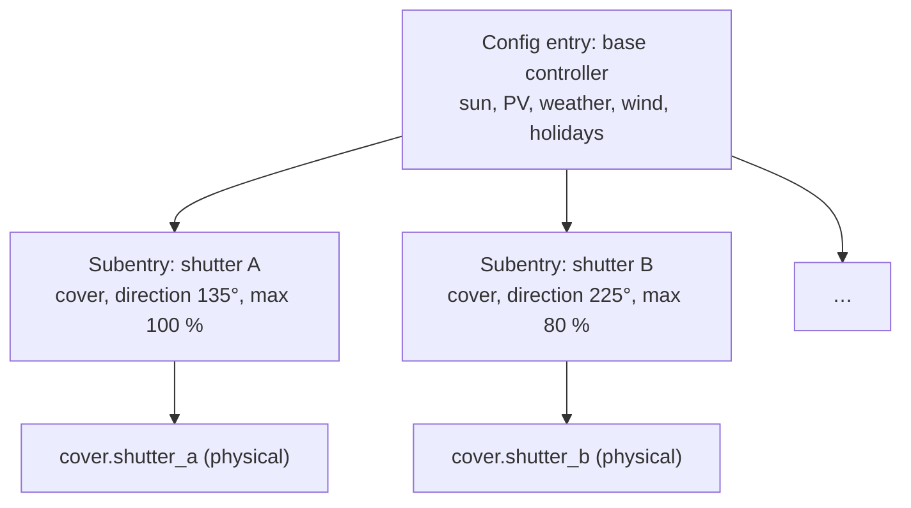
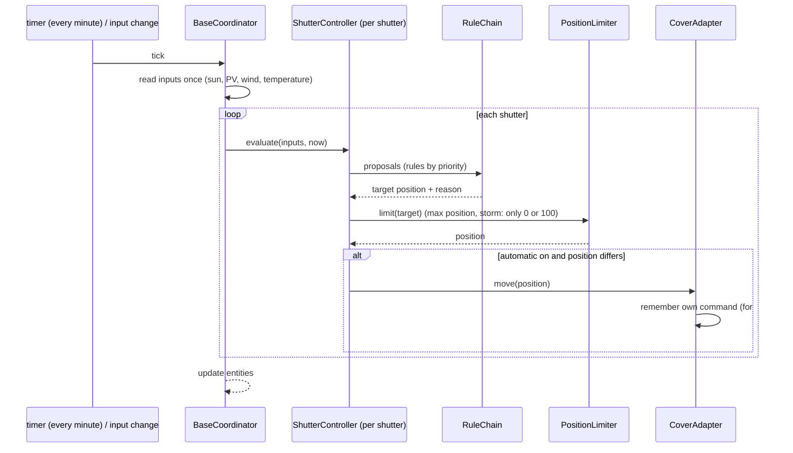
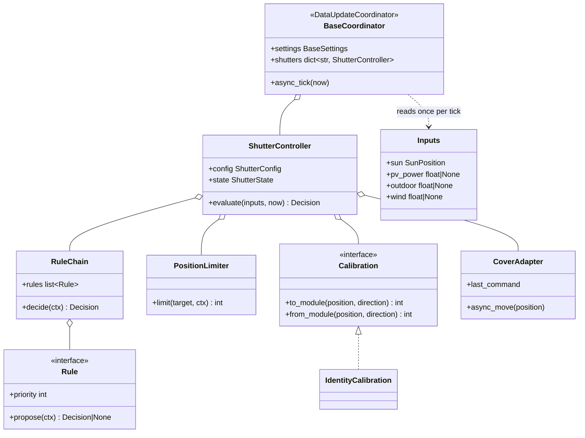

# Base controller and a device per shutter

- Issue: #2
- Status: **approved** (2026-11-20)
- Date: 2026-11-19
- Depends on: #1

## 1. Purpose

One **base controller** with the settings that apply to all shutters, and one **shutter controller** per
roller shutter, each a device of its own. This issue builds the structure: configuration, devices,
entities, the evaluation loop and the frame in which the rules of #3–#7 and the calibration of #10 fit. The
rules themselves come later; in this issue a shutter only follows a fixed default (no automatic moves).

## 2. Home Assistant structure

| Level | Home Assistant concept | Created with |
|---|---|---|
| Base controller | config entry + device "Smart Shutter Control" | *Add integration* |
| Shutter controller | config subentry of type `shutter` + device per shutter | *Add shutter* on the integration page |

- Config subentries let a user add, change (*Reconfigure*) and remove a shutter without touching the others.
- Each shutter device is linked to the base device (`via_device`), so the device page shows the hierarchy.
- One base controller is enough for a house; several are possible (e.g. two buildings).

## 3. Base controller settings

Set when adding the integration, changed with *Configure* (options) or *Reconfigure* (sources).

| Key | Name in the UI | Required | Used by |
|---|---|---|---|
| `pv_power` | PV power sensor(s) (one or more, summed) | no | clouds (#3) |
| `pv_peak` | PV peak power (kWp) | with `pv_power` | expected clear-sky power (#3) |
| ~~`pv_forecast`~~ | ~~PV forecast sensor~~ | – | removed in 0.6.1: never used |
| `outdoor_temperature` | Outdoor temperature | yes | heat protection, frost (#3, #6, #7) |
| `weather` | Weather | no | clouds fallback (#3) |
| `wind_speed` | Wind speed sensor | no | storm (#6) |
| `wind_gust` | Wind gust sensor | no | storm (#6) |
| `storm_limit` | Storm limit (km/h, wind or gust) | with a wind sensor | storm (#6) |
| `holidays` | Holidays (list) | no | weekend times (#4) |

- The sun position comes from Home Assistant's own location (latitude, longitude, elevation), computed in
  `core/` (no dependency on the `sun` integration's update interval).
- Settings of rules that do not exist yet are added by their own issue; the options flow is a menu so each
  rule gets its own page: *Sources*, *Storm and frost*, *Holidays*, …

## 4. Shutter settings (subentry)

| Key | Name in the UI | Default | Meaning |
|---|---|---|---|
| `cover` | Shutter | – | the existing cover entity that moves the shutter (must support `set_position`) |
| `name` | Name | the cover's name | device name |
| `azimuth` | Window direction | – | degrees, 0 = north, 90 = east, 180 = south, 270 = west |
| `tilt` | Window tilt | 90° | 90 = vertical window, less for roof windows |
| `min_elevation` / `max_elevation` | Sun elevation limits | 0° / 90° | outside these limits the sun is blocked (neighbouring buildings, overhang) |
| `room_temperature` | Room temperature sensor | none | heat protection (#3) |
| `max_position` | Maximum position | 100 % | automatic control never goes above it |

The maximum position is also a number entity (§5), so it can be changed from a dashboard; the subentry holds
its default.

## 5. Entities

Per **shutter device**:

| Key | Platform | Meaning |
|---|---|---|
| `shutter` | cover | the shutter with its calibrated position (#10; until calibrated: the module position). Commands go to the physical cover. Manual use of this entity counts as manual operation (#5). |
| `automatic` | switch | automatic control on/off; off = only manual operation, the controller never moves this shutter |
| `max_position` | number | 0–100 %, step 5 |
| `reason` | sensor (enum) | why the shutter is where it is: `manual`, `off`, `schedule`, `sun`, `storm`, `frost`, `sleep_in`, `winter`, `idle` (values added by their issues) |
| `next_action` | sensor (timestamp) | when the controller will next move the shutter; attributes `position` and `reason` |

Per **base device**: none in this issue; later e.g. a storm binary sensor (#6) and a sleep-in switch for all
shutters (#4).

Unique IDs: `<entry_id>_<subentry_id>_<key>`; entity IDs follow the device name (e.g.
`switch.living_room_shutter_automatic`).

## 6. Evaluation

- **Inputs** are read once per tick for all shutters (sun, PV, wind) and passed in: no rule reads Home
  Assistant itself.
- **Rules** (one class per rule, added by #3–#7) each return a decision (`position`, `reason`) or nothing.
  The chain asks them in priority order and takes the first proposal: safety (#6) > manual pause (#5) >
  sleep-in (#4) > sun (#3) > winter (#7) > schedule (#4). In this issue the chain is empty, so the reason
  is `idle` and nothing moves.
- **Limiter**: never above the maximum position; in a storm only 0 or 100, and 0 when the maximum position
  is below 100 (#6).
- **Adapter**: the only place that calls `cover.set_cover_position` on the physical cover. It sends only a
  change, and remembers what it sent and when, so #5 can tell its own moves from manual ones.
- **Calibration** (#10) sits between the controller and the adapter: real position → module position for
  the direction of travel. Until #10 it is the identity.

## 7. Classes

| Pattern | Where | Why |
|---|---|---|
| Chain of responsibility | `RuleChain`, `Rule` | each rule in its own class, priority in one place; new rules without changing others |
| Strategy | `Calibration` | identity now, roller model with #10 |
| Adapter | `CoverAdapter` | one place that talks to the physical cover; easy to fake in tests |
| Observer | coordinator → entities | entities update from the coordinator |
| Repository | `Store` for runtime state | pause, sleep-in and last command survive a restart |

`core/` holds `ShutterConfig`, `Inputs`, `ShutterContext`, `Decision`, `RuleChain`, `Rule`, `PositionLimiter`,
`Calibration` and the sun geometry (#3), without Home Assistant imports.

## 8. Runtime state

Stored per shutter with Home Assistant's `Store`: automatic on/off, last command (position, time), and later
pause (#5) and sleep-in (#4). After a restart the controller does not move a shutter until its inputs are
available and one full tick has run.

## 9. Tests

- Core: rule chain order, limiter (maximum position, storm), identity calibration.
- Home Assistant: adding the integration and two shutters, the devices and their link to the base device,
  entities with translations, reconfigure of a shutter, removing one shutter keeps the other, switch
  `automatic` off means no `set_cover_position` call, the cover entity forwards commands.

## 10. Out of scope

The rules (#3–#7), calibration (#10), the card (#9).
