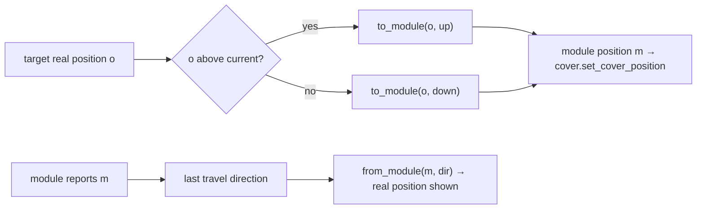
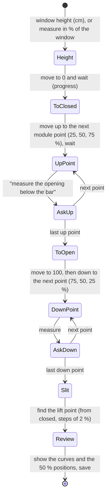
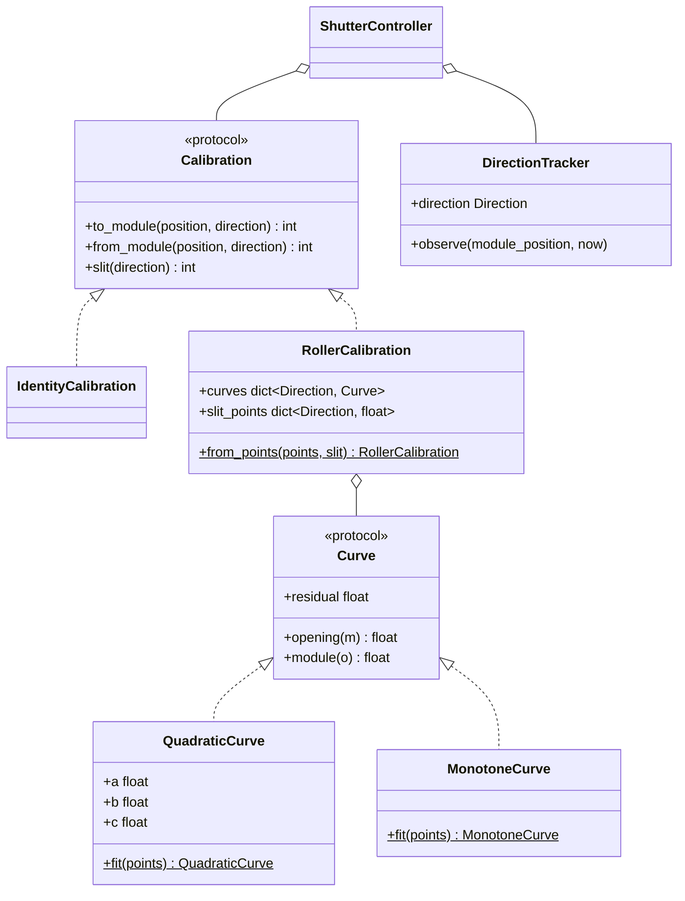

# Calibrated positions

- Issue: #10
- Status: **approved** (2026-11-20)
- Date: 2026-11-20
- Depends on: #2 (the `Calibration` strategy and the shutter cover entity)

## 1. Purpose

A position of 50 % must mean that the shutter is half way down the window, whether it comes from closed or
from open. This design adds a calibration per shutter, an assistant to measure it, and the conversion in both
directions.

## 2. Why module positions are not real positions

Most shutter modules (for example the common Z-Wave flush shutter modules) know only the travel time
between the end positions. They report "50 %" after half of the travel time. Three effects make that
different from half of the window:

1. **The roller grows.** The motor turns at a nearly constant speed. Every turn winds a circumference
   2πr onto the roller, and r grows with each layer of slats. With slat thickness d per layer, the wound
   length after an angle θ is (Archimedean spiral)

   ```
   L(θ) = r₀·θ + d·θ² / (4π)
   ```

   So the shutter moves slowly at first and faster later while opening, and fast at first and slower later
   while closing. In both directions it is **lower** than half way at 50 % of the travel time.
2. **Slat gaps.** From the fully closed position, the first part of the travel only pulls the slats apart
   (light gaps) before the bottom bar lifts. Going down, the bar reaches the sill before the gaps close.
3. **Direction.** Many modules use one travel time for both directions. If the motor is slower going up
   (it lifts the weight) than going down, the same module position is a different real position in each
   direction. The end positions are still right, because the module runs on until its limit switch.

## 3. Model

Positions are fractions here: module position `m` and real opening `o`, both 0 (closed) … 1 (open), where
`o` is the height of the opening below the bottom bar divided by the window height.

From §2, with a constant motor speed per direction (θ proportional to `m` with a factor per direction) and
the gap zone as an offset, the real opening per direction `dir` (up, down) is a clipped quadratic:

```
o_dir(m) = clamp(a_dir·m + b_dir·m² − c_dir, 0, 1)
```

- `a`, `b` (≥ 0) follow from r₀, d and the speed in that direction; `c` from the gap zone.
- The point where the bottom bar starts to lift is `m_lift,dir`, the root of `a·m + b·m² = c`.
- The curve must be increasing on [m_lift, 1]: `a + 2b·m > 0` there.
- **Fit** per direction: least squares through the measured points of that direction above the sill. With
  three or more points `a`, `b` and `c` are free: the slower direction may not be fully open at the end of
  the module's travel time (the module runs on to its limit switch), so `o(1)` can be below 1 and the curve is
  clipped at 1. With two points the end is fixed at `o(1) = 1`. A negative `b` (a shrinking roller) falls back
  to a straight line.
- **Fallback:** if the quadratic leaves a residual above 3 % of the window height, or the curve is not
  increasing, the calibration uses a monotone cubic (Fritsch–Carlson, like PCHIP) through the points and the
  ends (0, 0) and (1, 1). Adding a point (§5) improves either.
- At least two measured points between the ends are needed per direction; a direction without enough points
  uses the other direction's curve.
- **Not calibrated:** `IdentityCalibration` (as in #2).

### 3.1 Conversions

| Method | Meaning |
|---|---|
| `to_module(o, dir)` | the module position to send to reach real position `o` moving in direction `dir`: the inverse of `o_dir`, solved from the quadratic (or by bisection for PCHIP); `o = 0` → module 0, `o = 1` → module 1 |
| `from_module(m, dir)` | the real position for a module position reached moving in `dir` |

- **Direction of a command:** up when the target is above the current real position, else down.
- **Direction of a report:** the shutter controller watches the module position. While it changes, the
  direction is known; when it stops, the last direction is kept and used for `from_module`. After a restart
  without a known direction, `down` is assumed below 50 % and `up` above (the error is at most the difference
  between the two curves at that point).
- **Slit position.** Real positions between 0 and the start of the lift do not exist: the bar is on the sill.
  The module positions in the gap zone are offered as a separate *slit* target, `m_slit,dir` (default: the
  lift point, so all gaps are open but the bar has not lifted). The profiles of #4 can choose *slit* or a real
  position.



## 4. Calibration data

Stored in the shutter's subentry data (survives updates, changed only through the assistant or a manual
edit of points in the same flow):

```json
{
  "calibration": {
    "window_height_cm": 140,
    "points": {
      "up":   [[0.25, 0.12], [0.50, 0.33], [0.75, 0.61]],
      "down": [[0.75, 0.58], [0.50, 0.30], [0.25, 0.10]]
    },
    "slit": {"up": 0.10, "down": 0.08}
  }
}
```

Points are `[module position, real opening]` as fractions. The fitted coefficients are not stored; they are
computed at start-up, so a better model in a later version is used automatically.

## 5. Calibration assistant

The *Reconfigure* flow of a shutter becomes a menu: **Settings** (the form of #2) and **Calibrate**.



- **Moving and waiting** use the shutter's module directly (no calibration, no limits). A progress step waits
  until the position has been stable for 3 s (timeout: 2 × the longest travel seen, at most 3 min).
- **Measuring:** the opening in cm (with the window height), or in % if no height is given. 0 is allowed
  (bar still on the sill).
- **Lift point:** from closed the assistant moves up in steps of 2 % module position and asks *"Has the
  bottom bar lifted from the sill?"* until the answer is yes; the step before is `slit`.
- **Review page:** for each direction, the module position for real 25 / 50 / 75 % and the largest residual.
  If the two directions differ by more than 5 % at 50 %, the page says so (a sign of different speeds up and
  down).
- During the assistant, automatic control of that shutter is paused; it resumes afterwards.
- **Points can be added later** without measuring again: the menu has *Add a point*, which moves to a chosen
  module position from a chosen direction and asks for the opening.

## 6. Classes



- `RollerCalibration.from_points` chooses `QuadraticCurve` per direction and falls back to
  `MonotoneCurve` (factory method).
- `Curve` is a strategy, so another model can be added without changing the calibration.
- Everything in `core/calibration.py` without Home Assistant imports. Positions at the interface are
  integers 0–100; internally fractions.

## 7. Entities

| Entity | Change |
|---|---|
| shutter cover | position = calibrated real position; attributes `module_position`, `direction`, `calibrated` (true/false), `slit` |
| new: sensor `calibration` (diagnostic) | `calibrated` / `not_calibrated`; attributes: points, model per direction (`quadratic` / `monotone`), residuals, module position at real 50 % per direction |

## 8. Tests

- `QuadraticCurve`: fit of points generated from the spiral model with noise; residual; inverse; clipping at
  the gap zone; monotonicity check.
- `MonotoneCurve`: fallback for points the quadratic cannot follow.
- `RollerCalibration`: 50 % from closed and from open give the same real position with different module
  positions when the two curves differ; ends 0 and 100 map to 0 and 100.
- `DirectionTracker`: direction while moving, kept when stopped, the default after a restart.
- Home Assistant: the assistant from start to save with a simulated cover (moves to the requested position
  after a delay), cancelling restores automatic control, the cover entity shows the calibrated position, the
  calibration sensor.

## 9. Out of scope

Automatic calibration without measurements (e.g. from the motor's power use); slat tilt of venetian blinds.
