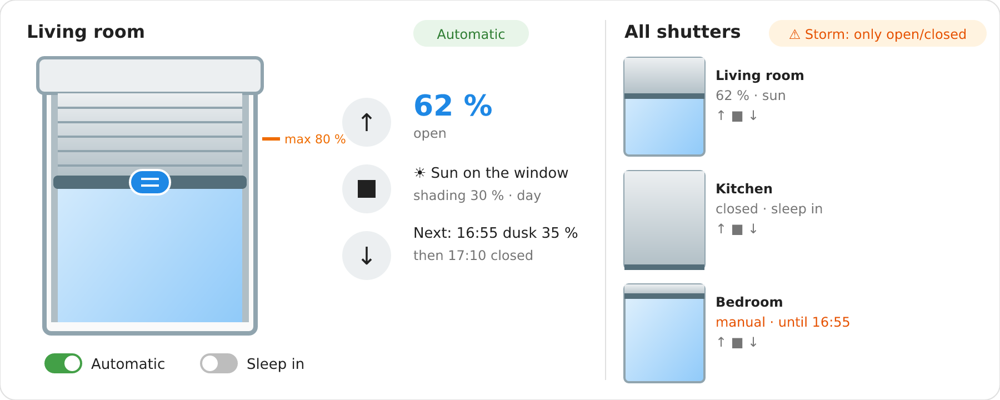
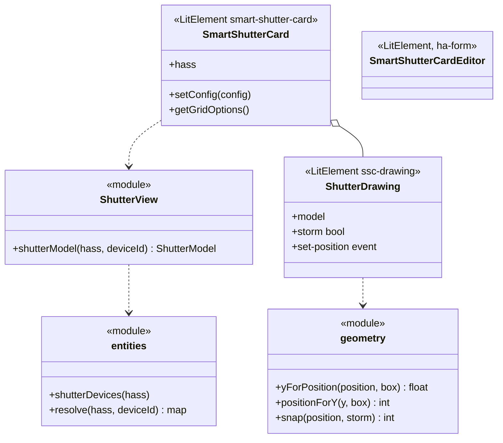

# Lovelace card

- Issue: #9
- Status: draft
- Date: 2026-11-20
- Depends on: #2 (entities), #4–#7 (status), #10 (calibrated position)

## 1. Purpose

A card to see and operate each shutter: a drawing at its real (calibrated) position that can be dragged to
a new position, up/stop/down buttons, and the status in words. It ships with the integration, so installing
or updating through HACS is enough.

## 2. Two views

| Config | Shows |
|---|---|
| `device_id` of a shutter | one shutter, large (left in the sketch) |
| `device_id` of the base controller | all its shutters, compact, in a grid (right in the sketch) |

The visual editor offers the devices of the integration; the base controller is listed as "All shutters".

## 3. One shutter

- **Drawing:** window frame, box on top, guide rails, slats down to the real position, the bottom bar with a
  handle, the glass below. The real position is the cover entity of the integration (calibrated, #10).
- **Maximum position:** a mark beside the window with "max 80 %" when below 100 %.
- **Moving:** while the shutter moves (cover state opening/closing) the slats glide to the new position and a
  small arrow shows the direction; with reduced motion, no animation.
- **Drag:** pointer down on the drawing, drag up or down: a shadow bottom bar shows the target with its
  percentage; release sends `cover.set_cover_position` to the integration's cover (a manual action, #5). On a
  touch screen a vertical drag on the drawing moves the shutter, so the page scrolls only outside it.
  Keyboard: the drawing can be focused, ↑/↓ 5 %, Home open, End closed, Enter sends.
- **During a storm** the drag snaps to the ends (only open or closed), like the integration does (#6).
- **Buttons:** ↑ open, ■ stop, ↓ close on the integration's cover.
- **Status**, in the user's language:

| Line | From |
|---|---|
| position: "62 %" and "open", "closed", "slit" | cover position, sensor `stand` |
| reason: sun, schedule, sleep-in, manual pause until …, storm, frost, winter, off | sensor `reason`, binary sensor `manual_pause` |
| next action: "16:55 dusk 35 %", then the one after | sensor `next_action` (attribute `following`, new) |

- **Chips:** "Automatic" (or "Manual pause"/"Off"), and a warning chip during a storm or frost.
- **Switches:** *Automatic* and *Sleep in*.

## 4. All shutters

A grid of compact tiles: a small drawing, name, position and reason, and ↑ ■ ↓. Tapping a tile opens the
more-info dialog of the shutter's cover. Storm/frost chip and *Sleep in (all shutters)* at the top.

## 5. Size

Adapts to its width like the pond card: below 360 px the status goes under the drawing; in a sections
dashboard one shutter needs at least 6 of 12 columns, the overview takes the full width by default.

## 6. Delivery and structure

As the pond planner card: TypeScript, Lit, esbuild; the built bundle is committed in
`custom_components/smart_shutter_control/frontend/` and served by the integration
(`/smart_shutter_control/smart-shutter-card.js`, versioned URL); no Lovelace resource needed.

- Entities are found by their translation keys on the shutter's device (not by entity ID), so renamed
  entities keep working.
- The view model is pure (no DOM) and tested with Vitest; the card and drawing are tested in jsdom.

## 7. Backend change

`next_action` gets an attribute `following` with the next two phase changes (time, phase, position), for the
"then …" line.

## 8. Tests

- Geometry: position ↔ y, snapping in a storm, clamping.
- View model: status lines for each reason, the manual pause with its end, the next actions, the maximum mark.
- Card: one shutter and the overview render; drag sends the right position (and only an end during a storm);
  keyboard; buttons call open/stop/close; switches call turn_on/off; missing device message.
- Screenshots for the README and the docs (light and dark), as for the pond card.

## 9. Out of scope

Grouping shutters by room in the overview; slat tilt of venetian blinds.
