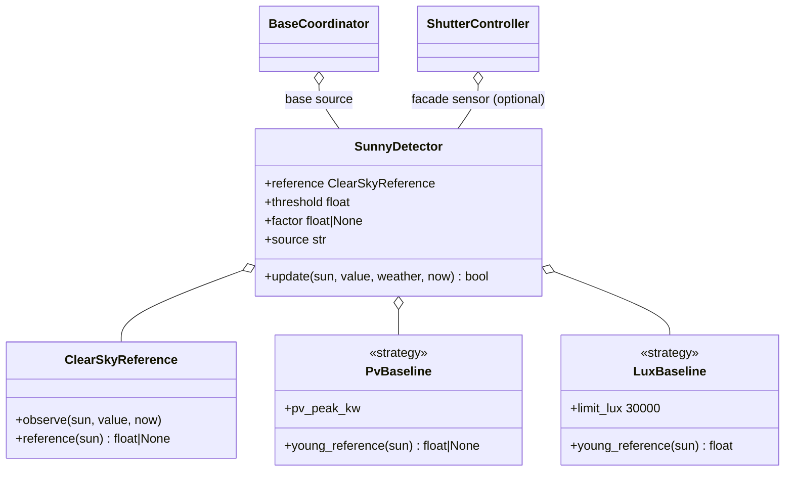

# Light sensors as the sun source

- Issue: #26
- Status: **approved** (2026-11-20)
- Date: 2026-11-20
- Depends on: #3 (sun factor, clear-sky reference, heat protection)

## 1. Purpose

Decide "is it sunny?" from light sensors (lux) instead of PV power, for houses without PV or with a light
sensor that sees the sun better. A base controller uses **either** PV **or** light sensors, never both.

## 2. Choosing the source

The sources page gets a select **Sun source**:

| Sun source | Fields that follow | "Is it sunny?" from |
|---|---|---|
| PV | PV power sensors, PV peak power | PV power (as now, #3) |
| Light sensor | light sensors (lux), sunny from (lux) | the highest light sensor value |
| None | – | the weather entity, else geometry only |

- The sources flow gets a second step with only the fields of the chosen source, so both can never be set.
- Existing entries: PV sensors set → *PV*, otherwise *None* (migration at start-up, nothing changes for the
  user).
- Switching the source clears the fields of the other source and starts a new learned reference (the old
  one is kept, so switching back does not start from zero).

## 3. Light sensors on the base controller

- One or more `sensor` entities with device class *illuminance*; the **highest** value counts (a sensor in
  the shade does not pull the value down).
- **Learned reference**, as for PV: per cell of the sky (azimuth 10° × elevation 5°) the 95th percentile of
  the daily highest lux of the last 30 days. Sun factor = lux / reference, sunny from 60 % (the existing
  *Sunny from* setting), 15 % hysteresis.
- **Start:** until a cell has 7 days of data, a fixed limit **Sunny from (lux)** applies, default
  30 000 lux, with 20 % hysteresis. The sun factor is then `lux / (limit / sunny_threshold)`, so the sensor
  *Sun factor* means the same in both cases.
- The sources page shows each sensor's **highest value of the last 30 days**. A sensor that never comes above
  about 10 000 lux probably saturates (many motion sensors do) and cannot tell sun from bright cloud; the page
  says so.

## 4. A light sensor per shutter (optional)

- Only when the sun source is *Light sensor*: a shutter can have its own **facade light sensor**.
- That sensor then decides "is it sunny?" for that shutter only, with its own learned reference and the same
  start limit. The window geometry (sun on the window, #3) still applies.
- Shutters without one use the base controller's light sensors.

## 5. Entities

| Entity | Change |
|---|---|
| base sensor *Sun factor* | attribute `source`: `learned`, `pv_peak`, `lux_learned`, `lux_limit`, `weather`, `geometry`; new attribute `lux` (highest value) |
| shutter binary_sensor *Sun on the window* | with a facade sensor: attributes `sunny`, `sun_factor`, `lux` |

## 6. Classes

- `SunnyDetector` stays one class; what differs per source (the fallback while the reference is young) is a
  small strategy. The learned reference is the same code for PV and lux.
- The base references are stored separately (`clear_sky` for PV, `clear_sky_lux` for light), a facade
  sensor's reference with its shutter.
- The heat protection rule (#3) asks the shutter's detector when it has one, else the base one.

## 7. Tests

- Sun source select: only the chosen fields; migration of existing entries; switching keeps the old
  reference.
- Lux: highest of several sensors; the start limit with hysteresis; the learned reference after 7 days; the
  factor means the same before and after.
- Facade sensor: sunny for one shutter while the base says not sunny, and the other way round; heat
  protection follows it; not offered with PV.
- The 30-day maximum and the saturation note on the sources page.

## 8. Out of scope

Using PV and light sensors together; light sensors to decide the evening (dusk by lux).
