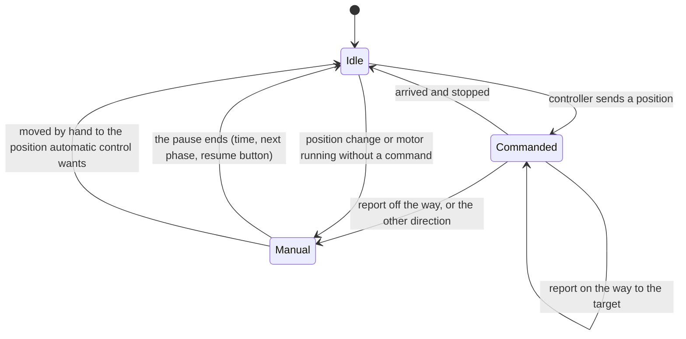
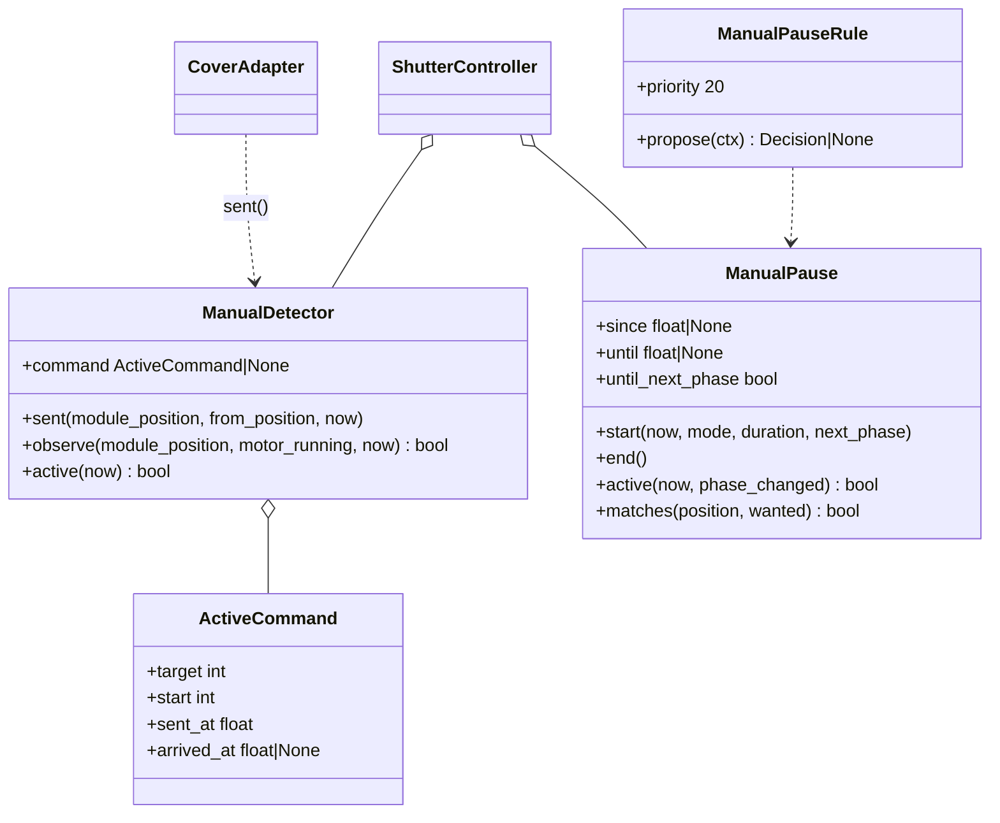

# Respect manual operation

- Issue: #5
- Status: **approved** (2026-11-20)
- Date: 2026-11-20
- Depends on: #2 (adapter remembers its commands), #4 (phases end a pause); uses the motor power of #16

## 1. Purpose

When someone moves a shutter by hand (wall switch, remote, app, dashboard, voice, another automation),
automatic control leaves it where it was put instead of moving it back at the next tick. Safety still
applies.

## 2. What counts as manual

Every position change of the shutter that the controller did not cause:

| Change | Manual? |
|---|---|
| reports while the shutter moves towards a position the controller sent | no |
| the shutter moves while the controller sent nothing, or away from what it sent | yes |
| a command through the integration's own shutter entity or *Opening* number | yes (recognised at once) |
| a move by the calibration assistant | no |

### 2.1 Telling own moves from manual ones

The adapter remembers each command it sends: module position, time, and whether it was automatic (#2).
A command is **active** from the moment it is sent until the shutter has arrived and stopped:

- with a motor power sensor: until the motor has been idle for 2 s after running, plus 30 s for the late
  position report (as in the calibration, #16);
- without one: until the module reports the commanded position, or at most `travel time + 30 s`
  (the measured travel time of #18, default 120 s).

While a command is active, reports between the starting position and the commanded position (±2 %) are
own moves. Any other change is manual:
- a report outside that range, or moving the other way;
- a change while no command is active;
- the motor running while no command is active (with a power sensor this is seen within a second, before
  any position report).

## 3. What happens after a manual action

Behaviour per shutter, with a base value in the base controller (inherited, overridable as in #4):

| `manual_mode` | Meaning |
|---|---|
| `until_next_phase` (default) | automatic control leaves the shutter alone until the next phase change of its schedule (#4) |
| `for_duration` | … for `manual_duration` (default 2 h) |
| `ignore` | no pause; the next rule decides again at the next tick |

- **Pause rule** (priority 20): while paused it decides *leave it where it is*, a final decision, so heat
  protection (#3, a cap) and the schedule do not move it. Only safety (#6, priority 10) still can.
- **Back to automatic by hand:** when a manual action brings the shutter (at rest) to the position automatic
  control would want at that moment, the pause ends and automatic control resumes. Example: the schedule
  wants the shutter fully open, someone set it to 40 % by hand (pause); moving it to 100 % by hand resumes
  automatic control.
  - "Would want" is the decision of all rules except the pause, after the limits (maximum position, caps):
    the same position the controller would send if there were no pause.
  - Within 2 % counts as equal (whole module percents, #10).
  - A manual action that ends exactly at that position starts no pause at all.
  - When no rule wants a position (idle), there is nothing to match and the pause runs its normal course.
- **Sleep-in ends** on a manual action (#4).
- **Resume:** a button *Resume automatic control* per shutter ends the pause and **moves the shutter at
  once** to the position automatic control wants (evaluated right away, not at the next phase change).
  Turning the switch *Automatic control* on does the same. When the pause ends by itself (time or next
  phase), the shutter also moves to the wanted position straight away. When no rule wants a position
  (idle), it stays where it is.
- **After a restart:** the pause and its end are stored with the runtime state and still apply.

## 4. Entities

| Entity | Meaning |
|---|---|
| binary_sensor `manual_pause` | on while automatic control is paused after a manual action; attributes `since`, `until` (time or "next phase"), `source` (`switch` = outside Home Assistant or another automation, `entity` = the integration's own entities) |
| button `resume` | end the pause now |
| sensor `reason` | new value `manual` |

## 5. Classes

- `ManualDetector`, `ManualPause` and `ManualPauseRule` live in `core/`, without Home Assistant imports.
- The coordinator passes every report of the physical cover and of its power sensor to the controller,
  which feeds the detector; a detected manual action starts the pause and ends sleep-in.

## 6. Tests

- Own moves: reports on the way, late reports after the stop, a move that stops short (no manual).
- Manual: a move without a command, the other direction, past the target, the motor running without a
  command, a command through the integration's own entities.
- Without a power sensor: arrival by the report, the travel time limit.
- Pause modes: until the next phase, for a duration, ignore; resume button; automatic off/on; restart.
- Resume button and switching automatic control on move the shutter at once to the wanted position (also
  in the middle of a phase); nothing moves when idle.
- Resume by hand: a manual move to the wanted position (also within 2 %) ends the pause; one to another
  position does not; a manual move that ends at the wanted position starts no pause; no match while idle.
- Priorities: safety still acts during a pause; heat protection and the schedule do not.
- Sleep-in ends on a manual action.

## 7. Out of scope

Learning preferred positions from manual actions.
