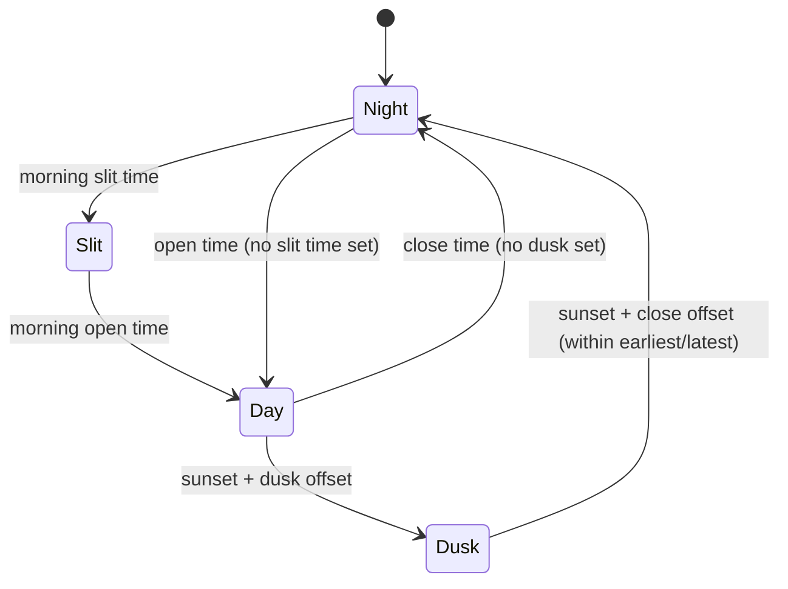
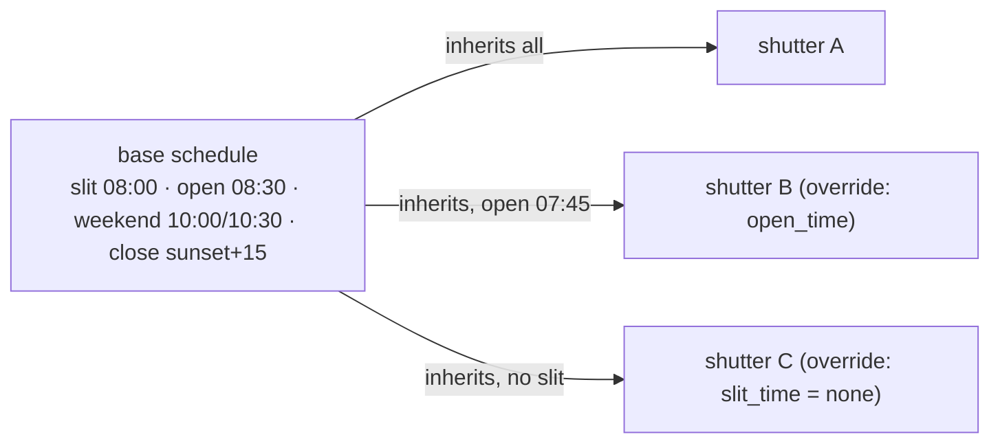
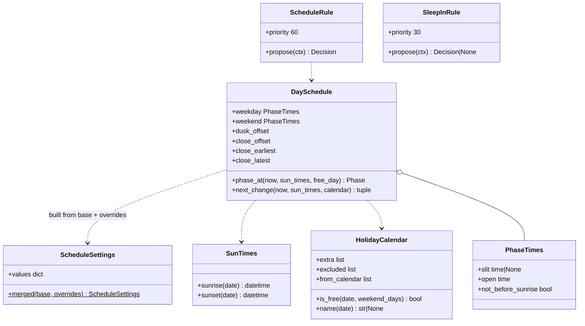

# Profiles: morning, evening, weekend and holidays, sleep-in

- Issue: #4
- Status: **approved** (2026-11-20)
- Date: 2026-11-20
- Depends on: #2, #3 (caps), #10 (slit position); uses the manual-operation detection of #5 for sleep-in

## 1. Purpose

Open and close each shutter on its own schedule, the way fixed automations do it today, but per shutter,
with weekend and holiday times, sun-relative evening times, a slit position, and sleep-in.

## 2. The day of a shutter

A shutter's day consists of phases. Each phase has a target position; the schedule rule proposes the target
of the current phase (a *target*, priority 60, see §6).

| Phase | Target | Default |
|---|---|---|
| Night | closed | 0 % |
| Slit | the slit position (slat gaps open, bottom bar on the sill), or a real position | slit |
| Day | the open position (never above the maximum position) | 100 % |
| Dusk | a real position | 35 % |

## 3. Times

### 3.1 Base schedule and overrides

- The **base controller** holds a base schedule with every setting of this section (options page
  *Schedule*).
- Every **shutter** takes the base value of each setting unless it has its own value for it. On the
  shutter's *Schedule* page each field shows the base value it inherits; filling in a value overrides
  that one setting, clearing it inherits again. *Reset to the base schedule* clears all overrides of the
  shutter.
- Changing the base schedule changes every shutter that inherits the changed setting, at once.
- The shutter's `phase` and `next_action` sensors show the effective times; an attribute `overrides` lists
  the settings the shutter overrides.

- "No slit phase" or "no dusk phase" is an override of its own (*none*), different from an empty field
  (*inherit*).

### 3.2 Settings

Base schedule defaults, with weekday and weekend values (each can be overridden per shutter):

| Setting | Weekdays | Weekend and holidays | Meaning |
|---|---|---|---|
| `slit_time` | 08:00 | 10:00 | start of the slit phase; empty: no slit phase |
| `open_time` | 08:30 | 10:30 | start of the day phase |
| `not_before_sunrise` | off | off | when on, slit and open wait for sunrise (+ offset) if that is later |

Evening (every day; base values, overridable per shutter):

| Setting | Default | Meaning |
|---|---|---|
| `dusk_offset` | 0 min | dusk phase starts at sunset + offset; empty: no dusk phase |
| `close_offset` | +15 min | night starts at sunset + offset |
| `close_earliest` | – | not before this time (e.g. 17:00) |
| `close_latest` | – | not after this time (e.g. 22:30) |

- **Weekend days** are a base controller setting (default Saturday and Sunday).
- **Times are local** (Home Assistant's time zone); sunrise and sunset come from the sun geometry of #3.
- **After a restart** the rule takes the phase of the current moment, so a shutter is not opened at night
  because the morning was missed.

## 4. Holidays

Holidays use the weekend times. The list lives in the base controller (options page *Holidays*):

| Source | How |
|---|---|
| Public holidays | optional: a calendar entity of Home Assistant's *Holiday* integration (one per country, with moveable feasts) |
| Extra dates | an editable list, one per line: `2026-12-24` (once) or `12-31` (every year), optionally followed by a name |
| Excluded dates | dates from the calendar that should count as normal days (same format) |

- The integration reads the calendar for the coming 400 days once a day and keeps the dates in memory; the
  options page shows the resulting list for this year, so it can be checked and edited.
- Without a calendar entity only the extra dates count.

## 5. Sleep-in

- A switch **Sleep-in** per shutter, and one on the base controller that turns all of them on or off.
- When on, the shutter stays closed in the next slit and day phases: the schedule proposes *closed* instead.
- It switches off by itself:
  - when the shutter is operated by hand (detection of #5: a position change not sent by the controller);
  - at the latest at `sleep_in_until` (base value 12:00, overridable per shutter), so a forgotten switch does
    not keep the shutter closed all day.
- Safety rules (#6) still apply while sleeping in.

## 6. Rules and priorities

| Priority | Rule | Kind |
|---|---|---|
| 10 | safety: storm, frost (#6) | target, final |
| 20 | manual pause (#5) | target |
| 30 | sleep-in | target: closed during slit and day |
| 40 | heat protection (#3) | cap |
| 50 | winter (#7) | target or cap |
| 60 | schedule | target of the current phase |

So in the morning: the schedule wants the slit position; heat protection may lower a day phase; sleep-in
keeps it closed; a manual action pauses everything except safety.

**Moves only at phase changes.** The schedule's target is the target of its phase, but the controller sends
it only when the phase starts, or when the target changes (a setting), or when a higher rule ends (pause,
sleep-in, heat protection). A shutter moved in the middle of a phase is left there until the next phase
change. This is what #5 builds on.

## 7. Settings pages

- **Base controller** (*Configure* menu): *Schedule* (the base schedule of §3, plus `sleep_in_until`),
  *Holidays* (§4) and *Weekend days*.
- **Shutter** (*Reconfigure* menu): *Schedule* with the same fields; empty = inherit the base value (shown
  in the field's description), *none* where a phase can be left out; and *Reset to the base schedule*.

## 8. Entities

| Device | Entity | Meaning |
|---|---|---|
| shutter | switch `sleep_in` | §5 |
| shutter | sensor `next_action` | filled: time of the next phase change; attributes `position`, `phase` |
| shutter | sensor `phase` | `night`, `slit`, `day`, `dusk` |
| base | switch `sleep_in_all` | on: all shutters sleep in; off: none |
| base | binary_sensor `holiday` | today is a holiday (or weekend) for the schedules; attribute `name` |

## 9. Classes

- `SunTimes` computes sunrise and sunset from the solar position of #3 (bisection on the elevation),
  in `core/`, so the schedule is testable without Home Assistant.
- `HolidayCalendar` is a repository of dates, filled from the calendar entity by the coordinator.

## 10. Tests

- Inheritance: a shutter without overrides follows the base; an override wins; *none* removes a phase; a
  change of the base reaches the inheriting shutters and not the overriding ones; reset clears overrides.
- Phases for a weekday, a weekend day and a holiday; no slit phase; `not_before_sunrise` in winter;
  evening with earliest/latest; a day where sunset is before `close_earliest`.
- Daylight saving changes (spring and autumn).
- Holiday list: once and yearly dates, exclusions, calendar dates, the text format and its errors.
- Sleep-in: closed in the morning, ends on a manual action, ends at `sleep_in_until`, the switch for all.
- Moves only at phase changes; after a restart no move to a missed phase's target.
- Home Assistant: the schedule page, copy from another shutter, the holidays page with a calendar entity,
  the new entities, a simulated morning and evening.

## 11. Out of scope

Presence simulation; schedules per room group (the base schedule with overrides covers it).
