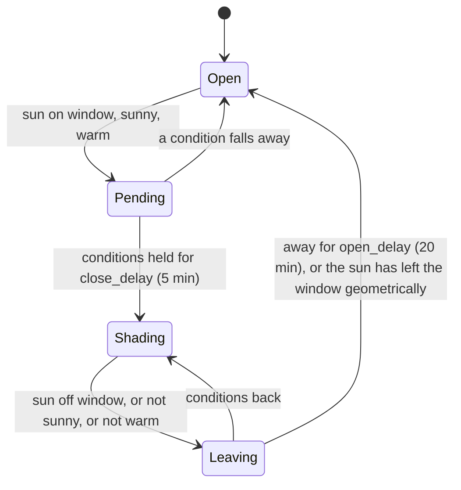
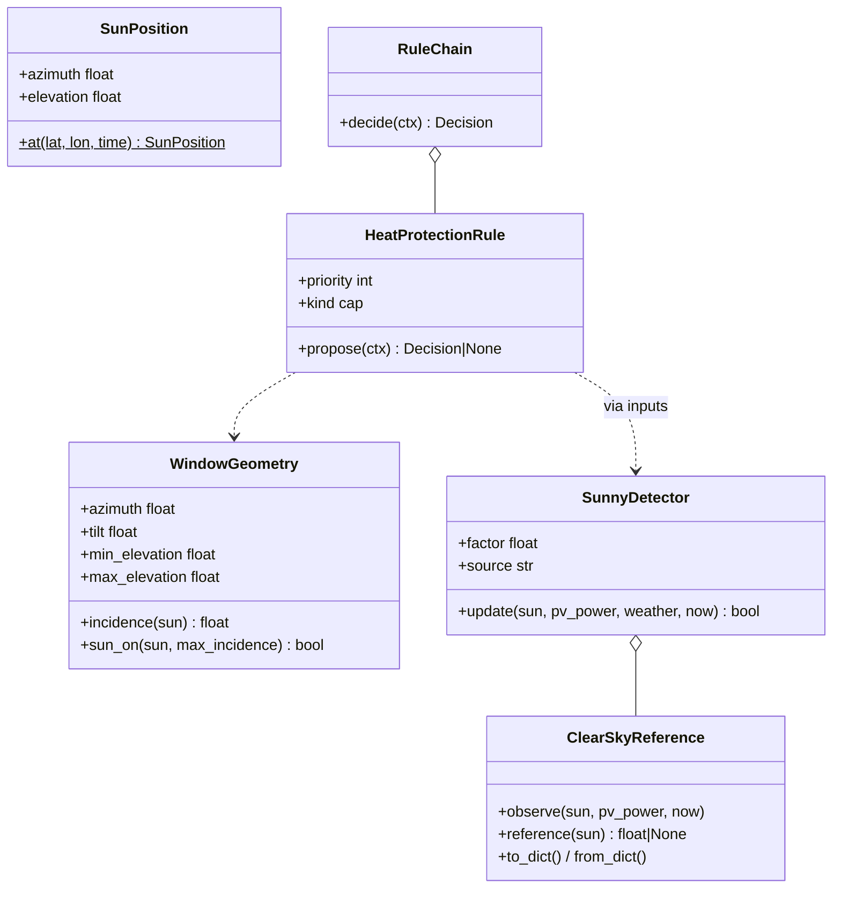

# Sun on the window: heat protection

- Issue: #3
- Status: draft
- Date: 2026-11-20
- Depends on: #2; uses calibrated positions from #10 when present

## 1. Purpose

Lower a shutter to its shading position when the sun really shines on its window and it is warm enough for
that to matter, and raise it again when it no longer does, without moving it up and down with every passing
cloud.

## 2. Sun position

Computed in `core/sun.py` from Home Assistant's latitude, longitude and the time (NOAA solar position
algorithm, accuracy about 0.1°; no dependency on the `sun` integration's update interval).

| Value | Meaning |
|---|---|
| azimuth `γ` | degrees, 0 = north, 90 = east, 180 = south, 270 = west (same convention as the window direction) |
| elevation `α` | degrees above the horizon |

## 3. Does the sun shine on this window?

### 3.1 Geometry

Window direction `A` (outward normal, degrees as above), tilt `β` from the horizontal (90 = vertical). The
angle of incidence `i` between the sun and the window normal:

```
cos i = sin α · cos β + cos α · sin β · cos(γ − A)
```

For a vertical window this is `cos i = cos α · cos(γ − A)`.

The sun is **on the window** when all of these hold:
- `α > 0` (above the horizon);
- `min_elevation ≤ α ≤ max_elevation` (#2: obstacles below, an overhang above);
- `i < max_incidence` (default 85°; a sun nearly parallel to the glass gives little heat).

### 3.2 Is it sunny? (clouds)

PV power is a direct measure of sunshine at the house. Its expected value depends on the orientation of the
panels, which the integration does not know, so it **learns** a clear-sky reference:

- The sky is divided into cells of sun position (azimuth 10° × elevation 5°).
- For each cell the integration keeps the PV power of the last 30 days and uses a high percentile (95th) as
  the clear-sky reference `P_ref(cell)` (sunny moments set it; cloudy ones do not lower it).
- **Sun factor** `f = P / P_ref(cell)`, clipped to 0…1.
- **Sunny** when `f ≥ sunny_threshold` (default 0.6), **not sunny** when `f < sunny_threshold − 0.15`
  (hysteresis).

Until a cell has enough history (7 days with at least one sample), a fallback is used, in this order:
1. with `pv_peak`: `P_ref = 0.8 · pv_peak · sin α` (a rough clear-sky curve);
2. with a weather entity: sunny when its condition is `sunny` or `partlycloudy`;
3. otherwise: sunny whenever the sun is on the window (geometry only).

The learned reference is stored with the runtime state, so it survives restarts. A diagnostic sensor on the
base controller shows the sun factor and which source it uses.

### 3.3 Is it warm enough?

Heat protection only applies when it helps (base controller defaults, overridable per shutter):

| Setting | Default | Applies when |
|---|---|---|
| `heat_outdoor` | 22 °C | outdoor temperature at or above it, **or** |
| `heat_room` | 24 °C | the shutter's room temperature at or above it (only with a room sensor) |

Without an outdoor or room temperature the condition counts as met.

## 4. The rule



- **Shading position** per shutter (default 30 %, a real position; with #10 calibrated). Never above the
  maximum position (limiter of #2).
- **Delays:** `close_delay` 5 min, `open_delay` 20 min; the geometric end (the sun has moved past the window)
  opens without waiting.
- **Kind of proposal: a cap.** The sun rule never raises a shutter. It says "at most the shading position".
  The schedule (#4) may still want it lower (night, slit in the morning). The rule chain of #2 is extended:

  | Kind | Meaning | Combination |
  |---|---|---|
  | target | the position the rule wants | the first target by priority wins (as in #2) |
  | cap | the shutter may not be higher than this | all caps apply: position = min(target, caps) |

  Safety rules (#6) can still override caps (a storm may require fully open).
- **Reason** `sun` when the cap lowers the position; attributes give the incidence angle, the sun factor and
  the temperatures.

## 5. Settings

Base controller (options page *Sun*): `sunny_threshold`, `max_incidence`, `heat_outdoor`, `heat_room`,
`close_delay`, `open_delay`.

Per shutter (subentry): `heat_protection` (on/off, default on), `shading_position` (default 30 %), and
optional overrides of `heat_outdoor` and `heat_room`.

## 6. Entities

| Device | Entity | Meaning |
|---|---|---|
| base | sensor `sun_factor` | 0–100 %, with `source` (`learned`, `pv_peak`, `weather`, `geometry`) |
| base | binary_sensor `sunny` | after hysteresis |
| shutter | binary_sensor `sun_on_window` | geometry only; attributes `incidence`, `sun_azimuth`, `sun_elevation` |
| shutter | switch `heat_protection` | on/off per shutter |
| shutter | number `shading_position` | 0–100 %, step 5 |

## 7. Classes



- `SunPosition`, `WindowGeometry`, `ClearSkyReference`, `SunnyDetector` and `HeatProtectionRule` are in
  `core/` without Home Assistant imports.
- The coordinator computes the sun position and the sunny state once per tick and passes them in `Inputs`
  (§6 of #2), so every shutter uses the same values.

## 8. Tests

- Sun position against reference values (e.g. NOAA calculator) for a few dates and places, both hemispheres.
- Incidence: a south window at noon, east and west windows in the morning and evening, a roof window, the
  elevation limits.
- Clear-sky reference: learns the high percentile, ignores cloudy samples, falls back while young, round trip
  through storage.
- The rule: delays and hysteresis with a passing cloud, cap combined with a schedule target, never above the
  maximum position, off per shutter.
- Home Assistant: the new entities and options page; a sunny afternoon simulated with sensor states moves a
  south shutter to its shading position after the delay and leaves a north shutter alone.

## 9. Out of scope

Pre-closing from a forecast; solar heat in winter (#7).
