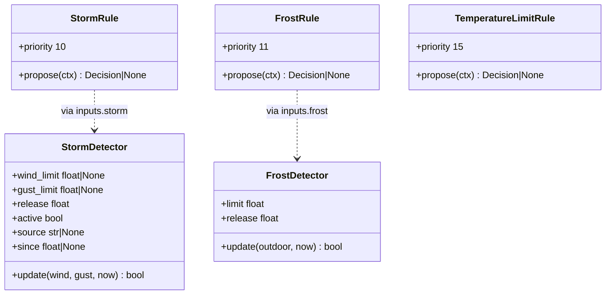

# Weather and safety: storm, frost, temperature

- Issue: #6
- Status: draft
- Date: 2026-11-20
- Depends on: #2 (limiter, final decisions), #5 (pauses)

## 1. Purpose

Protect the shutters against storm and frost, and close them in extreme heat or cold, above every other
rule. These rules apply only to shutters whose automatic control is on.

## 2. Storm

### 2.1 When is it a storm?

Each wind source of the base controller has its own limit, because sources differ a lot: a sheltered sensor
at the house may never reach a regional value (example from one installation over a year: highest gust 43 km/h
at the house against 81 km/h at the nearest weather station).

| Setting | Default | Meaning |
|---|---|---|
| `storm_wind_limit` | 50 km/h | for the wind speed sensor |
| `storm_gust_limit` | 60 km/h | for the gust sensor |
| `storm_release` | 15 min | the storm ends this long after the last value above a limit |

- Storm starts when **any** configured source is at or above its limit.
- A source that is unavailable does not start or end a storm on its own; the state shows which sources count.
- The options page shows each source's highest value of the last 30 days next to its limit (from Home
  Assistant's statistics), so the limit can be chosen sensibly.

### 2.2 What happens in a storm?

Only fully open or fully closed (module ends, #10):

| `storm_position` (per shutter, base value inherited) | In a storm |
|---|---|
| `nearest` (default) | 50 % or higher → fully open; below → fully closed |
| `open` | fully open |
| `closed` | fully closed |

- A shutter whose maximum position is below 100 % closes (decided earlier for this project; a shutter may
  never be opened above its maximum automatically).
- The decision is **final** (priority 10): it overrides the manual pause (#5), sleep-in, heat protection and
  the schedule. A manual move during a storm is moved back at the next evaluation.
- The shutter keeps its storm position until the storm has ended; then the normal rules decide again (and
  the shutter moves at once to their position).

## 3. Frost

| Setting | Default | Meaning |
|---|---|---|
| `frost_limit` | 0 °C | outdoor temperature at or below which shutters may freeze to the frame |
| `frost_release` | 60 min | frost ends this long after the temperature is above the limit again |

- During frost the controller **does not move a shutter automatically** (rule priority 10, final, "leave it
  where it is"). A shutter that froze stuck would strain the motor.
- Manual operation still works (it is the user's choice).
- Exception: storm (§2) still acts during frost; a storm with frost is rare, and wind damage is the larger
  risk. (Open question below.)

## 4. Heat and cold limits

Optional, off by default:

| Setting | Meaning |
|---|---|
| `close_above` | outdoor temperature above which all shutters with automatic control close (e.g. 30 °C) |
| `close_below` | outdoor temperature below which they close (e.g. −5 °C, extra insulation) |

These are targets of priority 15 (below storm and frost, above the manual pause), with a hysteresis of 1 °C.

## 5. Rules and priorities

| Priority | Rule | Kind |
|---|---|---|
| 10 | storm | target, final (open or closed) |
| 10 | frost | final, no move (after storm in the chain) |
| 15 | heat / cold limits | target, final |
| 20 | manual pause (#5) | final, no move |
| 30 | sleep-in | target |
| 40 | heat protection | cap |
| 60 | schedule | target |

## 6. Entities

| Device | Entity | Meaning |
|---|---|---|
| base | binary_sensor `storm` | attributes: the source and value that started it, `since`, `until` (end of the release time) |
| base | binary_sensor `frost` | attributes: temperature, `since` |
| shutter | sensor `reason` | new values `storm`, `frost`, `heat_limit`, `cold_limit` |

## 7. Classes

The coordinator updates both detectors once per tick and passes `storm` and `frost` in `Inputs`; the rules
read them from there, like the sun state of #3.

## 8. Tests

- Storm: each source with its own limit, the release time, an unavailable source, nearest/open/closed, the
  maximum position below 100, storm during a manual pause and during sleep-in, a manual move during a storm.
- Frost: no automatic moves, the release time, storm during frost.
- Temperature limits with hysteresis.
- Home Assistant: options page with the 30-day maxima, the base entities, a simulated storm.

## 9. Open questions

- During frost, should storm still move shutters (current proposal: yes)?
- Default `storm_position`: nearest end (proposal), or always closed?
