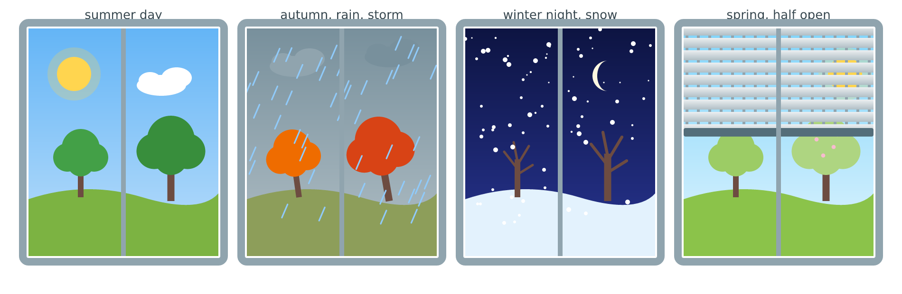
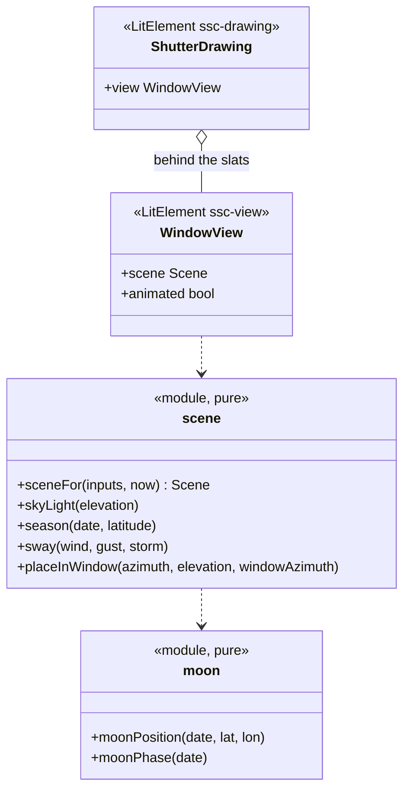

# The view through the window

- Issue: to be created
- Status: draft
- Date: 2026-11-20
- Depends on: #9 (card), #28 (gaps between the slats), #3 (sun position), #6 (wind)

## 1. Purpose

Behind the shutter in the card you look outside: a cartoon landscape with the real light, weather, sun,
moon and season, so the card shows at a glance what the shutter is keeping out (or letting in).

## 2. What you see

| Part | From | Shown |
|---|---|---|
| **Landscape** | – | rolling grass, two or three trees, cartoon style |
| **Sky light** | sun elevation | night (below −6°): dark blue with stars; twilight (−6° to 0°): orange to purple; day: blue, paler with a lower sun |
| **Clouds** | weather condition, sun factor | clear: none; partly cloudy: a few; cloudy, rain, snow: grey sky and grey clouds |
| **Sun** | sun azimuth and elevation, window direction | at its place as seen through this window: left–right by the azimuth relative to the window direction (about ±70° fills the width), up–down by the elevation; not drawn when it is behind the house or below the horizon |
| **Moon** | moon position and phase (computed in the card) | at night, at its place as for the sun, with the right phase (crescent, half, full); not drawn when below the horizon or new |
| **Stars** | sun elevation | at night, fewer near twilight, none when cloudy |
| **Rain** | weather `rainy`, `pouring`, `lightning-rainy`, `snowy-rainy` | falling drops, more when pouring; slanted with the wind |
| **Snow** | weather `snowy`, `snowy-rainy` | falling flakes; snow on the ground while it snows |
| **Fog** | weather `fog` | a white haze |
| **Season** | date and hemisphere | spring: light green leaves with blossom; summer: dark green; autumn: orange, red and brown; winter: bare branches |
| **Wind** | wind speed (or gusts) of the base controller | trees sway: still below 10 km/h, gentle to 40 km/h, strong from 60 km/h; in a storm (#6) harder still |

- **Closed shutter:** fully closed you see nothing outside: the slats are solid.
- **Not closed:** the separate slots between the slats are transparent (#28), so the outside shows through
  them; below the bottom bar the view is open.
- **Overview tiles:** the same view, smaller, without moving rain, snow or trees.
- **Reduced motion** (system setting): everything stands still.

## 3. Data

| Value | Where | Change |
|---|---|---|
| sun azimuth, elevation | base sensor *Sun factor* (attributes) | – |
| window direction | shutter binary sensor *Sun on the window* | new attributes `window_azimuth`, `window_tilt` |
| weather condition | base sensor *Sun factor* | new attribute `weather` (the state of the base controller's weather entity) |
| wind and gusts | base binary sensor *Storm* | new attributes `wind`, `gust` (km/h) |
| moon | the card | computed from the time and the location (`hass.config`) with a short lunar algorithm (about 1°), as the sun is in the integration |
| season | the card | month and hemisphere (`hass.config.latitude`) |

## 4. Structure

- `scene` and `moon` are pure functions (no DOM), tested with Vitest; `ssc-view` only draws the `Scene`.
- The view is drawn in the drawing's glass area, under the slats; the closed pattern covers it, the open
  pattern's slots show it.
- Animations are CSS (`transform`), a few dozen drops or flakes at most; the overview draws still frames.

## 5. Tests

- Sky light at night, twilight and day; stars only at night and not when cloudy.
- Sun and moon place: in front of the window, at the edge, behind the house; a south window at noon, an east
  window in the morning.
- Moon phase against known dates (full moon, new moon); moon below the horizon not drawn.
- Season per month for both hemispheres.
- Rain, snow and fog per weather condition; sway per wind speed and storm.
- Closed: no view; slit: view only through the slots; reduced motion: no animation.
- Screenshots: summer day, autumn storm with rain, winter night with snow and moon, spring half open.

## 6. Out of scope

A photo or a camera image as the view; the real landscape around the house.
