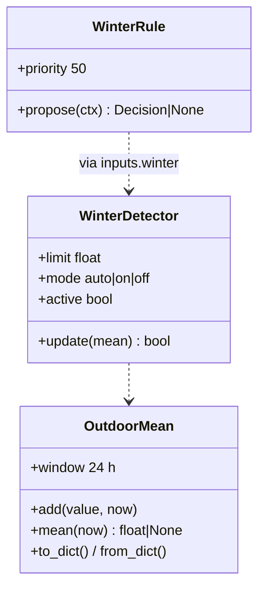

# Winter mode

- Issue: #7
- Status: draft
- Date: 2026-11-20
- Depends on: #3 (sun on the window), #4 (phases), #5 (manual pause), #6 (rule priorities)

## 1. Purpose

Use the shutters to keep heat in during cold periods, while keeping daylight and free solar heat when it
helps.

## 2. When is it winter?

| Setting | Default | Meaning |
|---|---|---|
| `winter_mode` | auto | auto / on / off; a select entity on the base controller, so it can also be switched from a dashboard |
| `winter_limit` | 12 °C | auto: winter while the mean outdoor temperature of the last 24 hours is below this |
| hysteresis | 1 °C | auto: winter ends when the mean is 1 °C above the limit |

- The 24-hour mean is a time-weighted mean of the outdoor temperature (values held between changes), kept
  by the base controller and stored with the runtime state, so it survives a restart.
- Per shutter: `winter` on/off (inherited from the base schedule, overridable).

## 3. What winter mode does

| Moment | Without winter | In winter |
|---|---|---|
| Evening, shutter open | dusk position, then closed | the same: dusk position, then closed |
| Evening, shutter already closed (e.g. closed during a cold day) | raised to the dusk position | **stays closed**: the dusk position never raises a shutter |
| Day, outdoor at or below `winter_closed_below` (default −5 °C, empty = off) | open | **closed all day**; a manual action overrides it (pause of #5) |
| Day, sun on the window and sunny | open (heat protection caps only when warm) | open at the day position for solar heat; never above the maximum position; a deliberately low day position (privacy) is kept |
| Morning (slit, open) | schedule | schedule; with `winter_closed_below` reached, the shutter stays closed |

Heat protection (#3) does not act in winter anyway (it needs warm weather); winter mode makes sure of that
and logs nothing.

## 4. Rule

`WinterRule`, priority 50 (below the manual pause and sleep-in, above the schedule):

- **cold day:** winter, outdoor at or below `winter_closed_below` → target closed (reason `winter`);
- **dusk:** winter, dusk phase, current position below the dusk position → a cap at the current position (the
  dusk position does not raise the shutter);
- otherwise nothing (the schedule decides).

| Priority | Rule |
|---|---|
| 10–15 | storm, frost, temperature limits (#6) |
| 20 | manual pause (#5) |
| 30 | sleep-in (#4) |
| 40 | heat protection (#3, cap) |
| 50 | **winter** (target or cap) |
| 60 | schedule (#4) |

## 5. Settings and entities

| Where | Setting / entity |
|---|---|
| base options *Winter* | `winter_limit`, `winter_closed_below` (base values) |
| base | select `winter_mode` (auto, on, off); binary_sensor `winter` with attribute `mean_24h` |
| shutter schedule overrides | `winter` (inherit/on/off), `winter_closed_below` |
| shutter | sensor `reason`: new value `winter` |

## 6. Classes

## 7. Tests

- 24-hour time-weighted mean with irregular samples, restart from storage.
- Winter on/off with hysteresis; modes auto/on/off.
- Cold day closed; manual override pauses it; dusk does not raise a closed shutter but lowers an open one;
  winter off per shutter; storm still acts (priority).
- Home Assistant: the select and binary sensor, the options page, a simulated cold day and evening.

## 8. Out of scope

Control of the heating itself; using room temperatures to decide winter.
