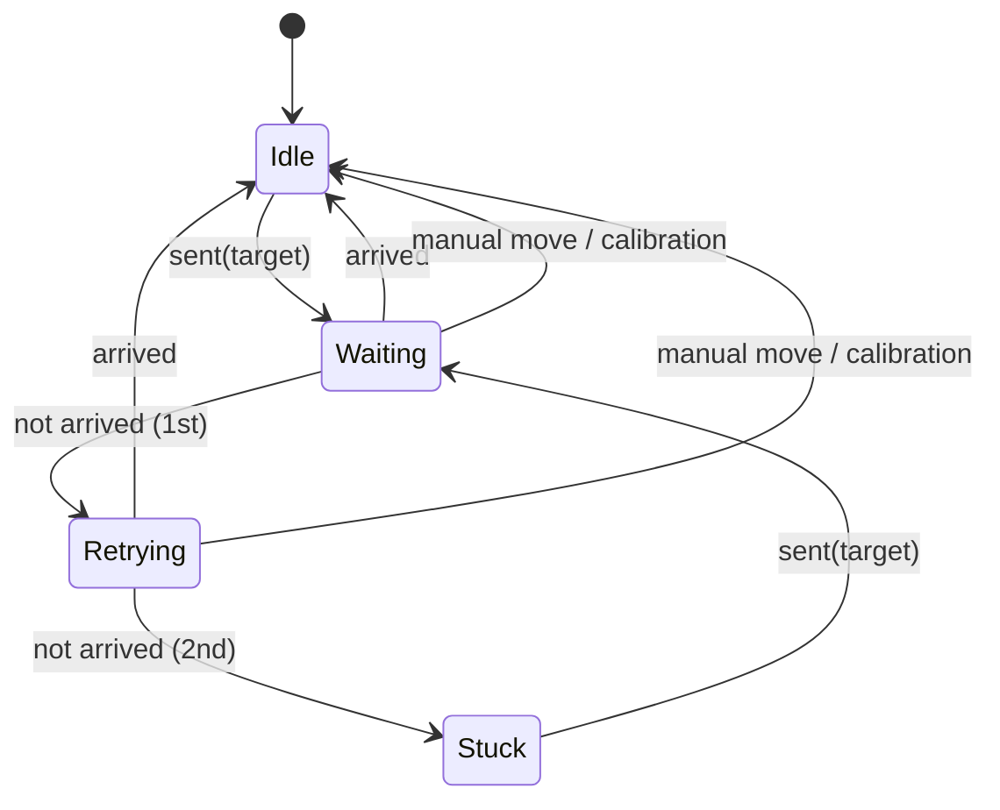
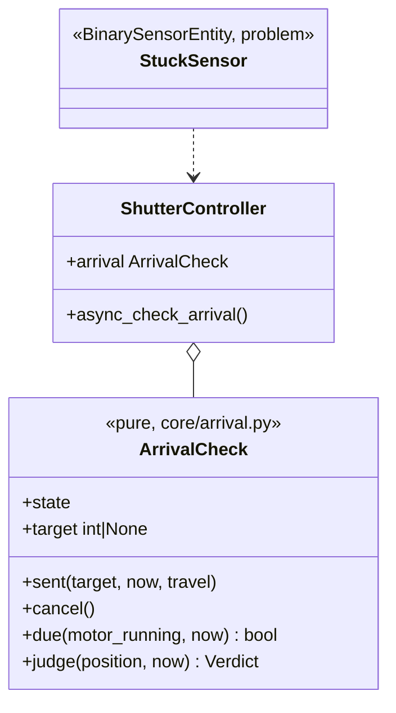

# Check that a move arrives

- Issue: #48
- Status: **approved** (2026-11-21)
- Date: 2026-11-21

## 1. Purpose

A radio command can get lost, and a module can stop short. Today the controller sends a position once and
assumes it arrives. It should notice, try once more, and tell the user when a shutter does not get there.

## 2. What the user sees

- Nothing while moves arrive.
- A move that did not arrive is sent **once more**, automatically.
- If that fails too, the shutter is **stuck**:
  - the binary sensor *Stuck* (device class *problem*) of the shutter turns on, with the attributes
    `target` and `position` (module positions);
  - a repair issue appears under *Settings → Repairs*: "*Living room* did not reach 100 % (it is at 64 %).
    Check the shutter and its module.";
  - both clear by themselves at the next move that arrives.
- The trace (#56) is unchanged: being stuck does not stop automatic control; the next decision sends again.

## 3. Behaviour

Every position the integration sends (automatic, or through its own entities) starts a check for that module
position. A later command replaces it; a manual move (wall switch, remote: #5) or the calibration assistant
cancels it.

The check is **due**:

- with a motor power sensor: when the motor has stopped, at the earliest 10 s after the command (a command
  that never starts the motor is due after those 10 s), and at the latest after the travel time;
- without one: after the travel time.

The travel time is the shutter's *Travel time* · 1.5 + 30 s, or 180 s when it is not known.

When due, the controller asks the module for its position (as the calibration assistant does, #42) and
compares: within **±2 %** of the target = arrived. Otherwise the first time: send the same command again
(the ends by open/close, #46) and start the check anew; the second time: stuck.

Checks run when the cover or its power sensor reports, and on the coordinator's tick (every minute), so a
due check is at most a minute late.

## 4. Structure

`Verdict`: `ARRIVED`, `RETRY`, `STUCK`. The controller creates and deletes the repair issue
(`issue_registry`, key `stuck_<shutter>`, not fixable, warning).

## 5. Tests

- Core: due with and without power sensor, the 10 s minimum, the deadline, arrived within 2 %, retry once,
  then stuck; cancel; a new command replaces the check.
- Home Assistant: a cover that ignores the first command arrives after the retry; a cover that never moves
  turns *Stuck* on and creates the repair issue; the next arriving move clears both; a manual move cancels.

## 6. Out of scope

More than one retry; notifications other than the repair issue (an automation can use *Stuck*).
