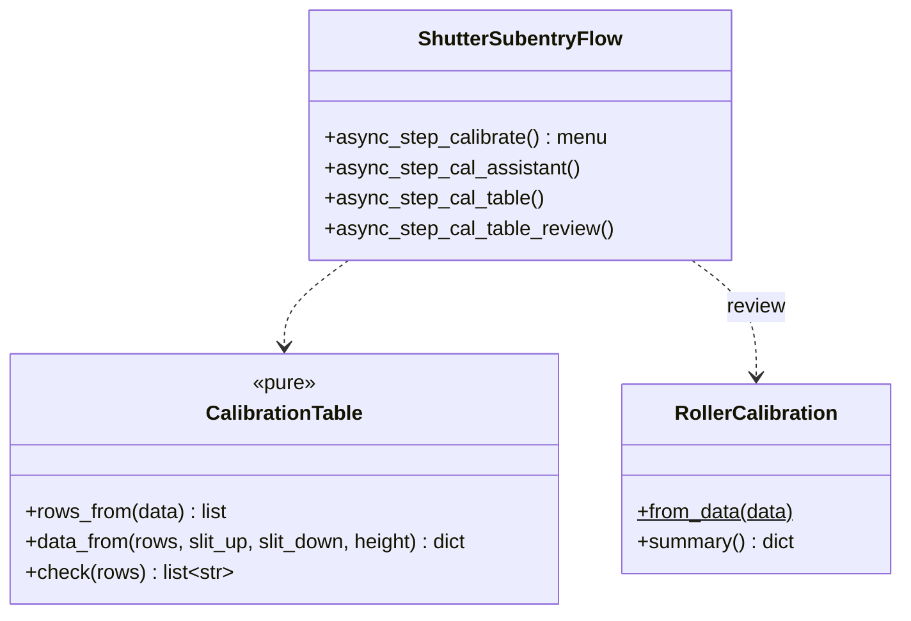

# Calibration: the assistant or a table

- Issue: #40
- Status: **approved** (2026-11-21)
- Date: 2026-11-21
- Builds on: [calibration](2026-11-20-calibration.md) (#10)

## 1. Purpose

The calibration assistant moves the shutter and asks for measurements. To correct one value, to type in
measurements taken earlier, or to copy a calibration to an identical window, editing the measured points
directly is quicker. *Calibrate* therefore offers two ways: the assistant as it is now, and a table.

## 2. What the user sees

*Reconfigure → Calibrate* on a shutter opens a menu:

1. **Assistant**: the current assistant, unchanged (window height, lift point, four points up and down).
2. **Edit table**: a form with the measured points, filled in with the stored calibration.

The table is a list of rows (Home Assistant object selector, rows can be changed, added and removed):

| Module position (%) | Going up: opening (%) | Going down: opening (%) |
|---|---|---|
| 34 | 9 | 1 |
| 53 | 30 | 22 |
| 73 | 60 | 53 |
| 92 | 90 | 86 |

- A row is a module position; *going up* is the measured opening below the bottom bar when the shutter came
  from below, *going down* when it came from above. A cell may be empty (measured in one direction only).
- Below the list: **Slit going up** and **Slit going down** (module position with the slat gaps open and the
  bottom bar still on the sill), optional.
- Openings are in % of the window height. The stored window height (cm) of the assistant is kept, not shown.

After *Submit* the integration fits the curves again and shows the result as the assistant does: per
direction the module position for 50 % and the fit (quadratic or monotone, ± %). *Submit* there saves it;
closing the dialog discards it.

**Checks** (the form shows an error and keeps the input):
- module positions 1 … 99, openings 0 … 100, no module position twice;
- at least one direction with two or more points (a direction with fewer uses the other one, as now);
- openings must not fall while the module position rises, per direction (the shutter only opens further).

*Add a calibration point* stays as it is.

## 3. Data

Unchanged: `calibration = {window_height_cm, points: {up: [[m, o], …], down: [[m, o], …]}, slit: {up, down}}`
with fractions 0 … 1 in the shutter's subentry. The table converts rows ↔ points:

- **to rows:** the module positions of both directions together, rounded to whole %, sorted; per row the
  opening of each direction at that module position, or empty;
- **to points:** per direction the rows with a value in that column.

## 4. Structure

- `core/calibration_table.py`: pure conversion and checks (pytest).
- The flow: `calibrate` becomes a menu (`cal_assistant`, `cal_table`); `cal_assistant` is today's first step.
- Translations en + nl; `docs/calibration.md` (a section *Edit the table*), `docs/architecture.md`.

## 5. Tests

- Rows from stored points with equal and different module positions per direction; empty cells.
- Points from rows; empty cells skipped; slits as fractions.
- Checks: duplicate module position, out of range, fewer than two points in both directions, falling openings.
- Home Assistant: the menu, the table pre-filled, an edited row saved and the calibration used by the cover.

## 6. Out of scope

Editing the travel time or the window height in the table; a table in the Lovelace card; importing or
exporting a calibration as a file.
