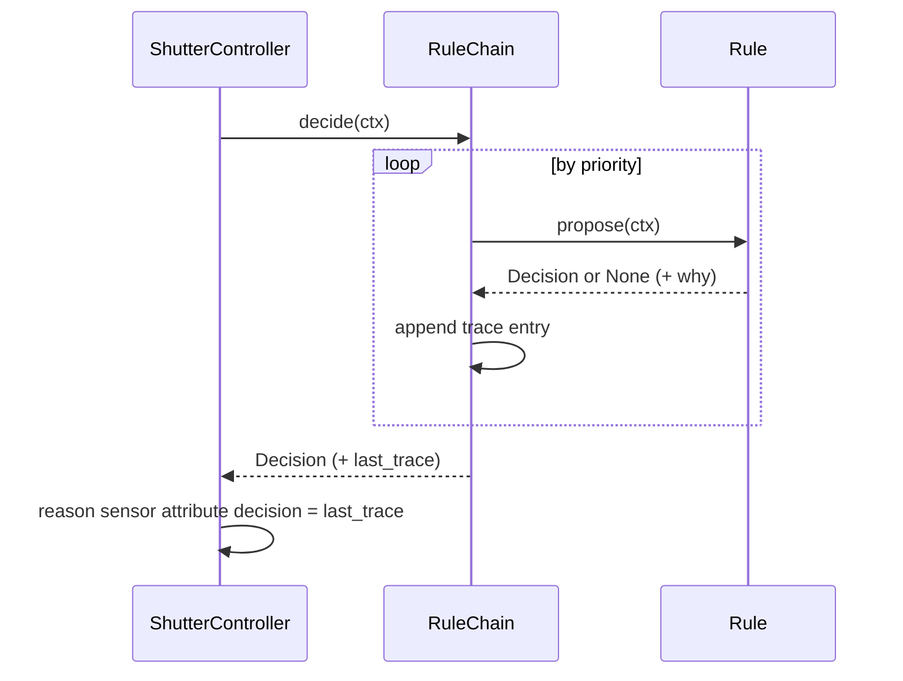

# The decision of every rule

- Issue: #56
- Status: **approved** (2026-11-21)
- Date: 2026-11-21

## 1. Purpose

*Reason* tells which rule won, not why the others did nothing. "Why does the shutter not go up?" needs the
whole picture: glare still active, heat not warm enough, the sun below the horizon, a manual pause.

## 2. What the user sees

- The *Reason* sensor gets the attribute `decision`: a list in priority order, one entry per rule:

  ```yaml
  - rule: glare
    priority: 41
    result: cap        # target | cap | final | none
    position: 40
    applied: true      # this entry decided (or lowered) the position
  - rule: heat
    priority: 40
    result: none
    why: too_cold      # a code, with values
    values: {outdoor: 9.5, limit: 22}
  ```

- The card gets a **"Why?"** line under the status; tapping it unfolds the list in the card's language,
  e.g. *Glare protection: at most 40 % (sun factor 100 % ≥ 70 %)* — *Heat protection: not warm (9.5 °C <
  22 °C)*.

## 3. Behaviour

- Rules keep `propose(ctx) -> Decision | None`. A rule that proposes nothing sets `self.why = (code, values)`
  during `propose`; the chain collects it. A rule without a reason shows only "nothing".
- `RuleChain.decide` builds the trace while it decides (no second pass) and keeps it as `last_trace`.
- Codes per rule (first set): heat `off`, `no_sun_on_window`, `below_horizon`, `too_cold`, `waiting`
  (close delay, seconds left), `leaving` (open delay); glare `off`, `not_day`, `no_sun_on_window`,
  `below_horizon`, `not_bright`, `waiting`, `leaving`; manual `no_pause`; storm `calm`; frost `not_frozen`;
  winter `off`, `not_cold`; schedule shows its phase.

## 4. Structure



## 5. Tests

- Core: the trace for a decided target, a cap that lowers it, a final target; the why codes of heat and
  glare.
- Home Assistant: the attribute on the reason sensor. Frontend: the "Why?" list renders and translates.

## 6. Out of scope

A history of decisions (the logbook and the attribute's history cover it).
