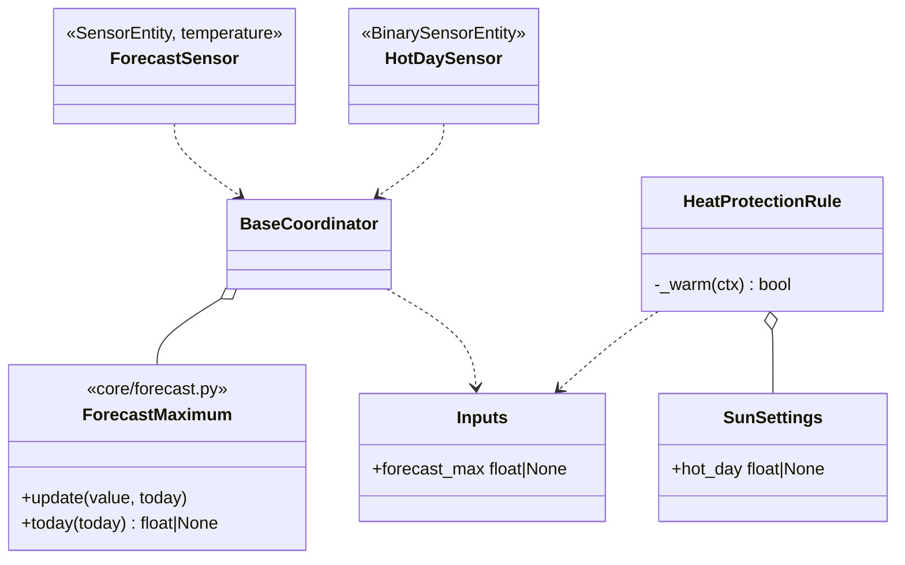

# Heat protection from the weather forecast

- Issue: #50
- Status: **approved** (2026-11-21)
- Date: 2026-11-21

## 1. Purpose

Heat protection waits until it is warm outside (or in the room). On a hot day that is too late: the sun has
already heated the room through the glass in the morning. With the day's forecast maximum, heat protection
can act from the first sun on the window.

## 2. What the user sees

- *Options → Sun*: **Hot day from (forecast)**, default 28 °C; empty = off. A shutter's *Settings* can
  override it (empty = the base value), like the outdoor and room heat limits.
- Base controller, two new entities:
  - sensor **Forecast maximum** (°C): today's maximum from the weather entity's daily forecast; unknown
    without a weather entity or a daily forecast. Attribute `date`.
  - binary sensor **Hot day**: on while the forecast maximum reaches the base value. Attributes
    `forecast_max`, `limit`.
- On a hot day (by the shutter's own limit), heat protection no longer needs the outdoor or room
  temperature: it starts as soon as the sun is on the window **and it is sunny** (the sun factor still
  decides), after the usual close delay (5 min). Leaving works as now.
- The decision trace (#56) shows the forecast: *not warm (18 °C < 22 °C; forecast 24 °C < 28 °C)*.
- Without a weather entity, a daily forecast or a value, nothing changes.

## 3. Behaviour

- The coordinator calls `weather.get_forecasts` (`type: daily`) at start and every 30 minutes, and takes the
  `temperature` of the entry whose date (local time) is today. A failed call keeps the last value for that
  date; after midnight a value from yesterday is no longer used.
- `Inputs.forecast_max` carries the value to every shutter; `HeatProtectionRule._warm` is true when
  `forecast_max ≥ hot_day` (the shutter's limit), besides the existing outdoor and room checks.

## 4. Structure

`core/forecast.py` (pure, pytest): `today_max` picks today's maximum from the forecast list and
`ForecastMaximum` keeps it for that day; the call itself lives in the coordinator.

## 5. Tests

- Core: today's entry by local date (time zones, a forecast starting tomorrow, missing temperature), the
  value expires at midnight; `_warm` with a hot day, below it, without a forecast, with a shutter override;
  the trace values.
- Home Assistant: a weather entity with a daily forecast fills both sensors; on a hot morning a sun-facing
  shutter lowers at 15 °C outside, on a mild day it does not; clearing the option switches it off.

## 6. Out of scope

Hourly forecasts; cloud forecasts; lowering before the sun is on the window.
