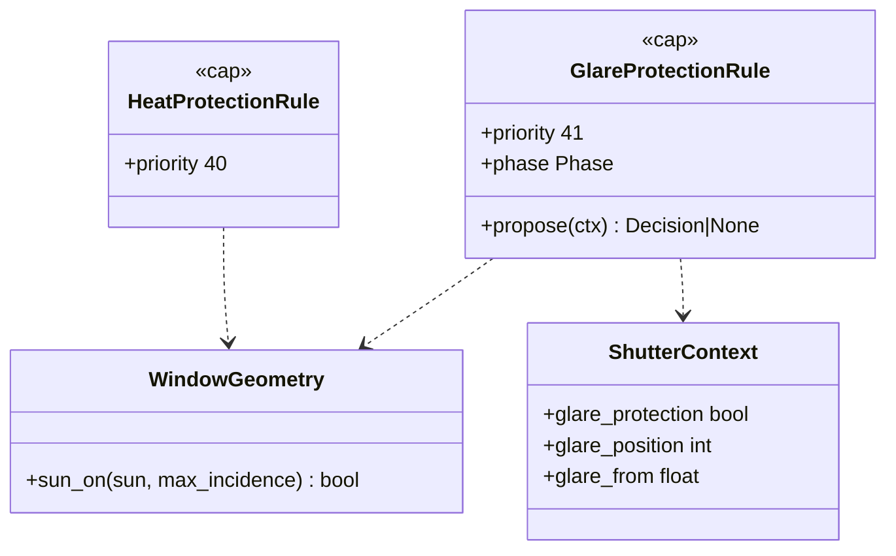

# Glare protection

- Issue: #36
- Status: **approved** (2026-11-21)
- Date: 2026-11-21
- Builds on: [sun on the window](2026-11-20-sun-on-the-window.md) (#3), [light sensors](2026-11-20-light-sensor.md)
  (#26), [winter](2026-11-20-winter.md) (#7)

## 1. Purpose

Heat protection only acts when it is warm. A low winter sun can shine bright and deep into a room while it is
cold outside, and then the shutter stays open. Glare protection lowers a shutter to its own **glare
position** when bright sun shines on **this window**, whatever the temperature, also in winter.

## 2. Rule

A shutter with glare protection switched on goes to at most its glare position when, for 5 minutes
(*Close after*):

1. **the sun is on this window:** the same geometry as heat protection: window direction and tilt, the
   largest angle of incidence, and the window's lowest and highest sun elevation;
2. **the sun is bright:** the sun factor is at or above the shutter's *Glare from* (default 70 %). The sun
   factor is PV power or light (lux) as a share of its clear-sky value for this position of the sun; with a
   facade light sensor, that sensor's own factor. Without a sun factor (no sun source, reference not usable)
   the base controller's *Sunny* counts instead;
3. **it is day in the schedule:** the phase is *day* (between *open* and *dusk*), not during the slit or
   night phase.

It ends 20 minutes (*Open after*) after one of these stops, or at once when the sun has left the window, as
heat protection does. Hysteresis: once active it stays until the sun factor falls 15 points below *Glare
from*.

- **A cap**, like heat protection: it only lowers. With heat protection active too, the lower of the two
  positions wins. A lower target (night, storm, winter closed in the cold) is not raised.
- **Winter:** glare wins over letting the sun's warmth in; the shutter goes down to the glare position, not
  further, so a glare position of, say, 40 % still lets some sun in.
- **Manual operation, storm, frost and the maximum position** keep their priority, as for every rule.

## 3. Settings and entities

| Where | Setting / entity | Default | |
|---|---|---|---|
| shutter (subentry) | *Glare position* | 40 % | the position while the sun dazzles |
| shutter (subentry) | *Glare from* | 70 % | sun factor from which the sun counts as bright |
| shutter | switch *Glare protection* | off | per shutter, like *Heat protection* |
| shutter | sensor *Reason* | – | new value `glare` (en "Glare", nl "Verblinding") |
| shutter | binary sensor *Sun on the window* | – | attribute `glare_phase` (open, pending, shading, leaving) |

The card shows the new reason. Translations en + nl.

## 4. Structure

- `core/glare.py`, pure Python, reusing `WindowGeometry` and the `Phase` state machine of heat protection
  (pending → shading → leaving), with its own thresholds.
- `Reason.GLARE`; `ShutterContext` gets `glare_protection`, `glare_position` and `glare_from`; the phase of
  the day comes from the schedule (already in the context).
- `docs/architecture.md` (class, sequence and state diagrams), `docs/how-it-works.md`, `docs/configuration.md`,
  `docs/entities.md`, `docs/faq.md` (*the sun shines into the room in winter*).

## 5. Tests

- Bright sun on the window in the cold (6 °C) during the day: the glare position after 5 minutes; heat
  protection does not act.
- Not on the window (north window, sun in the south; incidence above the limit): no glare.
- Sun factor below *Glare from*: no glare; above, then dropping between the limit and 15 points below it:
  stays; below that: open after 20 minutes.
- Facade sensor: its own factor decides.
- Slit and night phase: no glare; dusk ends it.
- Winter mode on: glare still acts; winter closed (−5 °C) stays closed.
- Heat and glare both active: the lower position.
- Switch off: no glare. Manual operation pauses it.

## 6. Out of scope

Glare from reflections (water, snow, glass of the neighbours); presence detection; a separate angle of
incidence for glare.
