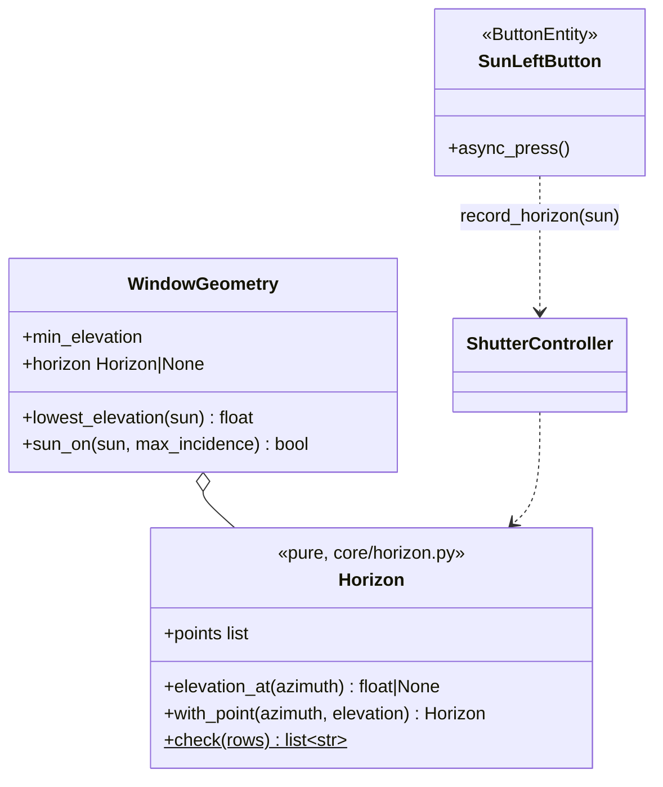

# Horizon profile per window

- Issue: #54
- Status: **approved** (2026-11-21)
- Date: 2026-11-21

## 1. Purpose

Buildings and trees block the low sun at different heights in different directions. One *lowest sun
elevation* per window is either too low in one direction (the shutter stays down while the sun is already
behind the neighbours) or too high in another. A horizon profile gives the lowest elevation per sun
direction, and the user builds it by pressing a button at the moment the sun leaves the window.

## 2. What the user sees

- **Button "Sun has left the window"** per shutter (a button entity, and a small button in the card while
  the sun counts as on the window). It records the current sun azimuth and elevation as a horizon point. A
  point within 3° of azimuth of an existing one replaces it. The sun is then off the window at once.
- **Shutter menu → Horizon:** a table (object selector, like the calibration table #40) with a row per point:
  *Sun direction (°)* and *Lowest elevation (°)*. Rows can be changed, added and removed; empty = no profile.
- The binary sensor *Sun on the window* gets the attribute `horizon`: the lowest elevation for the current
  sun direction.

## 3. Behaviour

- The horizon at a sun azimuth is interpolated linearly between the two neighbouring points. Outside the
  first and last point the nearest point's elevation holds for up to 15° of azimuth further; beyond that only
  the shutter's *Lowest sun elevation* applies.
- The effective lowest elevation is `max(lowest sun elevation, horizon at the sun azimuth)`.
- It applies wherever "sun on the window" is used: heat protection, glare protection, the card's view.
- Checks in the table: direction 0 … 360, elevation 0 … 60, no direction twice.

## 4. Data

`horizon: [[azimuth, elevation], …]` (degrees, sorted by azimuth) in the shutter's subentry, next to the
calibration. The button updates the subentry and the running controller without a reload.

## 5. Structure

## 6. Tests

- Interpolation, the 15° extension, replacing a near point, the checks (pytest, core).
- Home Assistant: the button records a point, the sun is off the window at once, the subentry holds the
  point; the table pre-filled, edited and saved; the card shows the button only while the sun is on.

## 7. Out of scope

Learning the horizon automatically from a facade light sensor; a horizon for the highest elevation
(overhangs keep the single *Highest sun elevation*).
