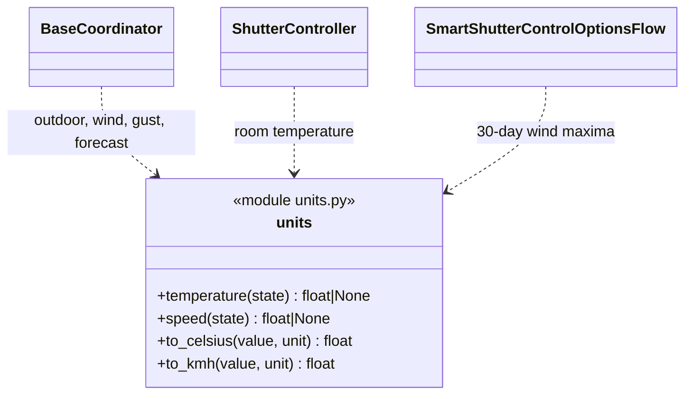

# Temperatures and wind speeds in any unit

- Issue: #64
- Status: **approved** (2026-11-22)
- Date: 2026-11-21

## 1. Purpose

The limits are in °C and km/h, but sensors report in their own unit: with US customary units Home Assistant
gives °F and mph. Read as plain numbers, those values make every temperature and wind decision wrong.

## 2. What the user sees

Nothing changes for °C and km/h. With °F or mph sensors (or a weather entity in °F), the integration decides
as if they were in °C and km/h: 77 °F counts as 25 °C, 31 mph as 50 km/h. The settings stay in °C and km/h
(#65 changes that). The 30-day wind maxima next to the storm limits are shown in km/h. *Forecast maximum*
shows the right value in the user's unit.

## 3. Behaviour

`units.py` (Home Assistant side) converts a state with Home Assistant's own converters
(`TemperatureConverter`, `SpeedConverter`):

| Value | Unit from | To |
|---|---|---|
| outdoor temperature, room temperature | the sensor's `unit_of_measurement` | °C |
| wind speed, gust | the sensor's `unit_of_measurement` | km/h |
| daily forecast maximum | the weather entity's `temperature_unit` | °C |
| 30-day wind maxima (statistics) | the sensor's `unit_of_measurement` | km/h |

A value without a unit, or with a unit the converter does not know, counts as °C or km/h, as today. The
`core/` rules do not change: they keep working in °C and km/h.

## 4. Structure

## 5. Tests

- Conversions: °F, K, °C and no unit; mph, m/s, kn, km/h and no unit; an unknown unit.
- Home Assistant: an outdoor sensor in °F below freezing gives frost; a wind sensor in mph above the limit
  gives a storm; a room sensor in °F triggers heat protection; a forecast in °F fills *Forecast maximum* and
  *Hot day* correctly.

## 6. Out of scope

Settings in °F and mph (#65).
