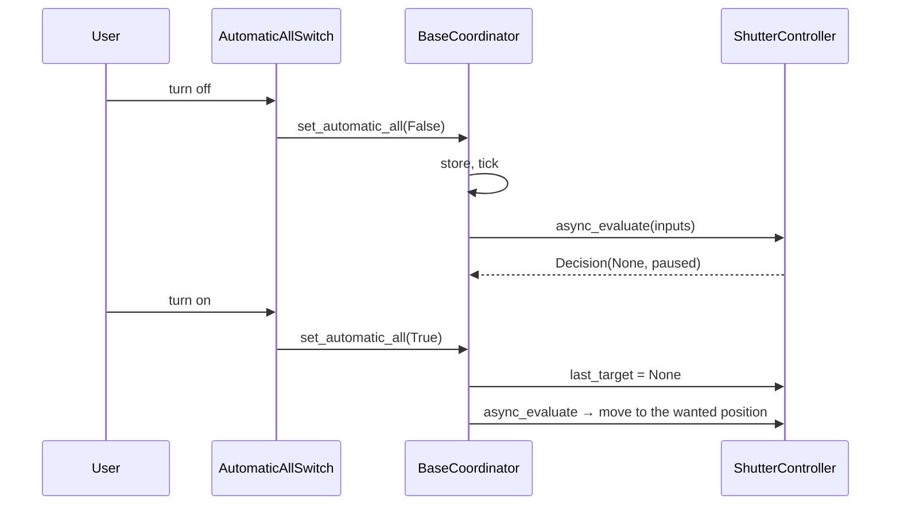

# Pause the whole integration

- Issue: #53
- Status: **approved** (2026-11-21)
- Date: 2026-11-21

## 1. Purpose

For maintenance, a party or window cleaning, stop all automatic control with one switch instead of one per
shutter.

## 2. What the user sees

- A switch **Automatic control** on the base controller's device (on by default, kept over restarts).
- **Off:** no shutter moves by itself, **also not in a storm**. Manual operation (wall switch, the card, the
  integration's cover entities) still works. The *Reason* of every shutter is **paused**; the card shows it.
- The per-shutter *Automatic* switches keep their own state; while the base switch is off, they have no
  effect.
- **On again:** every shutter goes **at once** to the position its rules want then (a running manual pause
  of a shutter still holds).

## 3. Behaviour

- Stored in the runtime store as a global (`automatic_all`), saved within seconds like the other settings.
- `ShutterController.async_evaluate` returns `Decision(None, PAUSED)` while it is off, before any rule (so
  the storm rule does not act either); the decision trace (#56) is empty.
- Arrival checks (#48) are cancelled while paused.
- Switching on clears every shutter's last target and runs a tick.

## 4. Structure

## 5. Tests

- Home Assistant: off → no moves (also in a storm), reason *paused*; on → moves at once; kept after a
  reload; the per-shutter switch is unchanged.
- Card: the reason *paused* translated.

## 6. Out of scope

A timer that switches it on again (an automation can do that).
