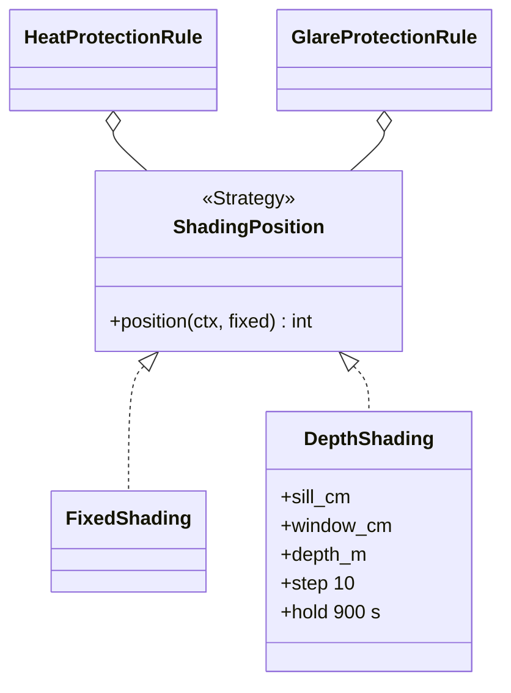

# Shading position from the sun elevation

- Issue: #55
- Status: **approved** (2026-11-21)
- Date: 2026-11-21

## 1. Purpose

Heat and glare protection lower a shutter to a fixed position. A high sun needs only a little of the window
covered to keep the sun patch near the window; a low sun needs much more. Computing the position from the
sun lets in more daylight while still keeping direct sun out of the room beyond a chosen depth.

## 2. What the user sees

Shutter *Settings*, three optional fields:

| Setting | Default | Effect |
|---|---|---|
| Window bottom above the floor | – | cm; the height of the glass's lower edge |
| Window height | from the calibration | cm; the height of the glass |
| Sun into the room | – | m; direct sun may reach this far over the floor, measured from the window |

With all three filled in, heat and glare protection compute their position; the *Shading position* and
*Glare position* become the **lowest** position they use (never further down than the fixed position).
Without them nothing changes. The binary sensor *Sun on the window* shows `shading_from_depth` (%).

## 3. Calculation

For a vertical window (tilt 90°), with sun elevation `e` and the horizontal angle `γ` between the sun and
the window normal, the profile angle `φ` is `tan φ = tan e / cos γ`. Light through the top of an opening
`o` (cm above the glass's lower edge `s`) reaches the floor at `(s + o) / tan φ`. To keep it within depth
`D`:

```
o = D · tan φ − s          position = 100 · o / window height   (clamped 0 … 100)
```

The position is a **real** opening (the calibration turns it into a module position).

- The result is rounded **down** to a step of 10 % and is at least the fixed position, at most the maximum
  position.
- It changes at most once per 15 minutes while protection is active; the first position when protection
  starts is computed at once.
- A sloped window (tilt ≠ 90°) keeps the fixed position.

## 4. Structure



`core/shading.py` (pure, pytest). Each rule has its own `DepthShading` instance (its own 15-minute hold).

## 5. Tests

- The formula against hand-calculated cases (high and low sun, sun at an angle), rounding down, clamping to
  the fixed and maximum position, the 15-minute hold, sloped windows.
- Home Assistant: settings saved, the heat and glare positions follow the sun over an afternoon.

## 6. Out of scope

Side walls and reveals (the window's depth in the wall); sloped windows; a window that does not reach the
room's floor level (the floor is the reference).
