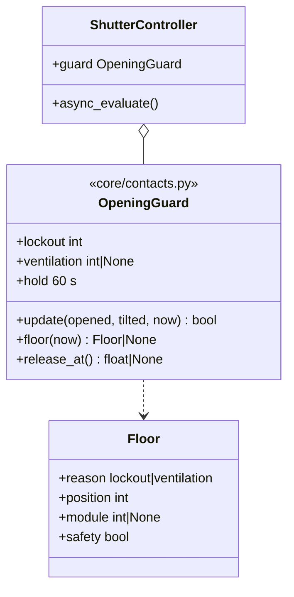
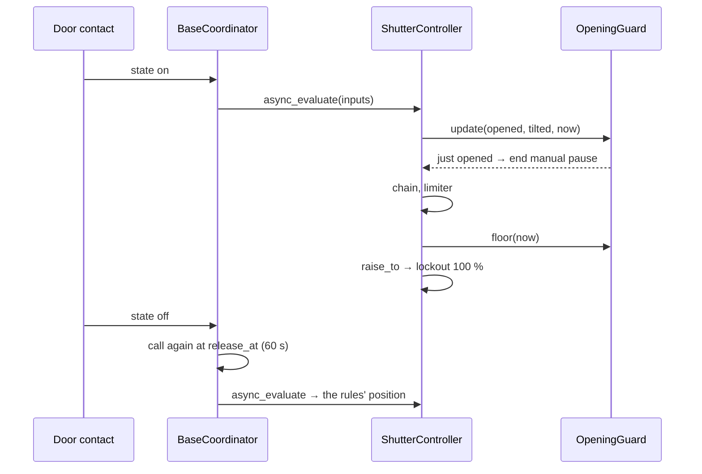

# Window and door contacts

- Issue: #49
- Status: **approved** (2026-11-21)
- Date: 2026-11-21

## 1. Purpose

A shutter in front of a (terrace) door must never close while the door is open: someone outside would be
locked out. A tilted window needs a gap in the shutter so air can flow.

## 2. What the user sees

Shutter menu, new step **Contacts** (all optional):

| Setting | Default | Effect |
|---|---|---|
| Opened contact | – | binary sensor, on = the door or window is open |
| Tilted contact | – | binary sensor, on = the window is tilted |
| Lockout position | 100 % | while opened, automatic control keeps the shutter at least this high |
| Ventilation position | the slit | while tilted, automatic control keeps the shutter at least this high (%) |

- **Opened:** the shutter goes up **at once** to the lockout position when it is lower, and no rule lowers
  it below that position, also not storm, the temperature limits or the maximum position. A manual pause
  running when the door opens ends (the shutter goes up); a manual move while the door is open is
  respected as usual.
- **Tilted:** the same with the ventilation position; the maximum position and storm still apply (a tilted
  window is about comfort, not safety).
- Opened and tilted both on: the lockout position.
- **Closed again:** after **1 minute** the shutter goes to the position its rules want then (a short
  close while walking in and out does not move it).
- The *Reason* is **lockout** or **ventilation** while that raises or holds the shutter; the card shows
  it, and the decision trace (#56) shows a line *contacts*.
- Not affected: frost (the shutter may be frozen: it does not move), calibration, automatic control off and
  the pause of the whole integration (#53): nothing moves then.
- A contact that is unavailable keeps its last state; unknown at start counts as closed.

## 3. Behaviour

In a storm only the ends exist: the lockout floor then means **fully open** (the end that keeps the door
free), whatever the storm mode and maximum position say.

The floor works on the position after the rules and the limiter:

```
wanted   = rule chain → limiter (maximum position, storm ends)
base     = wanted, or the current position when no rule wants anything
result   = floor   when base is below the floor, else wanted
```

Frost and a manual pause leave the shutter where it is (no base), so the floor does not act. The
slit counts as just above fully closed, so a ventilation position *slit* raises a closed shutter to the
slit and leaves every open position alone.

## 4. Structure

`core/contacts.py` (pure, pytest):



`update` returns true when the door has just opened (the controller ends a manual pause then).
`raise_to(target, current, floor, storm)` is a pure function that applies the floor.



The coordinator listens to the contacts as it does to the covers and evaluates at once; it schedules one
more evaluation at the end of the 1-minute hold.

## 5. Tests

- Core: lockout raises a lower target, a current position without a target, and a storm close (to 100);
  above the floor nothing changes; ventilation by slit and by percentage; ventilation does not override
  the maximum position or storm; both contacts; the 1-minute hold; unavailable keeps the last state.
- Home Assistant: the contacts step saves its values; door open raises a closed shutter at once with reason
  *lockout*; a manual pause ends when the door opens; the shutter returns 1 minute after closing; frost and
  the pause of the integration leave it alone.
- Card: reasons *lockout* and *ventilation* translated.

## 6. Out of scope

Alarm integration; one contact with three states (open/tilted/closed in one sensor: a template binary
sensor can split it).
