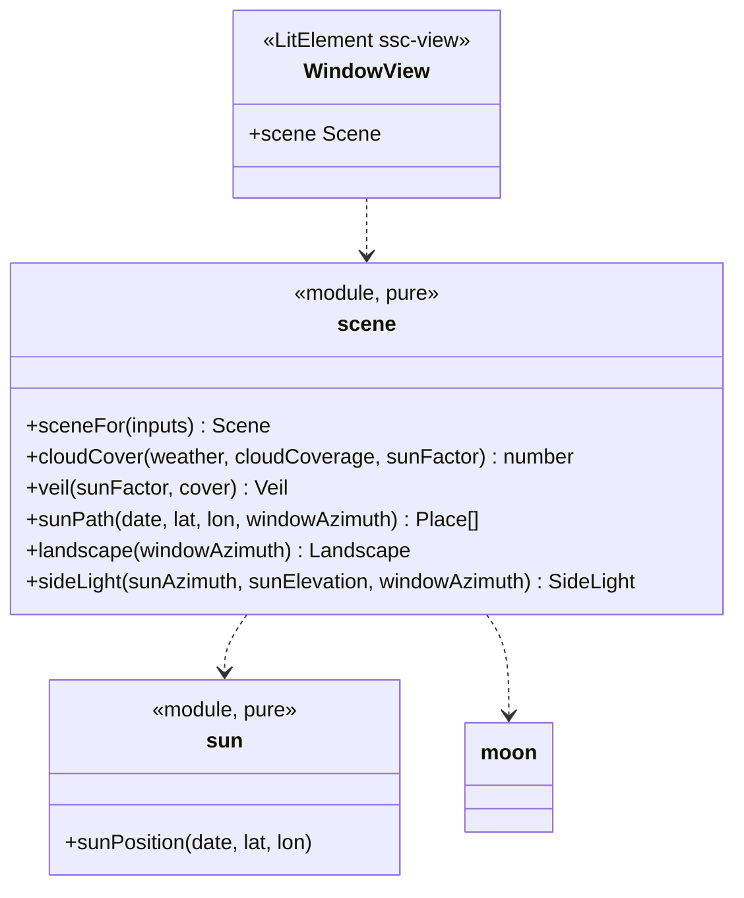

# The view through the window: direction, clouds and the sun's path

- Issue: #34
- Status: **approved** (2026-11-21)
- Date: 2026-11-21
- Builds on: [the view through the window](2026-11-20-window-view.md) (#30)

## 1. Purpose

Today every window shows the same view. Only the sun and moon are placed by the window direction, and the
clouds have three steps (none, few, overcast) taken from the weather condition. This design makes the view
match **this window** and **the light that is measured now**:

- each window direction has its own landscape and its own light;
- the amount of clouds follows the cloud cover;
- a sun that is in view but not bright has a cloud in front of it that dims it, and the cloud moves aside
  when the sun breaks through for a few minutes;
- the sun follows its real path from east to west across the window.

## 2. What you see

| Part | From | Shown |
|---|---|---|
| **Landscape** | window direction | the hills and the two or three trees are placed from the window direction (a fixed pattern per 10°), so a south window and a north window show a different view; the same window always looks the same |
| **Light per direction** | sun azimuth and elevation, window direction | the sky is lighter and warmer on the side where the sun is, also when the sun itself is just outside the window; strongest at a low sun (morning, evening), faint at noon |
| **Clouds** | cloud cover (section 3) | 0 to 6 clouds, more with more cover; from 80 % a grey sky with a closed layer; clouds drift slowly |
| **Cloud in front of the sun** | sun factor (section 3) | when the sun is in view and the sun factor is below 90 %: a cloud in front of the sun, the more opaque the lower the factor; the sun's glow fades with it. When the factor rises (sun breaks through), the cloud slides aside, as far as the factor rises; at 90 % or more it is gone |
| **Sun's path** | date, location, window direction | today's path from sunrise to sunset as a thin dotted arc, only the part seen through this window; higher in summer, lower in winter; the sun sits on the arc. A north window sees no arc in winter and at most a low piece at the side in summer |
| **Sun** | as before | now also drawn under a closed cloud layer (dimmed, behind the clouds), so its place stays visible |

Everything else (night, twilight, moon, stars, rain, snow, fog, season, wind, closed shutter, overview tiles,
reduced motion) stays as in #30.

## 3. Cloud cover and sun factor

**Cloud cover** `cover` (0 … 1):
1. the weather entity's `cloud_coverage` attribute (%), when it has one;
2. else from the condition: `sunny`/`clear-night` 0.05, `partlycloudy` 0.4, `windy-variant` 0.5,
   `cloudy`, `fog` 0.9, rain, snow, hail and lightning 1.0, unknown 0.3.

**Sun factor** `f` (0 … 1): the shutter's own facade light sensor when it has one (its `sun_factor` on the
binary sensor *Sun on the window*), else the base controller's *Sun factor* (PV power or light sensors,
whichever is the sun source). Unknown at night, or when there is no sun source.

By day, with a known sun factor, the measured light counts three times as much as the weather:
`cover_day = (cover + 3 × (1 − f)) / 4`. The weather entity reports for a wide area and changes slowly (a
station may say *cloudy* while the sun shines here); the PV panels or the light sensor see this house now.
Example: weather *cloudy* (0.9) and a sun factor of 92 % give 0.29: a blue sky with two clouds and a faint
cloud in front of the sun.

- **Number of clouds:** `round(cover × 6)`; from 0.8 the sky turns grey and the clouds join into a layer.
- **Cloud in front of the sun:** opacity `0.9 × (1 − f / 0.9)` for `f < 0.9`; its offset from the sun's centre
  is `f / 0.9 × 2.5` sun radii, so it slides aside as the factor rises. Without a sun factor the cloud follows
  `cover` instead (opacity `cover`, offset 0).
- **Sun glow:** opacity `0.25 × f` (or `0.25 × (1 − cover)` without a factor).

The card follows the sensors as they update (about once a minute), so a five-minute spell of sun shows as
the cloud sliding aside and back.

## 4. Data

| Value | Where | Change |
|---|---|---|
| cloud cover | base sensor *Sun factor* | new attribute `cloud_coverage` (the weather entity's `cloud_coverage`, or null) |
| sun factor | base sensor *Sun factor* (state); shutter binary sensor *Sun on the window* (`sun_factor`, with a facade sensor) | – |
| sun's path | the card | computed from the date and the location (`hass.config`) with a short solar algorithm (about 0.5°), sampled every 10 minutes from sunrise to sunset |
| window direction | binary sensor *Sun on the window* (`window_azimuth`) | – |

## 5. Structure

- `SceneInputs` gets `sunFactor` and `cloudCoverage`; `Scene` gets `cover`, `veil`, `path`, `landscape`
  and `sideLight`. `clouds` (none, few, overcast) is replaced by `cover` and a cloud count.
- `landscape(windowAzimuth)` uses a small seeded random generator (seed: the direction rounded to 10°).
- `sun.ts` is pure, like `moon.ts`; the integration keeps its own sun position (Python) for control.
- `docs/architecture.md`: class diagram of the view updated; `docs/card.md`: the new parts.

## 6. Tests (Vitest, pytest)

- Cloud cover from `cloud_coverage`, from each condition, mixed with the sun factor by day, weather only at
  night.
- Cloud count 0 … 6; grey layer from 0.8.
- Veil: none at f ≥ 0.9, opaque at f = 0, offset grows with f; without a factor from the cover.
- Sun's path: a south window at the solstices (high in June, low in December), an east window in the
  morning, a north window in winter (empty) and in summer (a low piece at the side); the sun on the arc.
- Landscape: the same direction gives the same landscape; 0° and 180° differ.
- Side light: on the sun's side, stronger at a low sun.
- Python: `cloud_coverage` attribute present, null without a weather entity or without the attribute.
- Screenshots: a south and a north window at the same moment; a sunny spell behind a passing cloud.

## 7. Out of scope

Real clouds from a satellite or radar image; cloud height or types; shadows of trees and clouds on the
landscape.
