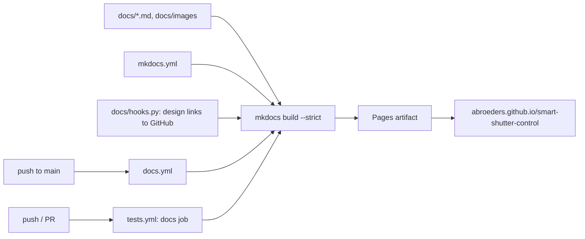

# Documentation site on GitHub Pages

- Issue: #78
- Status: **approved** (2026-11-22)
- Date: 2026-11-22

## 1. Purpose

The documentation in `docs/` is only readable inside the repository. A website with navigation and search makes
it easier to find, and Home Assistant and HACS can link to it.

## 2. What the user sees

- A site at `https://abroeders.github.io/smart-shutter-control/`, built with MkDocs and the Material theme:
  navigation at the side, search, a light and a dark theme that follows the browser, and a link to the
  repository.
- Navigation:

  | Section | Page | Source |
  |---|---|---|
  | Home | Documentation | `docs/README.md` |
  | Getting started | Installation | `docs/installation.md` |
  | | Configuration | `docs/configuration.md` |
  | | Calibration | `docs/calibration.md` |
  | Using it | Entities | `docs/entities.md` |
  | | The card | `docs/card.md` |
  | | How it works | `docs/how-it-works.md` |
  | | FAQ and troubleshooting | `docs/faq.md` |
  | Developers | Architecture | `docs/architecture.md` |

- Mermaid diagrams are drawn, and the card images from `docs/images/` are shown.
- Links to a design (`design/…`) open the design on GitHub; the designs are not part of the site.
- The site shows the state of `main`, so it matches the latest release.

## 3. Behaviour

### Source

- `docs/` stays the only source and stays readable on GitHub as it is: no MkDocs-only syntax in the pages.
- `mkdocs.yml` in the repository root: site name and URL, `repo_url`, the navigation above, the Material
  theme with a light/dark palette (`prefers-color-scheme`), search, and the Markdown extensions for tables,
  admonitions and Mermaid (`pymdownx.superfences` with a `mermaid` custom fence, which Material draws).
- `exclude_docs: design/` keeps the designs out of the site.
- `docs/hooks.py` (an MkDocs hook, `on_page_markdown`) rewrites relative links to `design/…` into links to
  `https://github.com/abroeders/smart-shutter-control/blob/main/docs/design/…`, so the pages need no change
  and `--strict` does not see links to excluded files.
- `requirements-docs.txt` pins `mkdocs` and `mkdocs-material`.

### Workflows

- `.github/workflows/docs.yml`: on push to `main` and by hand (`workflow_dispatch`). Job *build*: checkout,
  Python 3.13, `pip install -r requirements-docs.txt`, `mkdocs build --strict`, `actions/upload-pages-artifact`.
  Job *deploy*: `actions/deploy-pages` into the `github-pages` environment. Permissions `pages: write`,
  `id-token: write`; one deployment at a time (`concurrency: pages`).
- `.github/workflows/tests.yml` gets a job *docs*: `mkdocs build --strict` on every push and PR, so a broken
  link or a page missing from the navigation fails before it reaches `main`.

### Links

- `manifest.json`: `documentation` becomes the site's URL.
- `README.md`: a link to the site above the documentation table; the table keeps its links into `docs/`.

### GitHub settings (once, after the user's OK)

- Pages: source *GitHub Actions*.
- Repository website: the site's URL.

## 4. Structure

## 5. Tests

- `mkdocs build --strict` passes locally and in the *docs* job; it fails on a broken link.
- After the first deployment: the navigation, search, dark theme, a Mermaid diagram in *Architecture*, a card
  image in *The card*, and a design link from *Architecture* that opens on GitHub.

## 6. Documentation

- `docs/architecture.md`: a short section on the documentation site and its build.
- Changelog.

## 7. Out of scope

- Other languages than English.
- Versioned documentation per release.
- A GitHub wiki.
