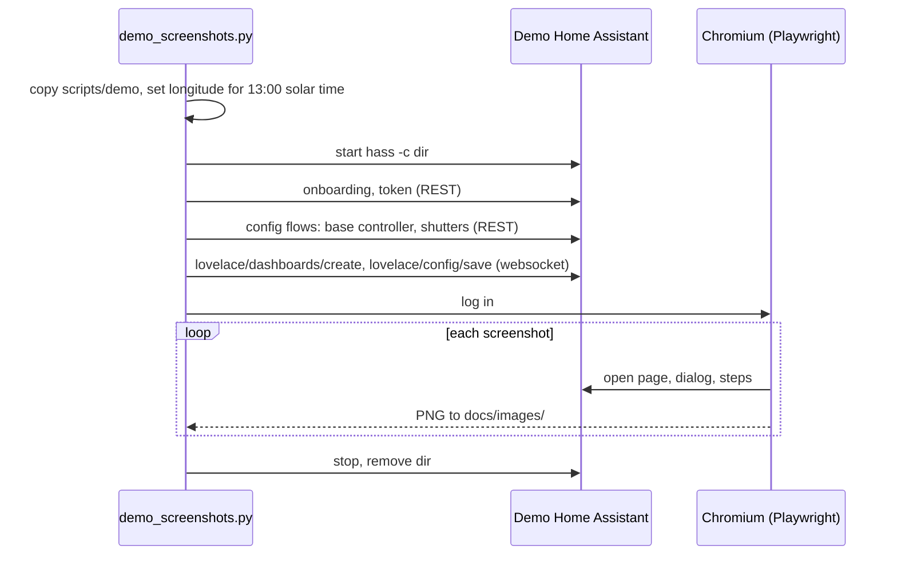

# Screenshots of Home Assistant in the documentation

- Issue: #81
- Status: **approved** (2026-11-22)
- Date: 2026-11-22

## 1. Purpose

The docs show the card, but not the rest of the integration in Home Assistant: setting it up, the settings,
the calibration and the device page. A user who reads the docs before installing cannot see what to expect.
The home page of the documentation site gets a picture of a real dashboard, and the site the integration's icon.

## 2. What the user sees

| Page | Screenshots |
|---|---|
| Home (`docs/README.md`) | a dashboard with the overview card and two single shutter cards, light or dark to match the theme |
| Installation | *Add integration* with *Smart Shutter Control* found; the first setup step of the base controller; *Add shutter* |
| Configuration | the base options *Sun and heat*, *Storm and frost* and *Winter*; a shutter's *Settings* |
| Calibration | the assistant's start, a measuring step and the review; the calibration table |
| Entities | a shutter's device page with its entities |

- All screenshots are in English and in the light theme; only the dashboard on Home is also in dark.
- On the site the dashboard image follows the site's light/dark switch; on GitHub it follows GitHub's theme.
- The site's title bar shows the integration's icon next to its name, and the browser tab shows it as favicon.

## 3. Behaviour

### Demo Home Assistant

- `scripts/demo/` holds a complete, made-up Home Assistant configuration: `configuration.yaml` with
  - three template covers (*Living room*, *Kitchen*, *Bedroom*), each backed by an `input_number` so a
    position command takes effect at once;
  - template sensors for PV power, outdoor temperature, wind and gust, and a room temperature;
  - English, metric units, a fixed latitude (45°) and a time zone of UTC.
- `scripts/demo/requirements.txt` pins `homeassistant` (the latest release); the frontend comes with it.
- `scripts/demo_screenshots.py` (one script, run by hand):
  1. creates a fresh copy of the configuration in a temporary directory, links `custom_components/` into it and
     sets the **longitude so that it is about 13:00 local solar time now**: the sun stands high in the south
     and the south-facing shutter has sun on the window, whenever the script runs;
  2. starts `hass -c <dir>` from the virtual environment in `$SSC_DEMO_VENV`, waits for the API;
  3. onboards through the REST API (user `demo`, made-up name), gets a token;
  4. sets up the integration through the config flow API: the base controller with the demo sensors, then one
     shutter per cover (south, east, west; *Living room* with a travel time, so calibrating needs no timing run);
  5. creates a dashboard *Shutters* through the websocket API (the default overview in 2026.11 is generated):
     the overview card and two shutter cards;
  6. logs in with Playwright (Chromium, 1280 × 900, device scale 2) and takes each screenshot: it opens the
     page, opens the dialog, fills the steps and screenshots the dialog element (or the page for the
     dashboard and the device page); then it stops Home Assistant and removes the directory.
- Nothing comes from a real installation: names, entities and the location are made up. The script never
  connects to another Home Assistant.

### In the docs

- PNGs in `docs/images/`, named `ha-<page>-<what>.png` (for example `ha-config-storm.png`) and
  `dashboard-light.png`, `dashboard-dark.png`.
- Home uses GitHub's theme fragments: `` and
  `…dark.png#gh-dark-mode-only`. GitHub shows one of them; `docs/hooks.py` rewrites the fragments to Material's
  `#only-light` and `#only-dark`, so the site shows the one for its own theme.

### Icon

- `docs/hooks.py` (`on_files`) adds `brand/icon.svg` to the site as `assets/icon.svg`, so `brand/` stays the
  only source.
- `mkdocs.yml`: `theme.logo` and `theme.favicon` point to `assets/icon.svg`. The title bar's colour is chosen
  so the icon stands out in light and dark.

## 4. Structure

## 5. Tests

- `mkdocs build --strict` passes, also with the hook's fragments and the added icon.
- Running the script twice gives the same set of files, with the same content apart from the sun and the
  times.
- By eye: every screenshot shows made-up names only, in English, without error messages; the dashboard image
  follows the site's light/dark switch; the icon is visible in the title bar in both themes.

## 6. Documentation

- The pages in the table above get their screenshots.
- `docs/architecture.md`: the demo and the screenshot script next to `screenshot_card.py`; the icon and the
  theme fragments in the section on the documentation site.
- Changelog.

## 7. Out of scope

- Screenshots of HACS itself; the installation page links to the HACS documentation.
- Other languages.
- Running the screenshots in CI.
