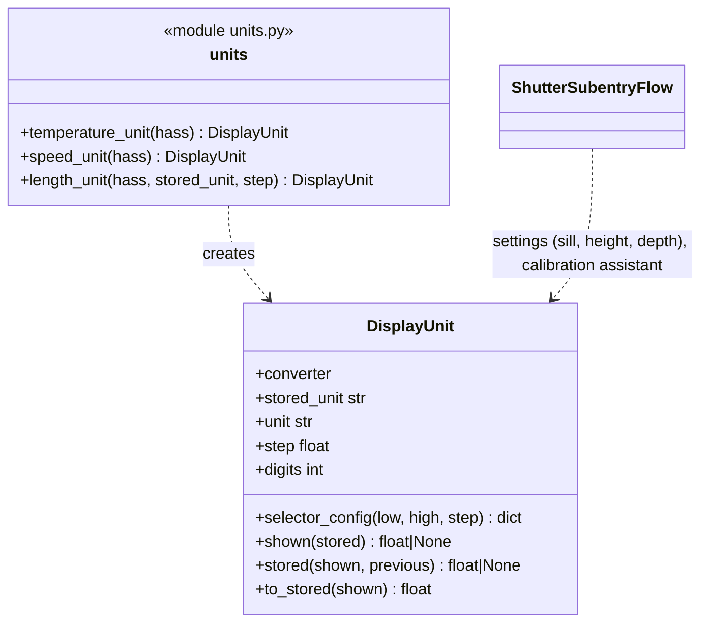

# Lengths in the user's units

- Issue: #71
- Status: **approved** (2026-11-22)
- Date: 2026-11-22

## 1. Purpose

Since #65 temperatures and wind speeds are shown in the user's unit system, but every length is still shown and
entered in cm and m. With Home Assistant set to US customary units, the user measures in inches and feet.

## 2. What the user sees

- With US customary units:
  - shutter settings: *Window sill* and *Window height* in inches (step 1), *Sun depth* in feet (step 0.5);
  - calibration assistant: the window height in inches (step 1) and every measured opening in inches
    (step 0.25, a quarter inch).
- Nothing changes with metric units. Switching unit systems changes only what is shown: the settings stay
  the same.
- The card and the *Why?* list show no lengths today, so nothing changes there.

## 3. Behaviour

### Storage

- Subentry data stays in cm (`window_sill`, `window_height`, `window_height_cm` in the calibration) and m
  (`sun_depth`). No migration is needed.
- The calibration points are fractions of the window height and do not depend on a unit.
- US customary units are detected as for wind speeds: `hass.config.units is US_CUSTOMARY_SYSTEM` (Home
  Assistant's length unit of the unit system is km or mi, which does not fit here).

### DisplayUnit

`DisplayUnit` (#65) gets two fields, so it can show lengths with a step other than one whole unit:

| Field | Meaning | Default |
|---|---|---|
| `step` | the step of the shown value; the range is rounded outwards to it | 1 |
| `digits` | decimals of a changed value when it is stored | 1 |

Temperatures and wind speeds keep the defaults and do not change.

| Quantity | Stored | Shown (US) | Step (US) | Stored rounded to |
|---|---|---|---|---|
| sill, window height | cm | in | 1 | 0.1 cm |
| sun depth | m | ft | 0.5 | 0.01 m |
| calibration window height | cm | in | 1 | 0.1 cm |
| calibration opening | cm | in | 0.25 | not stored (becomes a fraction) |

A new helper `length_unit(hass, stored_unit, step)` returns the `DisplayUnit` for cm or m: inches for cm and
feet for m with US customary units, otherwise the stored unit unchanged.

### Forms

- Shutter settings: `LENGTH_FIELDS` maps `window_sill` and `window_height` to cm and `sun_depth` to m;
  `_display_units` takes them into account, so `_shown_form` and `_stored_input` handle them like the
  temperatures. A value the user left unchanged keeps its stored value exactly (150 cm is shown as 59 in;
  saved unchanged it stays 150 cm, not 149.9).
- Calibration assistant: the window height is entered in inches and stored in cm. Each measured opening is
  entered in inches and converted to cm before it goes to `CalibrationSession.add_point`; without a window
  height the opening stays in %. The form's `{unit}` placeholder shows `in`; the description of the start
  page no longer names cm literally (*Enter the window height to measure, or leave it empty …*).
- Empty fields stay empty, as today.

## 4. Structure

## 5. Tests

- `DisplayUnit` for lengths: cm and m pass through with metric units; 150 cm shows as 59 in, 3 m as 10 ft
  (rounded to 0.5); ranges round outwards to the step; an unchanged value keeps its stored value; 60 in is
  stored as 152.4 cm, 10 ft as 3.05 m; empty stays None. Temperatures and wind speeds are unchanged.
- Subentry flow with US customary units: the settings show sill and height in inches and the depth in feet;
  saving unchanged keeps the stored values; saving a changed value stores cm and m.
- Calibration assistant with US customary units: a window height of 60 in is stored as 152.4 cm, and an
  opening of 30 in becomes the point 0.5.

## 6. Documentation

- `docs/configuration.md` (and wherever the fields are described): lengths in the user's unit system.
- `docs/architecture.md`: `DisplayUnit` with `step` and `digits`, `length_unit`.
- Translations en + nl: the calibration texts without a literal cm.
- Changelog.

## 7. Out of scope

- Temperatures and wind speeds (#65, done).
- Feet and inches in two fields; lengths are one number per field.
