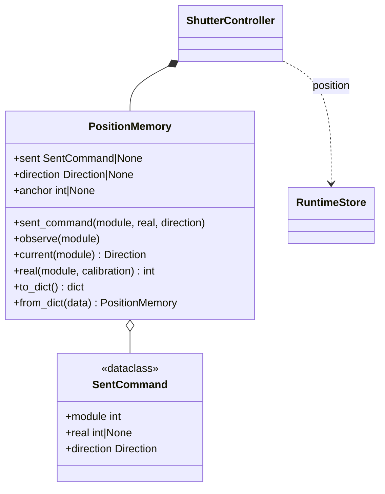
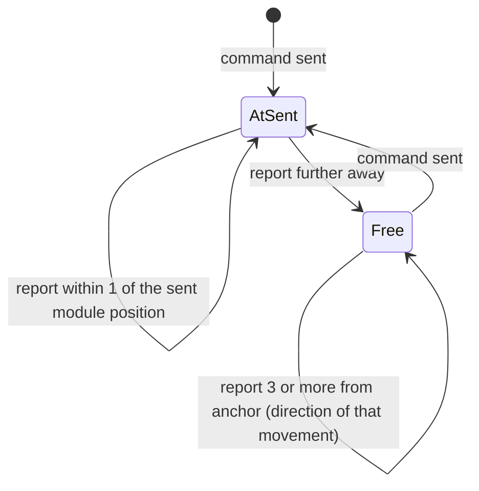

# The real position that was sent

- Issue: #75
- Status: **approved** (2026-11-22)
- Date: 2026-11-22

## 1. Purpose

With a calibration per direction, the real position is read back from the module position with the curve of
the direction in which the shutter last moved. That is not always the direction the command was computed with:

- after a reload or restart the direction is forgotten and guessed (module position 50 or more: up), so a
  shutter that went up to module 44 for 20 % is shown at 12 %;
- a command computed with the down curve can need a step of 1 up (module 52 to 53); the step makes the
  direction "up" and the shutter is shown at 31 %.

The shutters are physically right; only the shown position is wrong. Because the controller compares that
position with its target, the card shows "→ 20 %" and a later evaluation may move the shutter for nothing.

## 2. What the user sees

- After a command, the position shows the real position that was sent (20 %) for as long as the module stays
  there, also after a reload or restart of Home Assistant.
- When the shutter is moved elsewhere (by hand, by a switch, by another command), the position follows the
  calibration curve of that movement, as now.
- Nothing changes without a calibration.

## 3. Behaviour

### What is remembered

`PositionMemory` (in `core/calibration.py`, replacing `DirectionTracker`) keeps:

| Field | Meaning |
|---|---|
| `sent` | the last command: module position, real position (None for a module command such as the slit), direction |
| `direction` | the direction of the last real movement |
| `anchor` | the module position from which a new movement is measured |

It is stored per shutter in the runtime store (key `position`), like the manual pause, and read back at start.

### Reading the real position

1. A `sent` command with a real position, and the module within **1** of its module position: the sent real
   position.
2. Otherwise: the calibration curve of `direction` (with no direction known yet: the guess as now).

### Observing a report

- Within 1 of the `sent` module position: nothing changes (a step of 1 to reach the command is not a movement
  of its own).
- Closer to it than the previous report: the shutter is on its way, `sent` stays.
- Further from it (and not on its way): `sent` is cleared. The direction changes only when the module moved at least **3** points from
  `anchor`; then `anchor` becomes the new position. A report of a few points does not flip the direction.
- A command sets `sent`, the expected direction and `anchor` (the position it starts from).
- A manual move (reported by the switch) clears `sent`.

### Why these numbers

- 1: the same tolerance the controller already uses to call a module position reached.
- 3: smaller than any real movement of a command (the smallest steps are 5 %), larger than the step of 1–2
  points a module needs to reach a command or reports after its stop.

## 4. Structure

## 5. Tests

- Core: the sent real position while the module is within 1; the curve once it leaves; a step of 1–2 does not
  flip the direction, 3 does; to_dict/from_dict round trip; a module command (real None) uses the curve.
- Home Assistant: a shutter sent up to 20 % shows 20 % after the entry is reloaded; a command with the down
  curve that needs a step of 1 up shows the sent position; a manual move to another position shows the curve.

## 6. Out of scope

The calibration curves and the calibration assistant.
