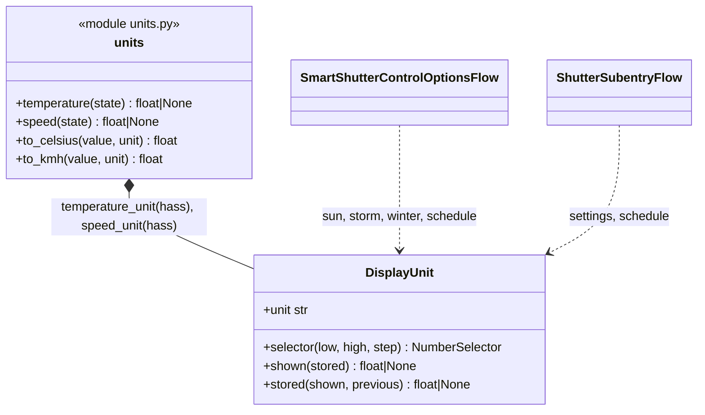

# Settings in the user's units

- Issue: #65
- Status: **approved** (2026-11-22)
- Date: 2026-11-22

## 1. Purpose

Since #64 the integration reads sensors in any unit, but every temperature and wind setting is still shown and
entered in °C and km/h. With Home Assistant set to US customary units, the user thinks in °F and mph.

## 2. What the user sees

- With US customary units, every temperature setting is shown and entered in °F and every wind setting in
  mph: the base options (*Sun and heat*, *Storm and frost*, *Winter*), the shutter settings (heat limits,
  hot day) and the schedule (*closed all day at or below*).
- The 30-day wind maxima on the *Storm and frost* page are shown in the same unit as the limit fields.
- The card's *Why?* list shows temperatures in the system's unit: *not warm (49 °F < 72 °F)*.
- Nothing changes with metric units. Switching unit systems changes only what is shown: the settings stay
  the same.

## 3. Behaviour

### Storage

- Options and subentry data stay in °C and km/h. No migration is needed.
- The display unit comes from `hass.config.units`: its `temperature_unit`, and mph with US customary units,
  otherwise km/h (Home Assistant's metric wind unit is m/s, which nobody uses for these limits).

### Forms

`units.py` gets a small helper per quantity that knows the display unit:

| Quantity | Stored | Shown (US) | Step (US) | Range |
|---|---|---|---|---|
| temperature | °C, step 0.5 | °F | 1 | the °C range converted, rounded outwards to whole °F |
| wind speed | km/h, step 1 | mph | 1 | the km/h range converted, rounded outwards to whole mph |

- Building a form: `_number(...)` for a temperature or wind field takes its range and step from the helper, and
  each stored value is converted to the display unit and rounded to the step before it becomes the default
  or suggested value.
- Saving a form: each entered value is converted back to °C or km/h. **A value the user left unchanged keeps
  its stored value exactly**, so opening and saving a form never shifts a setting by rounding (50 km/h is
  shown as 31 mph; saved unchanged it stays 50 km/h, not 49.9). A changed value is stored rounded to 0.1.
- Empty fields stay empty (off), as today.
- Temperature *differences* do not occur in the settings; the hysteresis (1 °C) stays internal.

### Decision trace and card

- The `decision` attribute keeps its values in °C (it is machine data and stays the same in every unit system).
- The card converts the temperature values (`outdoor`, `limit`, `room`, `room_limit`, `forecast`,
  `forecast_limit`) to `hass.config.unit_system.temperature` and formats each value together with its unit.
  The translations lose their literal `°C`: `not warm ({outdoor} < {limit})`.
- *Forecast maximum* is already a temperature sensor in °C; Home Assistant shows it in the user's unit.

## 4. Structure

## 5. Tests

- `DisplayUnit`: °C and km/h pass through; °F and mph convert both ways; ranges round outwards; an unchanged
  value keeps its stored value; a changed value is stored in °C/km/h; empty stays None.
- Options flow with US customary units: the storm page shows mph and the maxima in mph, and saving 40 mph stores
  64.4 km/h; the sun page saving unchanged keeps the stored °C values.
- Subentry flow with US customary units: heat limits and the schedule's *closed all day at or below* in °F.
- Card: a trace with `outdoor: 10` shows *50 °F* with US units and *10 °C* with metric.

## 6. Out of scope

- Reading sensors in other units (#64, done).
- Lengths in the settings (cm, m) in inches and feet (#71).
