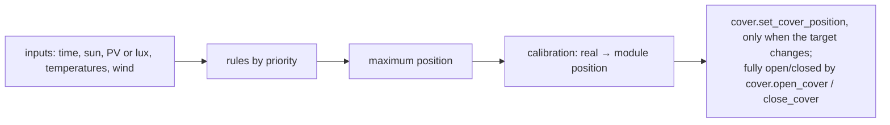
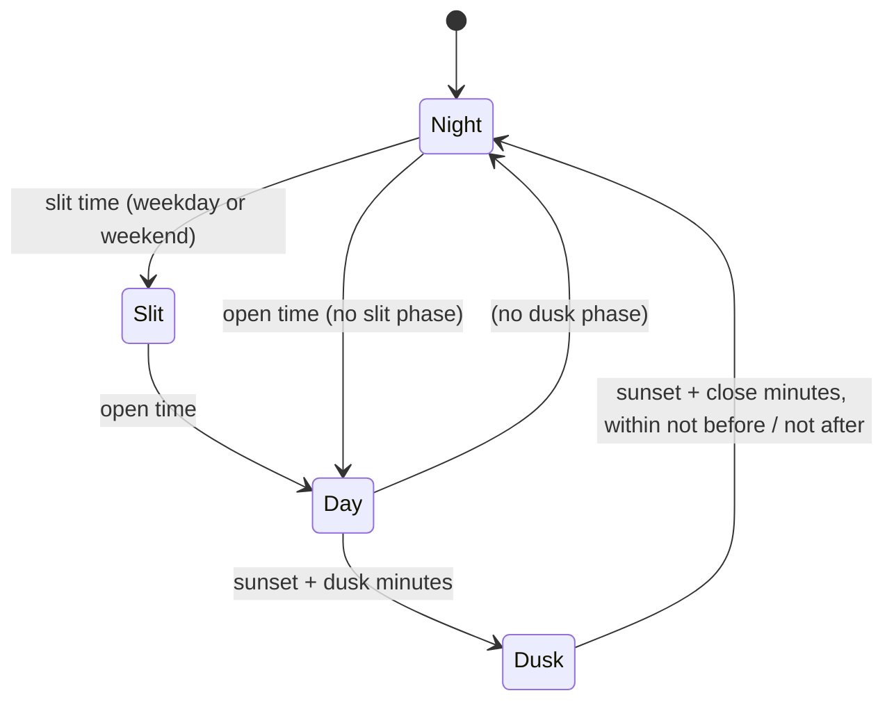

# How it works

Every minute, and whenever an input changes, the integration decides for each shutter where it should be,
and moves it only when that changes.

## Rules and priorities

Each rule may propose a position. The first proposal by priority wins; *caps* can lower it; a *final*
proposal is not changed by lower rules.

| Priority | Rule | Proposes |
|---|---|---|
| 10 | storm | fully open or fully closed (final) |
| 11 | frost | do not move (final) |
| 12 | lock | hold, fully open or fully closed, as set by an automation (final) |
| 15 | temperature limits | closed above *Close above* or below *Close below* (final) |
| 20 | manual pause | leave the shutter where it was put (final) |
| 30 | sleep-in | closed during the slit and day phases |
| 40 | heat protection | at most the shading position (cap) |
| 41 | glare protection | at most the glare position (cap) |
| 50 | winter | closed all day in severe cold; at dusk, never raise a closed shutter (cap) |
| 60 | schedule | the position of the current phase |

With the switch *Automatic control (all shutters)* off, no rule is asked at all (storm included): the
*Reason* is *paused* and nothing moves by itself.

Afterwards the **maximum position** limits every automatic target (except fully closing). The sensor
*Reason* says which rule decided; its attribute `decision` lists what **every** rule said, in priority order:
the position it proposed (`target`, `cap` or `final`), whether that one decided (`applied`), or why it
proposed nothing (`why` with `values`), for example:

```yaml
- {rule: heat, priority: 40, result: none, why: too_cold, values: {outdoor: 9.5, limit: 22}}
- {rule: glare, priority: 41, result: cap, position: 40, applied: true, why: bright,
   values: {factor: 100, limit: 55}}
```

Codes: `off`, `night`, `below_horizon`, `above_overhang`, `not_facing` (the sun is not in front of the
window), `not_sunny`, `too_cold`, `waiting` / `leaving` (seconds until the delay ends), `bright` /
`not_bright` (sun factor against *Glare from*), `not_day`, `phase`, `calm`, `no_frost`, `within_limits`,
`no_pause`, `not_cold`. The card shows the list under **Why?**. The attribute is not recorded in the
history (it changes on every evaluation).

**Moves only at changes.** The schedule's target is sent when a phase starts, when a setting changes, or when
a higher rule ends. A shutter moved in the middle of a phase is left there until the next phase.



## The day of a shutter



Weekend days and holidays use the weekend times. With *Not before sunrise* the morning waits for the sun.
Sunrise and sunset are computed from your Home Assistant location.

## Sun on the window

The integration computes the sun's position (NOAA algorithm, about 0.1°) and the angle of incidence `i`
between the sun and the window's outward normal:

```
cos i = sin α · cos β + cos α · sin β · cos(γ − A)
```

with sun elevation `α`, sun azimuth `γ`, window direction `A` and window tilt `β`. The sun is **on the
window** when it is above the horizon, between the lowest and highest sun elevation of the shutter, and
`i` is below the largest angle of incidence (85°).

**Horizon.** Buildings and trees block a low sun at different heights in different directions. Press the
button *Sun has left the window* (on the shutter's device, or in the card while heat or glare protection has lowered the shutter) at
the moment the sun disappears behind something: the sun's current direction and elevation become a point of
the window's horizon, and the sun is off the window at once. A point within 3° of direction replaces an older
one. Between points the horizon is interpolated; the outermost points hold 15° further; elsewhere only
*Lowest sun elevation* applies. The higher of the two counts. View and edit the points under
*Reconfigure → Horizon*.

## Is it sunny?

The base controller uses **one** sun source: PV power or light sensors (lux), never both.

Both are a direct measure of sunshine, but their clear-sky value depends on the panels or on where the
sensor is. The integration **learns** it: the sky is divided in cells of sun position (10° × 5°), and for
each cell it keeps the high (95th percentile) daily value of the last 30 days. The **sun factor** is the
current value as a share of that reference. Sunny from 60 %, no longer sunny below 45 %.

Until a cell has 7 days of history:

| Sun source | Then |
|---|---|
| PV power | a rough clear-sky curve from the PV peak power, if set |
| Light sensors | sunny from a fixed limit (30 000 lx), not sunny below 80 % of it |

The rough PV curve uses the sun's angle of incidence on the panels (*Panel tilt* and *Panel direction*), so a
low winter sun on tilted panels is expected to give much more than on flat ones. It only models direct
sunlight; at a low sun most PV power is diffuse light, so the curve never drops below its value for flat
panels with the sun at **10°**. While the reference is young the weather entity's condition takes part: below
10° it decides (`sunny` or `partlycloudy`: sunny), and from 10° a sky that is not sunny (`cloudy`, `rainy`,
`fog`, …) vetoes bright sun. The factor is still shown; `source` is then `pv_peak_weather`. A grey day
therefore does not count as bright sun. The sun factor's attributes
`learned_days` and `learned_days_needed` show how far the current cell is learned.

Without values (or without a sun source) it uses the weather entity's condition, and otherwise geometry only.

**Light sensors:** the highest of the base controller's sensors counts. A shutter can have its own
**facade light sensor**; that sensor then decides for that shutter, with its own learned reference. Many
motion sensors measure only up to a few thousand lux and cannot tell sun from bright cloud: the sources page
shows each sensor's highest value of the last 30 days.

## Heat protection

When the sun is on the window, it is sunny, and it is warm (outdoor or room temperature at or above the
limit), the shutter goes down to its heat protection position after 5 minutes. It goes up again 20 minutes after
one of these stops, or at once when the sun has moved past the window. Passing clouds do not make it move up
and down.

**Hot day.** With a weather entity, the integration reads today's maximum from its daily forecast at start
(also once the weather entity is there) and every 30 minutes. When it reaches *Hot day from (forecast)* (28 °C; a shutter may use its own value),
heat protection no longer waits for the outdoor or room temperature: on such a day the shutter goes down as
soon as the sun is on the window and it is sunny, after the same 5 minutes, even on a cool morning. Empty in
the base options switches this off; without a weather entity or a daily forecast nothing changes.

**Shading position from the sun.** With *Window bottom above the floor*, *Window height* (or the
calibration's) and *Sun into the room* set, heat and glare protection lower the shutter only as far as needed
to keep direct sun within that depth over the floor. For a vertical window, with sun elevation `e` and `γ`
the sun's horizontal angle to the window normal, the profile angle is `tan φ = tan e / cos γ`; light through
the top of an opening `o` above the glass's lower edge `s` reaches `(s + o) / tan φ` into the room, so

```
o = depth · tan φ − s          position = 100 · o / window height
```

The position is rounded down to 10 %, never below the fixed *Heat protection position* / *Glare position*, and
changes at most once per 15 minutes. A high summer sun thus leaves most of the window open; a low sun closes
it to the fixed position. A sloped window keeps the fixed position. *Sun on the window* shows the computed
position as `shading_from_depth`.

## Glare protection

Heat protection needs warmth; a low winter sun can dazzle on a cold day. **Glare protection** (switch per
shutter, off by default) lowers the shutter to its **glare position** after 5 minutes when:

- the sun is on **this window** (the same window direction, tilt, largest angle of incidence and sun
  elevations as heat protection), so a north window never reacts to a sun in the south;
- the sun is **bright**: the sun factor (PV power or light as a share of its clear-sky value, or the facade
  light sensor's own factor) is at or above *Glare from* (70 %). Without a sun factor, *Sunny* decides;
- it is the **day** phase of the schedule (not slit, dusk or night).

It does not look at the temperature and also acts in winter. Once down it stays until the sun factor is 15
points below *Glare from*; it goes up 20 minutes after a condition falls away, at once when the sun leaves
the window or the day phase ends. With heat protection active as well, the lower position wins.

## Manual operation

A position change the integration did not send is **manual**: a wall switch, a remote, the module's app, or
the integration's own cover and *Opening* entities. With a motor power sensor a manual move is seen within a
second. This also holds while the integration itself is moving the shutter: pressing the switch against the
direction of an automatic move, or stopping it halfway (with a power sensor), counts as manual, and the
integration does not send its position again. Then:

| After a manual action | Effect |
|---|---|
| pause until the next phase (default) | automatic control leaves the shutter alone until the next phase change |
| pause for a while | … for *Pause after a manual action* (120 min) |
| ignore | no pause |

Automatic control **resumes**:
- when the pause ends (the shutter then moves to the wanted position);
- with the button *Resume automatic control*, or by turning *Automatic control* on: the shutter moves at once;
- when you move the shutter by hand to the position automatic control wants anyway.

A manual action also ends sleep-in. Storm still acts during a pause.

## Locks

An automation can lock a shutter with the [action](actions.md) `smart_shutter_control.set_lock`, or you can
set the select *Lock* of the shutter. The lock is a rule of its own, and while it is on it decides for
everything below it. The modes:

| Mode | The shutter |
|---|---|
| *Hold* | is not moved by the integration; it stays where it is |
| *Force open* | goes fully open (100 %), also above the *Maximum position*: an explicit order, like manual operation |
| *Force closed* | goes fully closed (0 %) |
| *None* | is not locked |

**Order.** Storm comes first, then frost, then the lock: in a storm the shutter goes to the storm position
and in frost it is not moved, whatever the lock says; the lock applies again when they end. Temperature
limits, manual pause, sleep-in, heat and glare protection, winter and the schedule are not used while the
lock is on.

**Door floors.** The lockout and ventilation floors apply after the rules (see below): a *Force closed*
shutter is still raised to its lockout or ventilation position while the door is open or the window is
tilted, and goes back to closed afterwards. The *Reason* is then *lockout* or *ventilation*.

**How a lock ends.**

- Its duration has passed (a lock set without a duration lasts until it is ended).
- The action with mode *None*, or the select set to *None*.
- Any manual action on that shutter (wall switch, remote, app, or the integration's own cover or opening
  entity): the lock ends and the usual [manual handling](#manual-operation) follows.
- The button *Resume automatic control*, which ends a manual pause too.

When a lock ends, the shutter moves to what automatic control wants. A new lock replaces the one that is
on, with its mode and end time. With the shutter's *Automatic control* switch off, or *Automatic control
(all shutters)* off, nothing moves; the lock is kept and applies again when control is back on, unless it
has expired. A lock and its end time survive a restart. While the calibration assistant runs, the lock waits.

The sensor *Reason* shows *locked*, and the decision trace says which mode.

## Lockout and ventilation

An opened contact raises the shutter at once to its lockout position and holds it there while the door or
window is open. A running manual pause ends, but a manual move while open is respected. In a storm the
lockout floor means fully open, and it may go above the maximum position. Opened and tilted at once use the
lockout floor.

A tilted contact holds the shutter at the ventilation position, or at the slit when *Ventilation position*
is empty. Ventilation is comfort: the maximum position and storm still apply.

Nothing moves during frost (the shutter may be frozen), during calibration, with the shutter's *Automatic*
switch off or with the whole integration paused. A contact that is unavailable keeps its last state.

When a contact closes, the floor continues for one minute so a short walk in or out does not move the shutter.
After the hold, the shutter goes to the position the rules want. The *Reason* is *lockout* or
*ventilation* while the contact raises or holds it.

## Did the move arrive?

After every position the integration sends (automatic, or through its own entities), it checks that the
shutter got there: with a motor power sensor when the motor has stopped (at the earliest after 10 s, so a
command that never started the motor is noticed too), without one after 1.5 × the travel time + 30 s
(180 s when the travel time is not known). It asks the module for its position and accepts ±2 %. If the
shutter is not there, the same command is sent **once more**. If that does not arrive either, the binary
sensor *Stuck* turns on and a repair issue appears under *Settings → Repairs*; both clear at the next move
that arrives. A manual move in between (wall switch, remote) cancels the check. Automatic control goes on as
usual: being stuck does not block the next decision.

## Storm

Storm while the wind speed or the gusts are at or above their limit, until 15 minutes after the last value
above it. During a storm a shutter with automatic control is **only fully open or fully closed**, never in
between (half-open slats catch the wind):

- *nearest* (default): the end nearest to what the other rules want now. A shutter locked open by day closes
  when the evening starts.
- *open* or *closed*: always that end.
- A shutter whose maximum position is below 100 % closes.

A manual move to a position in between is put back to an end within seconds; dragging in the card snaps to
an end.

## Frost

At or below the frost limit the shutters do not move automatically: they may be frozen to the frame. Frost
ends 60 minutes after the temperature rose above the limit. Storm still acts during frost.

## Winter

Winter mode is on while the time-weighted mean outdoor temperature of the last 24 hours is below 12 °C (or
when the select *Winter mode* is *On*). In winter:

- at or below −5 °C a shutter stays **closed all day** as insulation (a manual action overrides it);
- in the evening an open shutter goes to the dusk position and then closes as usual, but a shutter that is
  already closed **stays closed**;
- with sun on the window during the day the schedule opens it for free solar heat (heat protection does not
  act in the cold).
