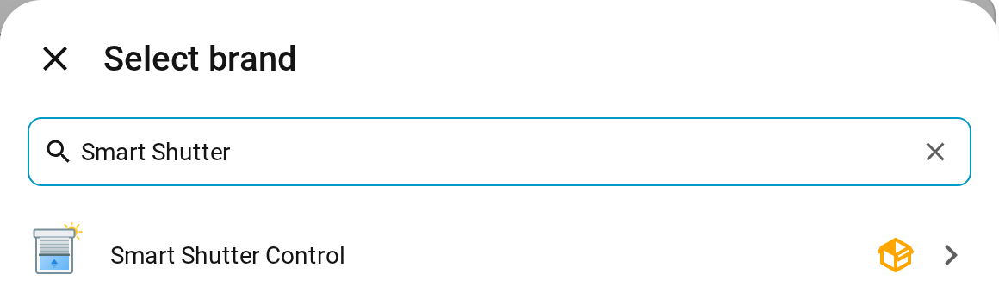
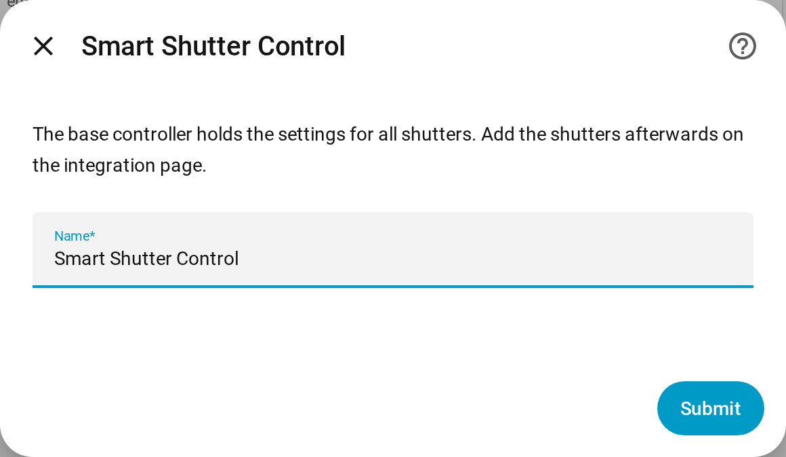
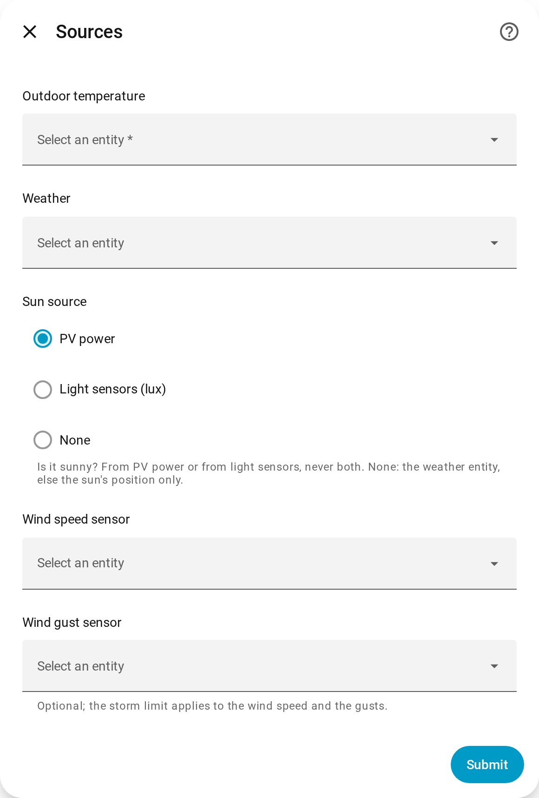
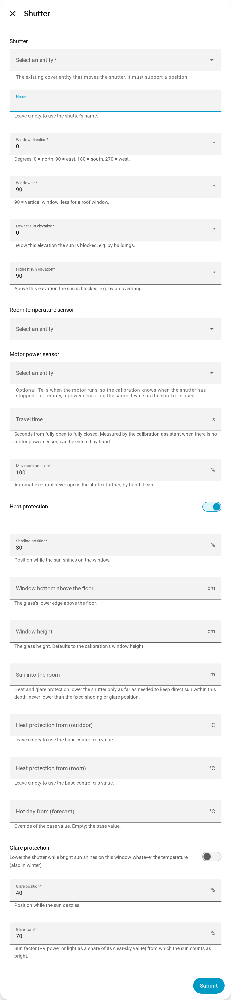

# Installation

## Requirements

- Home Assistant 2026.3 or newer.
- Roller shutters as `cover` entities that can be **set to a position** (for example Z-Wave, Zigbee or Shelly
  shutter modules). The integration does not talk to the hardware itself; it moves these covers.
- An outdoor temperature sensor.
- Recommended: one or more PV power sensors or outdoor light sensors (lux), used to tell whether the sun
  really shines (one kind, not both; see [Configuration](configuration.md)), a wind or gust sensor (storm),
  and a power sensor on each shutter module (calibration and manual-operation detection). Optionally a light
  sensor at a window, which decides for that shutter alone whether it is sunny.

## Install from the Marketplace (Home Assistant 2026.11 and later)

Smart Shutter Control is in the Marketplace's own catalog.

1. *Settings → Marketplace*, search for **Smart Shutter Control**.
2. Open it and select **Install**, check the version, **Install**.
3. Restart Home Assistant.

The Marketplace needs a GitHub account connected to it (it asks for one the first time).

## Install with HACS (Home Assistant 2026.3 to 2026.10)

1. HACS → search for **Smart Shutter Control** (category *Integration*), *Download*.
2. Restart Home Assistant.

Manual install: copy `custom_components/smart_shutter_control` into your `config/custom_components/` and
restart.

## Add the base controller

*Settings → Devices & services → Add integration → Smart Shutter Control.*

1. **Name**, for example *House*.

    

2. **Sources** (see [Configuration](configuration.md#sources)): outdoor temperature (required), weather,
   wind speed and gust sensors, and the sun source: *PV power* (PV power sensors, PV peak power), *Light
   sensors (lux)* (light sensors, the "sunny from" limit) or *None*. A second page shows only the fields of
   the chosen sun source.

    

The base controller is a device of its own. It holds the settings shared by all shutters.

## Add the shutters

On the integration's page: **Add shutter** (once per shutter).

1. **Shutter**: the existing cover entity. Each cover can have one controller.
2. **Window direction** in degrees: 0 = north, 90 = east, 180 = south, 270 = west. A compass app held
   against the glass, facing outward, gives it within a few degrees.
3. The other fields have sensible defaults; see [Configuration](configuration.md#a-shutter).

Each shutter becomes a device under the base controller with its own entities, among them a new cover
entity. Use that one in dashboards and automations: it shows and takes real (calibrated) positions, and its
commands count as manual at once. Moves by a wall switch or the module's own app are recognised too.

## Then

- [Calibrate](calibration.md) each shutter, so positions are real positions.
- Check the [base schedule](configuration.md#schedule) (morning and evening times).
- Add the [card](card.md) to a dashboard.
- Turn off any automations that already move these shutters, or they will fight each other.

## Update and remove

- Update: the Marketplace (or HACS) shows the new version under *Settings → Updates*; install it and
  restart. After an update, reload the browser so the new card is used.
- Remove: *Settings → Devices & services → Smart Shutter Control → ⋮ → Delete*. Your covers stay as they are.
